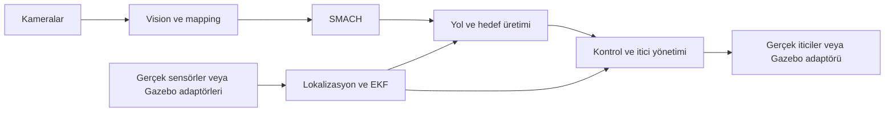

# Tüm repo için ROS 2 Jazzy ve Gazebo Harmonic geçiş planı

İlk taslak: 25 Ekim 2026; teknik inceleme: 28 Ekim 2026.  
Durum (29 Ekim 2026, son port devri): Kullanıcının daralttığı varsayılan `pool` dünya portu, Python sim bringup/mock bağlantıları ve Mini Harmonic model/sensör/itici portu uygulandı. Taluy havuz derinlik/yön kabulü geçti; Mini derinlik davranışı açık. Kullanıcı kararıyla sıcak reset desteği kaldırıldı; yeni koşu için simülasyon ve ilgili ROS node’ları birlikte yeniden başlatılır. Önceki reset kabul kayıtları tarihseldir. Tam repo/G4–G6 kabulü verilmedi. Güncel kanıt ve sınırlar bölüm 22'nin son kaydındadır; önceki kayıtlar tarihseldir.

## 0. İnceleme sonucu ve uygulama öncesi kararlar

Paket sınırlarını, SMACH'i ve kontrol matematiğini koruma yaklaşımı uygundur. Esas risk yalnızca ROS API dönüşümü değildir: mevcut davranışın ölçülmemesi, Taluy fizik/sensör modelinin yeni Gazebo ortamına aktarılması ve cihaz protokollerinin uygulama zincirine etkisidir. İlk teslim tek profil üzerinde ölçülebilen bir zincir olacak; tüm repo geçişi ayrıca izlenecek.

28 Ekim 2026 kaynak incelemesinde görülen somut noktalar:

| Bulgu | Plan üzerindeki etkisi |
|---|---|
| Gazebo Harmonic yerleşik Buoyancy, Hydrodynamics, Thruster ve DVL sistemleri sunuyor | Ayrı sualtı framework'ü eklenmeden mevcut `auv_sim` paketlerinde model ve adaptör kurulacak |
| İtici yöneticisi `board/drive_pulse` üzerinde `UInt16MultiArray` PWM yayımlıyor; sim bridge bunu eski UUV girişine aktarıyor | PWM → Newton dönüşümü simülasyon adaptöründe yapılacak; Gazebo Thruster kuvvet modunda kullanılacak |
| `model` altındaki üç 6×6 matris hem C++ XmlRpc parser'ı hem DVL Python kodunca okunuyor | Yalnızca `ros__parameters` sarmalı eklemek yetmez; ortak matris biçimi ve iki dilde okuyucu dönüşümü gerekli |
| FollowPath tanımında `paths` var; mevcut sunucu bunu okumuyor ve `/planned_path` bekliyor | Action ve topic'in fiili sözleşmesi porttan önce kaydedilecek; yol kaynağı sessizce değiştirilmeyecek |
| DVL velocity/validity mesajları header içermiyor; senkronizasyon alım zamanına dayanıyor | Sensör zamanı ile alım zamanı ayrılacak; gecikme, geçersiz veri ve tamamen kesilen yayın ayrı test edilecek |
| Gerçek araç ve simülasyon kontrol YAML'larında farklı PID/model/mapping değerleri var | Tek bir ortak YAML ile birleştirilmeyecek; mevcut profil ve ortam ayrımı korunacak |

Kesinleşen kararlar ve ilk aşamada tamamlanacak kayıtlar:

| Karar | Başlangıç tercihi / açık iş | Kararı kapatan kanıt |
|---|---|---|
| Masaüstü platform | Kesin karar: Ubuntu 24.04 / ROS 2 Jazzy / Gazebo Harmonic + `ros_gz` | Kurulum ve örnek dünya ile çalışabilirlik doğrulanacak |
| Simülasyon sürümleri | Gazebo/SDFormat/`ros_gz` paket sürümleri, container digest'i; kaynak build gerekirse SHA | Bölüm 3'teki uyumluluk matrisi ve bağımlılık kaydı |
| İlk profil | Aksi kararlaştırılmazsa `taluy`; Mini sonraki kabul aşaması | Kullanılan config/model dosyaları ve çalıştırma komutu |
| İlk görev | Başlat/etkinleştir → derinlik tut → yön tut → iptal → durdur | Aynı senaryonun referans ve ROS 2 kayıtları; süre/hedefler uygulama başında sabitlenecek |
| Gerçek araç ortamı | Jetson modeli, JetPack ve MCU protokolü belirlenecek | Cihaz envanteri, sürücü/çıkarım denemesi; masaüstü başarısı bu satırı kapatmaz |

Bu inceleme kod veya bağımlılık değişikliğine başlamaz. Aşağıdaki `.repos`, arayüz tablosu ve test raporları uygulama aşamasının teslimleridir; burada tamamlanmış kabul edilmez.

## 1. Amaç ve kapsam

Bu planın kapsamı `auv-software` reposunun tamamının ROS 1 Noetic'ten ROS 2 Jazzy'ye taşınmasıdır: 29 ROS paketi, gerçek araç sürücüleri, kontrol, lokalizasyon, navigation, mapping, vision, SMACH, operatör araçları, robot tanımları, config/launch, logging, harici bağımlılıklar, Docker ve CI. Paket sınırları, görev algoritmaları ve ROS dışı kod aynen korunacak. Simülasyon, Gazebo Harmonic'in yerleşik sualtı sistemleri ve `ros_gz` ile kurulacak. DAVE, POSIM ve Stonefish bu geçişin bağımlılığı veya iş kalemi olmayacak. G0 aşaması seçilen ortamın kurulumunu ve çalışabilirliğini doğrulayacak.

Kapsam yalnızca `auv_software` metapaketinin bağımlılık ağacıyla sınırlandırılmayacak. Simülasyon, yardımcı script'ler, kurulmayan Python modülleri, RViz ayarları ve geliştirici araçları da tek tek ele alınacak. Donanım erişimi gerektiren doğrulamalar da kapsam dahilindedir; cihaz bulunamadığında tamamlanmış sayılmayıp açık iş olarak raporlanacak.

Temel yaklaşım mevcut kodu taşımaktır. Bu çalışma sırasında kontrol algoritmalarını yeniden tasarlamak, SMACH'i değiştirmek veya tüm paketleri yeniden düzenlemek hedeflenmez.

### 1.1 Bağlayıcı minimal değişiklik kuralı

Kullanıcının açık talebi: **ROS dışı kodlar ve mevcut yorum satırları olduğu gibi bırakılacak; hiçbir şekilde değiştirilmeyecek. Kod yalnızca ROS 2/Gazebo Harmonic geçişinin zorunlu kıldığı ölçüde, mümkün olan en küçük değişikliklerle taşınacak.** Bu kural bütün ajan aşamaları, paketler, testler ve teslimler için geçerlidir; plandaki diğer maddeler daha geniş değişiklik yetkisi vermez.

- ROS dışı hesaplamalar, matematik ifadeleri, kontrol/filtre/planlama/takip/çıkarım algoritmaları, görev kararları ve cihaz protokolleri aynen korunacak. Sadeleştirme, optimizasyon, refactor, değişken/fonksiyon yeniden adlandırma ve dosya/sınıf düzenleme yapılmayacak.
- Mevcut yorumlar, docstring'ler ve yorum satırına alınmış kod aynen korunacak; silinmeyecek, yeniden yazılmayacak, çevrilmeyecek veya biçimlendirilmeyecek. ROS'a ilişkin eski bir yorum bile bu geçişte değiştirilmeyecek; açıklama gerekiyorsa geçiş dokümanında kaydedilecek. Zorunlu dosya dönüşümünde mevcut yorum metinleri değiştirilmeden taşınacak.
- Değiştirilen dosyaların tamamına veya repoya formatter/import sıralayıcı çalıştırılmayacak. İlgisiz boşluk, satır sonu, girinti ve stil değişikliği yapılmayacak. Lint gerekçesiyle kapsam dışı satırlara dokunulmayacak.
- İzin verilen değişiklikler; ROS import/API ve mesaj oluşturma çağrıları, publisher/subscriber/service/action/TF/zaman/parametre erişimi, ROS executor bağlantısı, ament/rosidl ve paketleme, Python launch, zorunlu config biçimi dönüşümü ve Gazebo entegrasyonudur. ROS nesnesine bağlanan bir işlevde yalnızca zorunlu bağlantı satırları değiştirilecek; çevresindeki ROS dışı gövde korunacak.
- Yeni ROS/Gazebo adaptörü gerekiyorsa dar bir sınırda eklenecek. Config matrisinin düz diziden okunması gibi veri biçimi uyarlaması giriş katmanında yapılacak; sayısal değerler, eksen sırası ve hesaplama korunacak. PWM dönüşümü mevcut eğri ve davranışı yeni simülatöre bağlamak için taşınacak.
- Mevcut hata adayları veya ROS dışı Python/OpenCV/CUDA uyumsuzlukları bulunduğunda yalnızca raporlanacak; bu geçiş kapsamında düzeltilmeyecek. İlerlemeyi engelliyorsa ilgili teslim açık/engelli kalacak ve nedeni yazılacak; kapsam kendiliğinden genişletilmeyecek.
- ROS API'sinin değişmesi zorunlu uygulama farkı doğuruyorsa gerekçe, etkilenen arayüz ve en küçük uyarlama kaydedilecek. Algoritma, görev davranışı, timeout politikası veya parametre değerleri için yeni tasarım kararı uygulanmayacak.

Her teslimde diff gözden geçirilecek: değişen her kod bloğu ROS 2/Gazebo geçişindeki somut bir zorunluluğa bağlanmalı; ROS dışı kod ve yorumlarda değişiklik bulunmamalı. Mevcut kodu topluca yeniden üretmek yerine dar değişiklikler uygulanacak. Bu kontrol build ve davranış testlerine ek kabul koşuludur.

Kararlaştırılan yaklaşım:

- ROS 2'de SMACH kullanılmaya devam edecek.
- `robot_localization` paketinin ROS 2 sürümü kullanılacak.
- TF ağacının anlamı ve mevcut frame isimleri mümkün olduğunca korunacak; eski `tf` kullanımları `tf2` ailesine taşınacak.
- Launch dosyaları Python olacak; parametre değerleri ağırlıklı olarak YAML'da tutulacak.
- Gerçek araç ve simülasyon aynı uygulama arayüzlerini kullanacak.
- Gazebo mesaj ve servis farkları mevcut `auv_sim` katmanında karşılanacak. Fizik ve sensörler için Gazebo'nun yerleşik sistemleri kullanılacak.
- Mevcut kontrolcü ve görev davranışları başlangıç referansı olacak.

### Tamamlanma düzeyleri

| Düzey | Tamamlandı sayılma koşulu |
|---|---|
| Kod dönüşümü | Repodaki 29 paketin tamamı Jazzy'de keşfediliyor/derleniyor, Python modülleri import ediliyor, taşınan launch dosyaları yükleniyor |
| İlk çalışan sistem | Gazebo Harmonic'te sensör → lokalizasyon → kontrol → itici zinciri ve seçilen kısa görev çalışıyor |
| Simülasyon geçişi | Hedef görevler, GUI işlemleri, hata/iptal yolları ve iki araç profili kapsama göre doğrulanmış |
| Gerçek araç geçişi | Hedef Jetson'da sürücüler, çıkarım ortamı ve araç testleri doğrulanmış |
| Tüm repo geçişi | Paket envanterindeki tüm satırlar, yardımcı araçlar, deployment ve doğrulama işleri kapatılmış; açık kalan donanım/ortam işleri tamamlanmamış olarak belirtilmiş |

Bu düzeyler ayrı raporlanmalı. Derlenen kod, tüm görevlerin veya gerçek donanımın doğrulandığı anlamına gelmez.

## 2. Mevcut repo özeti

İlk dosya taramasında görülen kapsam:

| Öğe | Miktar |
|---|---:|
| ROS paketi | 29 |
| Python dosyası | 95 |
| Python kaynak satırı | Yaklaşık 26.000 |
| C++ kaynak ve başlık satırı | Yaklaşık 5.000 |
| `.launch` dosyası | 56 |
| Özel mesaj | 7 |
| Özel servis | 11 |
| Özel action | 1 |

Sayılar ilk taramanın yaklaşık envanteridir; yorum, test ve yardımcı dosyalar içerir. Ek `.launch.xml` dosyaları 56 sayısına dahil değildir. Paketlerin bir kısmı metapaket veya tanım paketidir; 29 bağımsız uygulama taşınacağı anlamına gelmez. Harici sürücü ve simülatör kaynakları bu kod büyüklüğüne dahil değildir.

Önemli başlangıç dosyaları:

- [Ana bringup](auv_bringup/launch/start.launch)
- [EKF launch](auv_bringup/launch/inc/localization/start_robot_localization.launch.py)
- [Taluy EKF ayarları](auv_bringup/config/ekf_taluy.yaml)
- [Taluy Mini EKF ayarları](auv_bringup/config/ekf_taluy_mini.yaml)
- [Global ortam parametreleri](auv_bringup/config/environment.yaml)
- [Ana görev makinesi](auv_smach/scripts/main_state_machine.py)
- [Ortak görev state'leri](auv_smach/src/auv_smach/common.py)
- [FollowPath sunucusu](auv_navigation/auv_navigation/scripts/follow_path_action_server.py)
- [Harici bağımlılıklar](third_party.repos)
- [Mevcut simülasyon bağımlılığı](sim.repos)
- [Docker tabanı](docker/Dockerfile.auv-base)

## 3. Hedef ortam ve ilk doğrulama

Tüm uygulama paketleri için hedef ROS dağıtımı **ROS 2 Jazzy**'dir. Masaüstü geliştirme ve simülasyon ortamı:

- Ubuntu 24.04
- ROS 2 Jazzy
- Gazebo Harmonic
- Gazebo'nun yerleşik Buoyancy, Hydrodynamics, Thruster ve sensör sistemleri
- ROS 2 bağlantısı için `ros_gz`

Gazebo Harmonic'in yerleşik sualtı sistemleri kullanılacak. Gazebo, ROS 2 Jazzy kurulumundan bağımsız olarak `ros_gz` ile kurulup başlatılacak; modelin fizik ve sensör özellikleri açıkça yapılandırılacak. Hazır bir havuz veya su görseli eklemek sualtı fiziğini otomatik uygulamaz.

Gazebo ve `ros_gz` için Jazzy ile uyumlu resmî binary paketleri esas alınacak; kurulu paket sürümleri ve container taban digest'i kaydedilecek. Kaynaktan alınması gereken harici bağımlılıklar `.repos` dosyasında tam commit SHA ile kilitlenecek. Eski Noetic/Gazebo Classic kurulum adımları kullanılmayacak. Bu plan kurulumun veya araç modelinin çalıştığını henüz iddia etmez.

İlk teslimde aşağıdaki matris doldurulacak:

| Bileşen | Kaydedilecek sürüm ve sonuç |
|---|---|
| Temel ortam | Ubuntu, mimari, ROS dağıtımı/paket sürümleri, Python, GCC/CMake |
| Simülasyon | Gazebo Harmonic / gz-sim 8, SDFormat, `ros_gz` ve sensör/bridge bağımlılıklarının paket sürümleri; kaynak build varsa URL+SHA |
| ROS bağımlılıkları | SMACH/smach_ros, robot_localization, vision_msgs, cv_bridge, PCL ve sürücüler |
| Vision ortamı | GPU/sürücü, CUDA/TensorRT, PyTorch/Ultralytics, NumPy/OpenCV; model/engine ve SHA |
| Cihaz ortamı | Jetson modeli/JetPack/L4T, MCU firmware/protokol sürümü; henüz bilinmeyenler açıkça işaretli |

İlk teknik kontrol (Gazebo Harmonic üzerinde):

1. Seçilen Gazebo ortamı örnek sualtı dünyasıyla açılıyor mu?
2. ROS 2 tarafında `/clock` ve gerekli sensör/aktüatör arayüzleri erişilebilir mi?
3. Taluy modelinin kütle, atalet, kaldırma ve itici bilgileri bu sürüme aktarılabiliyor mu?
4. DVL, basınç, IMU ve kamera gereksinimlerinin hangileri hazır, hangileri adaptör gerektiriyor?
5. GPU, kamera görüntüsü ve gerekli çıkarım bağımlılıkları hedef ortamda çalışıyor mu?

Jetson ayrı bir ortam kontrolüdür. Mevcut Docker tabanı L4T R35.2.1 ve ROS Noetic kullanıyor. Masaüstünde çalışan Jazzy imajının mevcut JetPack/CUDA/TensorRT sürümleriyle doğrudan çalışacağı varsayılmamalı. Jetson modeli ve desteklenen yazılım sürümleri görülerek gerçek araç imajı belirlenmeli.

Jetson/MCU incelemesi başlangıç aşamasında yapılacak; son haftaya bırakılmayacak. Jazzy hedefiyle cihazın desteklediği host/container/GPU kombinasyonu uyuşmazsa gerekli OS/JetPack veya donanım değişimi ayrı karar ve süre kalemi olacak. TensorRT engine'lerinin farklı GPU/TensorRT ortamlarında yeniden üretim ihtiyacı ayrıca denenecek.

## 4. Korunacak mimari

Mevcut dizin grupları korunacak:

```text
auv_msgs/          Özel mesaj, servis ve action tanımları
auv_common_lib/    Ortak matematik ve yardımcılar
auv_control/       Kontrolcü, kontrol node'u ve itici yönetimi
auv_navigation/    Lokalizasyon, mapping ve yol takibi
auv_vision/        Algılama ve görüntü işleme
auv_hardware/      Gerçek sensör ve kamera bağlantıları
auv_smach/         Görev makineleri ve state'ler
auv_description/   Ortak robot tanımları
auv_sim/           Gazebo Harmonic modelleri, dünyalar ve adaptörler
auv_teleop/        Operatör arayüzü ve joystick
auv_bringup/       Launch dosyaları ve sistem ayarları
```

Üst dizinlerin altında zaten bulunan gerçek ROS paketleri korunacak. Taşıma sırasında bu gruplar tek pakete birleştirilmeyecek.



Simülasyon verileri mevcut uygulama mesajlarına uyarlanacak. Gazebo'ya özgü mesajların kontrolcü veya SMACH içine yayılması önlenecek. Gazebo Transport → ROS 2 köprüsü ile ROS 2 mesajlarını uygulama sözleşmesine uyarlayan adaptörün görevleri ayrı tutulacak.

## 5. Başlangıçta sabitlenecek arayüzler

İlk ajan ortak arayüz tanımlarını kaydedecek; sonraki ajanlar kendi kapsamlarına ait aşağıdaki bilgileri sırasıyla tabloya ekleyecek:

| Alan | Kaydedilecek bilgi |
|---|---|
| Topic | İsim, namespace, mesaj tipi, yayınlayan/okuyan node, QoS |
| Servis | İsim, istek/cevap tipi, timeout ve hata davranışı |
| Action | Goal, feedback, result, iptal ve yeni goal davranışı |
| TF | Parent/child frame, yayıncı, dinamik veya statik olması |
| Parametre | Sahibi olan node, tip, varsayılan, sınır, çalışma anında değişebilirlik |
| Fiziksel veri | Birim, eksen düzeni, işaret, geçerlilik ve covariance anlamı |

Mevcut `board/drive_pulse` PWM arayüzü korunacak; simülasyon adaptörü PWM'yi Newton'a çevirip Gazebo Thruster'a gönderecek. İtici sırası, dönüş yönü, doygunluk ve dönüşüm eğrileri eşleştirilmeli.

Tablo yalnızca topic isimlerinden oluşmayacak. Yayın hızı, beklenen en büyük veri yaşı, stamp kaynağı, latched/durability davranışı, bağlantı kaybı ve yeniden bağlanma davranışı da kaydedilecek. İlk envanter koddan çıkarılır; ROS 1 çalışabiliyorsa gerçek graph ile karşılaştırılır. Çalıştırılamayan uçlar "kaynak koddan çıkarıldı, çalışırken doğrulanmadı" diye işaretlenir.

### Ajan 1 ortak arayüz envanteri

Kaynak tanımları korunmuştur; ROS 1 graph ve çalışma zamanı karşılaştırılmamıştır. Alanların ayrıntılı tipleri ve sırası `auv_msgs/msg`, `srv`, `action` dosyalarında değişmeden durur.

| Tür | Ad ve alanlar (sıralı) |
|---|---|
| Mesaj | `Keypoint`: id, x, y, confidence; `KeypointResult`: header, keypoints; `ObjectPose`: label, pose |
| Mesaj | `PropsYaw`: object, header, angle; `SegmentMeasurement`: header, angle, thickness_px, valid; `TDOA`: td21, td31, td41 |
| Mesaj | `WaypointPath`: name, ref_a, ref_b, b_mode, b_reference_distance, waypoint_prefix, waypoints |
| Servis | `AlignFrameController`: source_frame, target_frame, angle_offset, keep_orientation, use_depth, closest_yaw, closest_yaw_180, max_linear_velocity, max_angular_velocity → success, message |
| Servis | `CalibrateIMU`: duration → success, message; `PlanPath`: target_frame, angle_offset, dynamic → success; `SendAcoustic`: data → success, message |
| Servis | `SetDampingTarget`: enable, target → success, message; `SetDepth`: target_depth, frame_id, max_velocity → success, message; `SetDetectionFocus`: focus_object → success, message |
| Servis | `SetObjectTransform`: transform → success, message; `SetPremap`: reference_frame, objects → success, message; `SetWaypoint`: paths → success, message; `SpawnDebugCube`: frame_name → success, message |
| Action | `FollowPath`: goal paths; result success; feedback current_segment_progress, overall_progress, current_segment_index. Mevcut sunucu goal paths kullanmaz, `/planned_path` bekler; iptal/yeni goal davranışı runtime doğrulanmadı. |
| Ortak C++ | `conversions::convert`, `rosparam::parser<T>::parse/parse_or`, `SubscriberWithBuffer<T>`, `SubscriberWithTimeout<T>`; ROS 2 node ve mesaj tipleriyle kullanılır. |
| Ortak Python | `transform` ve `vision.camera_calibrations`: ROS 2 node nesnesi açıkça geçirilir; aşağıdaki devirde imzalar ve eksik bağımlılık vardır. |

Topic isimleri, QoS, hız, servis timeout, TF ve fiziksel birimlerin tüketiciye özgü ayrıntıları sonraki sahipleri tarafından kaydedilecek; bu envanter bunları çalışırken doğrulamaz.

### 5.1 Referans davranış ve karşılaştırma kaydı

Porttan önce ROS 1 commit'i, yerel değişiklikler, araç/ortam config'leri, kalibrasyon ve model dosyaları kaydedilecek. Mevcut ROS 1 ortamı çalışıyorsa sabit duruş, derinlik/yön adımı, kısa yol ve iptal senaryolarından topic/TF/config ve bag kayıtları alınacak. Çalışmıyorsa mevcut kayıtlar veya aynı girdilere hesaplanan matematik çıktıları kullanılacak; eksik davranış referansı açık kalacak.

ROS API değişimi ile UUV → Gazebo Harmonic fizik değişimi ayrı değerlendirilir:

1. Aynı sayısal girdi, durum ve `dt` ile ROS 1/ROS 2 PID, model ve itici dağıtımı çıktısını karşılaştır.
2. Aynı sensör dizisiyle odometri adaptörlerini ve EKF girişlerini karşılaştır.
3. Seçilen Gazebo fizik/sensör modeliyle kapalı çevrim sistem davranışını ayrıca ölç.

Her rapor; commit/config/ortam, komut, beklenen sonuç, gözlenen sonuç, kayıt yolu ve geçme/kalma/koşul nedeniyle çalıştırılamadı durumunu içerecek. Mevcut hata adayları raporlanacak; ROS geçişinden bağımsız hata düzeltmesi yapılmayacak. Bir hata kabulü engelliyorsa ilgili test başarılı sayılmayacak; hata kaydı açık tutulacak. Sayısal toleranslar ilgili deneyden önce referans veya görev gereksinimiyle belirlenecek.

### 5.2 Haberleşme politikası

- Sensör abonelikleri kaynak yayıncı QoS'uyla uyumlu seçilecek; yalnızca tüm uçlara aynı profil kopyalanmayacak.
- ROS 1 latched yayınların geç katılan abonelere etkisi tek tek değerlendirilecek; gerekli durum/harita verilerinde uygun transient-local yayıncı ve abone eşleştirilecek.
- Hareket ve PWM komutları volatile olacak; eski komutun yeniden bağlantıda uygulanması engellenecek. Queue derinliği, veri yaşı ve uygulama watchdog'u birlikte ele alınacak; reliable iletim tek başına tazelik sağlamaz.
- Statik TF, CameraInfo, görev durumu ve rosbag2 kayıt/oynatma için geç katılma testleri yapılacak.

### 5.3 Ajan 3 son portunun simülasyon arayüzleri

`namespace` yalnız `taluy` veya `taluy_mini`; tam giriş `auv_sim_bringup/start_gazebo.launch.py`, varsayılan dünya `pool`, `gui=false`, `initial_z=-0.5`. Fizik/sensör girişi `start_harmonic.launch.py` minimal dünya olarak varsayılan `taluy_harmonic` kullanır.

| Uç | Tür / sözleşme |
|---|---|
| `/<ns>/sim/set_enabled` | `std_srvs/SetBool`; ideal mock enable, başlangıç false; rewind'da false |
| `/<ns>/enable`, `/<ns>/cmd_vel`, `/<ns>/board/drive_pulse` | Mevcut Bool / Twist / 8-kanal UInt16MultiArray sözleşmesi korunur |
| `/<ns>/mainboard/power_sensor/power`, `propulsion_board/status` | İdeal BatteryState 16 V / Bool true |
| `/model/<ns>/dvl/velocity` | Ham native ros_gz Dvl; sim stamp, gerçek TF sensör frame'i, m/s; raw altitude slant target range olarak tanısal kalır |
| `/<ns>/sensors/dvl/{velocity_raw,is_valid,altitude}` | Mevcut Twist/Bool/Float32; altitude dört geçerli beam'in sensör-Z menzil projeksiyonu (m); headerless hız/validity alım-zamanı sınırı korunur |
| `/<ns>/cameras/cam_{front,bottom,torpedo}/{image_raw,camera_info,image_rect_color}` | Image / CameraInfo / rectify çıktısı; Mini'de torpedo kamera yok |
| `/<ns>/actuators/{torpedo_1,torpedo_2}/launch`, `{bandaid,electric,nutbolt,pill}/spawn` | Trigger; Gazebo create sonucu; Mini torpedoyu açıkça reddeder |
| `/<ns>/actuators/ball_dropper/set_angle`, `actuators/gripper{,1}/set_angle` | Float32 ball seçimi / UInt16 gripper komutu; gripper echo `sim/gripper_angle` |
| `/<ns>/sim/spawn_events`, `map/set_object_transform` | String JSON create sonucu / SetObjectTransform ile sim statik TF saklama |
| Yeni simülasyon koşusu | Tam launch durdurulup yeniden başlatılır; sıcak world/time reset kapsam dışı |

## 6. Paket bazında iş listesi

| Paket/grup | Ana iş | Doğrulama |
|---|---|---|
| `auv_msgs` | `rosidl` ile 7 mesaj, 11 servis ve 1 action üretimi | Python/C++ tarafında tipler kullanılabiliyor |
| `auv_common_lib` | Catkin yerine ament; ortak matematiğin korunması | Bağımlı C++ paketleri derleniyor |
| `auv_controllers` | Ament, ROS tipleri/zaman kullanımları ve pluginlib export | Mevcut PID testleri ve plugin yükleme |
| `auv_control` | `rclcpp`/`rclpy`, TF, parametre callback'leri, servisler | Hedef → kontrol → itici zinciri |
| `auv_localization` | IMU, DVL ve basınç odometri node'ları; `message_filters` | EKF girişlerinin stamp/frame/covariance doğruluğu |
| `auv_mapping` | Servisler, TF, senkronizasyon, PCL ve GUI erişimi | Nesne/waypoint işlemleri ve TF çıktıları |
| `auv_navigation` | ROS 2 FollowPath action client/server | Tamamlama, iptal, hata ve yeni goal |
| `auv_smach` | ROS erişimi ve executor düzeni | State geçişleri, concurrence, timeout ve preempt |
| `auv_vision`, `auv_detection` | Kamera akışı, cv_bridge, algılama mesajları, enable servisleri | Model çıktısının tracker ve mapping'e ulaşması |
| `auv_cam` | Kamera node'ları, image_transport ve eski nodelet launch'ları | Görüntü, CameraInfo, kalibrasyon |
| DVL/hidrofon ve harici IMU sürücüleri | ROS 2 arayüzleri ve bağlantı ayarları | Veri/servis davranışının gerçek cihazla doğrulanması |
| `auv_description` alt paketleri | Ament kuralları, xacro ve robot_state_publisher launch | Robot modeli ve statik sensör dönüşümleri |
| `auv_sim` alt paketleri | Gazebo Harmonic modelleri, yerleşik fizik/sensör sistemleri, köprüler ve mock servisleri | Kapalı çevrim araç ve görev nesneleri |
| `auv_teleop` | ROS 2 client'ları, joystick, GUI thread düzeni, komutlar | Operatör işlemleri sırasında GUI ve ROS iletişimi |
| `auv_bringup` | Python launch, parametre dağıtımı, sim/gerçek araç seçimi | Belgelenen komutla sistemin açılması |
| Metapaketler, Docker ve CI | Bağımlılık grupları, colcon, imajlar, kontroller | Temiz ortamdan tekrar üretilebilir build |

Mevcut kontrolcü kendi sınıf ve plugin yapısını kullanıyor. Sırf ROS 2'ye geçildiği için sistemi `ros2_control` üzerine yeniden kurmak bu çalışmanın zorunlu parçası değildir.

### 6.1 Eksiksiz paket takip tablosu

Aşağıdaki tablo repodaki 29 `package.xml` dosyasının her birini kapsar. Bütün satırlar başlangıçta açık iştir. Grup tablosu işin türünü, bu tablo ise hiçbir paketin atlanmadığını takip etmek içindir.

| # | Paket | Manifest konumu | Pakete özel teslim | Durum |
|---|---|---|---|---|
| 1 | `auv_msgs` | `auv_msgs/package.xml` | Tüm arayüzlerin ROS 2 üretimi ve export'u | Kısmi: build, Python nesneleri ve örnek C++ tüketicisi geçti; sistem entegrasyonu açık |
| 2 | `auv_common_lib` | `auv_common_lib/package.xml` | C++ yardımcıları ve iç içe Python alt modüllerinin kurulumu | Kısmi: build, C++ tüketicisi ve matris geçti; transform import bağımlılığı eksik |
| 3 | `auv_controllers` | `auv_control/auv_controllers/package.xml` | Kontrol kütüphanesi, plugin ve mevcut testler | Jazzy build, PID ve plugin testi geçti; Ajan 2 kaydına bak |
| 4 | `auv_control` | `auv_control/auv_control/package.xml` | Kontrol/itici node'ları ve yardımcı Python araçları | Jazzy build ve sentetik zincir geçti; fizik/donanım açık |
| 5 | `auv_localization` | `auv_navigation/auv_localization/package.xml` | Üç odometri node'u ve kalibrasyon akışı | Jazzy build ve test sensörleri/EKF geçti; gerçek sensör açık |
| 6 | `auv_mapping` | `auv_navigation/auv_mapping/package.xml` | C++ mapping/cloud node'ları, Python trajectory/KDE ve iki GUI | Açık |
| 7 | `auv_navigation` | `auv_navigation/auv_navigation/package.xml` | Planner, FollowPath ve Python yardımcı modülleri | Açık |
| 8 | `auv_detection` | `auv_vision/auv_detection/package.xml` | Tüm tracker profilleri ve harici algılama paketi bağlantısı | Açık |
| 9 | `auv_vision` | `auv_vision/auv_vision/package.xml` | Kamera handler'ları, YOLO bridge, depth ve roll compensation | Açık |
| 10 | `auv_wayfinder_dvl` | `auv_hardware/auv_wayfinder_dvl/package.xml` | DVL SDK bağlantısı, geçerlilik/velocity/range ve enable servisi | Açık |
| 11 | `auv_hydrophone` | `auv_hardware/auv_hydrophone/package.xml` | TDOA → yön ve görselleştirme | Açık |
| 12 | `auv_cam` | `auv_hardware/auv_cam/package.xml` | GStreamer, RTSP, OAK ve RealSense başlatma yolları | Açık |
| 13 | `auv_hardware` | `auv_hardware/auv_hardware/package.xml` | Gerçek donanım bağımlılık grubunun ament karşılığı | Açık |
| 14 | `auv_smach` | `auv_smach/package.xml` | Bütün state modülleri, ana görev ve monitor node'u | Açık |
| 15 | `auv_teleop` | `auv_teleop/package.xml` | Joystick ve bütün GUI sekmeleri | Açık |
| 16 | `auv_bringup` | `auv_bringup/package.xml` | Launch/config, image saver, damping aracı ve görev parametreleri | Açık |
| 17 | `auv_common_descriptions` | `auv_description/auv_common_descriptions/package.xml` | Ortak xacro/asset kurulumu | Açık |
| 18 | `taluy_description` | `auv_description/taluy_description/package.xml` | Taluy modeli, gripper ve RViz2 profili | Açık |
| 19 | `taluy_mini_description` | `auv_description/taluy_mini_description/package.xml` | Taluy Mini modeli ve RViz2 profili | Ament build ve Mini Harmonic TF/mesh kullanımı geçti; RViz2 profili açık |
| 20 | `auv_description` | `auv_description/auv_description/package.xml` | Tanım grubu ve robot_state_publisher launch | Açık |
| 21 | `auv_common_sim_descriptions` | `auv_sim/auv_sim_description/auv_common_sim_descriptions/package.xml` | Ortak sensör/aktüatör/fizik tanımları | Açık |
| 22 | `taluy_sim_description` | `auv_sim/auv_sim_description/taluy_sim_description/package.xml` | Taluy Gazebo Harmonic modelinin kurulumu | Taluy Harmonic model/sensör/itici ve pool kapalı çevrim geçti; gerçek fizik kalibrasyonu değil |
| 23 | `taluy_mini_sim_description` | `auv_sim/auv_sim_description/taluy_mini_sim_description/package.xml` | Taluy Mini Gazebo Harmonic modelinin kurulumu | Mini Harmonic model/sensör/8 itici/launch portu geçti; Mini derinlik davranış kabulü açık |
| 24 | `auv_sim_description` | `auv_sim/auv_sim_description/auv_sim_description/package.xml` | Görev nesneleri, dünyalar ve simülasyon tanım grubu | Kullanıcı kapsamı: varsayılan pool + minimal Harmonic dünya portu geçti; diğer dünyalar kapsam dışı |
| 25 | `auv_sim_bridge` | `auv_sim/auv_sim_bridge/package.xml` | Simülasyon adaptörleri ve tüm mock servisleri | Sensör/PWM ve ideal board/görev mock portu geçti; gerçek aktüatör/akustik fiziği kabulü değil |
| 26 | `auv_sim_vision` | `auv_sim/auv_sim_vision/package.xml` | Bbox/ground-truth vision ve depth bridge araçları | Açık |
| 27 | `auv_sim_bringup` | `auv_sim/auv_sim_bringup/package.xml` | Gazebo Harmonic dünyaları, spawn ve dünya üretme araçları | Python pool/Taluy/Mini zinciri çalışma kabulü geçti; tam mapping/vision/görev bringup kabulü değil |
| 28 | `auv_sim` | `auv_sim/auv_sim/package.xml` | Simülasyon bağımlılık grubu ve TF debug aracı | Açık |
| 29 | `auv_software` | `auv_software/package.xml` | Ana bağımlılık grubu ve normal araç kurulumu | Açık |

Bir satır ancak build, kurulum, başlatma ve ilgili davranış kanıtlarıyla kapatılmalı. Kullanılmayan eski araçlar da korunacak; ROS dışı kod kaldırılmayacak. Başlatılmayan veya doğrulanmayan araçlar açıkça raporlanacak; sessizce kurulum dışında bırakmak tamamlanma sayılmaz.

## 7. Build ve paket altyapısı

1. C++/arayüz/tanım paketlerinde uygun `ament_cmake` düzenini kur.
2. Saf Python paketlerinde `ament_python` veya mevcut karma yapıya uygun ament düzenini seç.
3. `catkin_package`, `catkin_install_python`, mesaj üretimi ve export kurallarını değiştir.
4. Python entry point'lerini ve çalıştırılabilir adlarını belirle; launch dosyalarını bu adlarla eşleştir.
5. Launch, config, mesh, xacro, SDF ve plugin dosyalarını paket share alanına kur.
6. C++ bağımlılıklarını ve pluginlib tanım/export yollarını ROS 2'ye uyarla.
7. Özel arayüz alanlarını başlangıçta koru; ROS 2'nin ürettiği import ve sınıf adlarına geç.

Her paketin `package.xml` içindeki build/runtime/test bağımlılıkları gerçek import ve include kullanımlarıyla karşılaştırılmalı. Mevcut manifest'ler eksik olabileceği için yalnızca bağımlılık isimlerini topluca değiştirmek yeterli değildir. Saf Python ve karma C++/Python paketlerinde kaynak ağacından çalışan ama kurulumdan import edilemeyen modül kalmamalı. Özellikle `auv_common_lib/auv_common_lib` altındaki `transform`, `vision`, `spatial` ve `control` modülleri; vision handler/utils modülleri; navigation ve SMACH alt paketleri kurulu ortamdan denenmeli.

Örnek API farkları:

```python
# ROS 1
from auv_msgs.srv import SetDepth, SetDepthRequest
request = SetDepthRequest()

# ROS 2
from auv_msgs.srv import SetDepth
request = SetDepth.Request()
```

Action tarafında `FollowPathAction` yerine ROS 2'nin `auv_msgs.action.FollowPath` tipi ve onun `Goal`, `Result`, `Feedback` sınıfları kullanılacak.

ROS 1 ve ROS 2 build/install alanları karıştırılmamalı. Çalışma başlamadan mevcut kullanıcı değişiklikleri kaydedilmeli; bağımsız branch/worktree kullanılacaksa bu değişikliklerin nasıl dahil edildiği açık tutulmalı. Kullanıcı değişiklikleri otomatik stash/reset ile kaldırılmamalı.

## 8. Config dosyalarının taşınması

### 8.1 Node parametreleri

Mevcut değerler korunarak ROS 2 parametre YAML yapısına geçilecek:

```yaml
# ROS 1
frequency: 20
two_d_mode: false
base_link_frame: $(arg namespace)/base_link
```

```yaml
# ROS 2: Taluy profili için örnek
/taluy/auv_localization_node:
  ros__parameters:
    frequency: 20.0
    two_d_mode: false
    base_link_frame: taluy/base_link
    odom0: localization/odom_imu
    odom1: localization/odom_pressure
    odom2: localization/odom_dvl
```

Bu örnek tam EKF config'i değildir; mevcut sensör maskeleri ve diğer gerekli parametreler de taşınacak. Göreli topic isimleri ancak node namespace'iyle mevcut topic'lere çözülüyorsa kullanılmalı. Frame isimleri topic namespace'i gibi otomatik önek almaz.

- Normal YAML dosyalarında `$(arg namespace)` kendiliğinden çözülmez. Araç profiline özel değerler veya launch üzerinden parametre override kullanılacak.
- Parametre tipleri node'un beklediği tiplerle eşleşecek. Özellikle integer/double ve sayısal array tipleri kontrol edilecek.
- PID katsayıları, sensör maskeleri, covariance ve diğer algoritma değerleri aynen korunacak; bu geçişte tuning yapılmayacak. Davranış farkı görülürse kaydedilip ROS/Gazebo uyarlaması incelenecek; katsayı değiştirerek fark gizlenmeyecek.
- YAML'ı Python kodunun doğrudan veri dosyası olarak okuduğu yerlerde `ros__parameters` eklemek gerekmeyebilir.

### 8.2 Global parametreler

`environment.yaml` şu anda `/env/sound_speed` ve `/env/pool_depth` gibi global değerler içeriyor. ROS 2'de merkezi parameter server varsayımı kaldırılacak.

Uygulama:

1. Her global parametrenin okuyucularını çıkar.
2. Sabit ortak değerleri aynı kaynak config'den ilgili node'lara geçir.
3. Canlı değişmesi gereken ortak ayarlarda yetkili node'u ve diğer node'lara güncelleme yolunu belirle.
4. `use_sim_time` parametresini zaman kullanan ilgili node'lara tutarlı uygula.

### 8.3 Karmaşık görev ve GUI verileri

Ana görev makinesinde `state_map`, görev listeleri ve GUI waypoint verileri gibi kullanımlar var. ROS 2 parametreleri keyfi dictionary veya dictionary listeleri taşıyan bir veri deposu değildir.

- Basit listeler uygun tipte parametre olabilir.
- Statik iç içe görev/nesne tanımları doğrudan okunan YAML veri dosyası olarak tutulabilir.
- Canlı GUI güncellemelerinde mevcut waypoint/premap servisleri mümkün olduğunca kullanılmalı.
- Parametre üzerinden paylaşılan canlı yapılandırılmış veriler için gerektiğinde açık bir servis/topic arayüzü kurulmalı.
- İç içe YAML'ı parametreye dönüştürmenin eski dictionary erişimini otomatik koruyacağı varsayılmamalı.

### 8.4 Fizik modeli ve sayısal matrisler

`auv_control/auv_control/config/{taluy,taluy_mini}/default.yaml` ve sim bridge kontrol profillerindeki `model.mass_inertia_matrix`, `model.linear_damping_matrix`, `model.quadratic_damping_matrix` iç içe 6×6 dizilerdir. C++ `auv_controllers/src/model.cpp` bunları XmlRpc struct olarak; DVL node'u `np.array` ile okuyor. ROS 2 parametre değerleri iki boyutlu dizi taşımaz.

Varsayılan taşıma biçimi: her matris 36 elemanlı, tamamı double olan satır sıralı düz dizi olarak ilgili node'a verilecek; C++ ve Python okuyucuları aynı sırayla 6×6'ya dönüştürecek. Başlangıçta uzunluk, sonlu değer ve gerekli terslenebilirlik koşulları doğrulanacak. Matrisler bu portta başlangıç ayarı olacak; canlı değiştirme gereksinimi ayrıca kararlaştırılacak. EKF'nin 225 elemanlı covariance dizileri de homojen double olarak korunacak. Okuma sırasını doğrulayan karşılaştırmada simetrik olmayan bir örnek kullanılarak transpose hatası yakalanacak.

### 8.5 Dynamic reconfigure ve canlı güncellemeler

Taşınacak dosyalar:

- `auv_control/auv_control/cfg/Controller.cfg`
- `auv_control/auv_control/cfg/AlignFrame.cfg`
- `auv_bringup/cfg/SmachParameters.cfg`
- `auv_navigation/auv_mapping/cfg/GateTrajectory.cfg`
- `auv_navigation/auv_mapping/cfg/TorpedoTrajectory.cfg`

Her dosyada varsayılanlar YAML'a; tip, sınır ve açıklamalar parametre tanımlarına; güncelleme mantığı parametre callback'lerine taşınacak. Birlikte anlamlı olan katsayılar toplu doğrulanmalı. Geçersiz güncellemeler reddedilmeli; kontrol döngüsünün uyguladığı config tutarlı kalmalı. Mevcut istemciler ROS 2 parametre servislerine veya uygun uygulama servisine geçirilmeli.

Birlikte değişmesi gereken değerler `set_parameters_atomically` yoluyla gönderilecek. `on_set` callback'i yalnızca aday config'i doğrulayacak; sonraki bir callback reddederse aktif kontrol durumunu değiştirmiş olmayacak. Kabul edilen config, desteklenen API ile kabul sonrasında kontrol döngüsüne tek tutarlı kopya olarak aktarılacak. Executor/GUI/SMACH thread'leri arasında paylaşılan hedef ve config verisinin sahipliği ve kilitleme düzeni belirtilecek. Bilinmeyen parametreleri sessizce kabul ederek yazım hatalarını gizleyen genel bir uyumluluk katmanı kurulmayacak.

## 9. Python launch düzeni

Mevcut modüler launch ayrımı korunacak. Aşağıdaki isimler öneridir; uygulama sırasında mevcut adlarla eşleştirilecek:

```text
auv_bringup/launch/
  vehicle.launch.py
  simulation.launch.py
  navigation.launch.py
  localization.launch.py
  cameras.launch.py
  logging.launch.py
```

Üst seviye launch; araç profili, namespace, simülasyon zamanı, GUI ve logging seçeneklerini alt launch'lara geçirir. Algoritma değerleri launch içine gömülmez.

Taluy için sade bir EKF launch örneği:

```python
from ament_index_python.packages import get_package_share_path
from launch import LaunchDescription
from launch_ros.actions import Node


def generate_launch_description():
    config = get_package_share_path('auv_bringup') / 'config' / 'ekf_taluy.yaml'
    return LaunchDescription([
        Node(
            package='robot_localization',
            executable='ekf_node',
            name='auv_localization_node',
            namespace='taluy',
            parameters=[str(config), {'use_sim_time': True}],
            remappings=[('odometry/filtered', 'odometry')],
            output='screen',
        ),
    ])
```

Bu örnek yalnızca parametre yükleme düzenini gösterir. Nihai sürüm araç/namespace argümanlarını, mevcut ek remap'leri, başlangıçta devre dışı kalma davranışını ve gerçek araç zaman seçimini de taşıyacak. YAML node anahtarı launch'taki tam node adıyla eşleşmeli.

Dosya bazında kontrol edilecekler:

- Include zincirleri ve argümanların aktarılması.
- Namespace ve göreli/absolute isimlerin çözümü.
- Parametre dosyaları ve override sırası.
- Xacro'dan `robot_description` üretimi.
- Koşullu başlatma, logging ve süreç kapanış davranışı.
- `clear_params`, global `rosparam` ve eski nodelet yükleme varsayımlarının kaldırılması.
- GUI içindeki `roslaunch`/`rosrun` komutlarının ROS 2 komutlarına geçirilmesi.

Başlatma sırası, yalnızca launch dosyasındaki satır sırasıyla sağlanmayacak. `/clock`, robot TF'leri, sensör verisi, EKF ve görev servisleri için gerçek hazır olma koşulları ve bekleme süreleri tanımlanacak. Kontrol; geçerli odometri, taze komut ve etkinleştirme koşulları sağlanana kadar kapalı kalacak. Eksik bağımlılık açık hata üretmeli; node'un yeniden doğması veya görevin yeniden başlatılması eski hareket hedefini otomatik etkinleştirmemeli. Bu amaçla bütün node'ları lifecycle node'a dönüştürmek zorunlu değildir.

## 10. TF ve zaman

Örnek çerçeve yapısı, mevcut uygulama ağacına göre doğrulanacak:

```text
map → odom → taluy/base_link → camera/IMU/DVL frame'leri
```

`map → odom` yalnızca gerçekten üretiliyorsa ağaca dahil edilir; sırf örnekte var diye yeni dönüşüm eklenmez.

- Eski `tf` çağrıları `tf2_ros` ve uygun dönüşüm yardımcılarına taşınacak.
- Buffer/listener/broadcaster ilgili ROS 2 node'u ile oluşturulacak.
- Sabit robot/sensör dönüşümlerinin yayıncısı robot_state_publisher veya açıkça belirlenmiş statik yayıncı olacak.
- Aynı child frame için birbiriyle yarışan yayıncılar olmayacak.
- ENU/NED, quaternion sırası ve derinlik/Z işareti Gazebo sensör/adaptör çıkışında kontrol edilecek.
- Frame isimlerine namespace'in otomatik uygulandığı varsayılmayacak.
- Simülasyonda `/clock`, mesaj stamp'leri, TF sorgu zamanı ve node saatleri aynı zaman alanında olacak.
- Yeni simülasyon koşusu Gazebo ve ROS node’ları birlikte yeniden başlatılarak yapılır. Çalışan süreçlerde world/time reset desteği kullanıcı kararıyla kapsam dışıdır.
- Beklemeler, gerekli callback'leri çalıştıran executor'ı bloke etmeyecek.

Her süre için mevcut saat kaynağı ve anlamı kaydedilip ROS 2 karşılığına taşınacak. Sensör stamp'leri, TF ve simülasyon hareket hesabında ROS zamanı tutarlı kullanılacak. Watchdog saatini veya timeout politikasını yeniden tasarlamak bu geçişin kapsamı değildir. Simülasyon pause sırasında görev süresinin durması ile iletişim bekleyişinin sonlanması farklı gereksinimlerdir. `/clock` gelmeden sıfır zaman, pause/resume, hızlandırılmış simülasyon, `dt <= 0` ve büyük `dt` durumları PID integrali, DVL modeli ve timeout'larla birlikte denenecek. Mevcut kontrolcü sabit nominal `dt` kullanıyor; ROS timer'a geçerken sessizce ölçülen `dt`'ye çevrilmeyecek. Mevcut saat ve timeout anlamı korunacak; ROS API uyarlamasının zorunlu kılmadığı zamanlama değişikliği yapılmayacak. Davranış farkı veya eski hata görülürse raporlanacak.

## 11. Lokalizasyon ve robot_localization

Mevcut düzen korunacak:

```text
IMU → imu_odometry_node ──────────┐
Basınç → pressure_odometry_node ─┼→ robot_localization EKF → odometry + TF
DVL → dvl_odometry_node ─────────┘
```

Mevcut EKF maskeleri IMU odometrisinden roll/pitch ve açısal hızları, basınçtan Z'yi, DVL'den X/Y hızlarını kullanıyor. Başlangıçta bu seçim değiştirilmeyecek.

İşler:

1. Üç sensör adaptörünü `rclpy` ile taşı.
2. EKF launch'ını `ekf_node` ve ROS 2 parametre dosyasıyla kur.
3. `SetPose` istemcisini ROS 2 servis API'sine taşı.
4. EKF'nin başlangıçta devre dışı kalması ve etkinleştirme akışını hedef sürümle eşleştir.
5. `message_filters` abonelikleri ve kaynak QoS profillerini eşleştir.
6. Frame, timestamp, covariance, veri geçerliliği ve sensör kaybı davranışını doğrula.
7. EKF çıktısını Gazebo ground truth ile karşılaştır; ground truth'u test dışında sensör yerine bağlama.

Kabul: Araç sabitken tahmin sonlu ve kararlı; kontrollü hareketlerde eksen/işaret doğru; sensör kesilmesinde mevcut tasarıma uygun davranış görülüyor.

Kaynak koda özgü doğrulamalar:

- DVL `Twist` + `Bool` header içermiyor; `ApproximateTimeSynchronizer(allow_headerless=True)` alım zamanlarıyla eşleştiriyor. İlk portta bu sözleşme korunacak ve sınırlaması kaydedilecek; kaynak stamp'i yokken ölçüm zamanı varmış gibi üretilmeyecek. Gerekirse stamped iç arayüz ayrıca tanımlanacak.
- DVL `is_valid=false` geldiğinde mevcut model/desired_velocity fallback'i ve covariance artışı sınanacak. Velocity veya validity yayını tamamen kesildiğinde callback'in çalışmaması farklı bir senaryodur; son verinin taze kabul edilmediği ayrıca doğrulanacak.
- Basınç adaptörü sınır dışı derinliği clamp ederek aynı covariance ile yayımlıyor. Simülasyon basınç/derinlik adaptörünün Pa/kPa birimi, atmosferik offset ve negatif Z dönüşümü bilinen su derinlikleriyle kontrol edilecek; eski bridge'deki `1000` çarpanı doğrudan kopyalanmayacak.
- IMU/DVL dönüşümlerinde vektör, orientation ve covariance aynı frame anlamını koruyacak. Basınç sensörü konumunun eğimdeki etkisi ve kalibrasyon offset'i ayrıca sınanacak.
- EKF `set_pose`/enable/reset servislerinin gerçek adları, tipleri ve sırası seçilen Jazzy sürümünde doğrulanacak; tüm bu işlemler için geç gelen cevap ve kısmi başlatma hatası denenecek.

## 12. Kontrol ve itici yönetimi

- C++ kontrol matematiği ve PID davranışı korunacak.
- ROS wrapper'ları, zaman tipleri, subscriber/publisher ve servisler taşınacak.
- Pluginlib sınıf export'u ve yükleme yolu doğrulanacak.
- Parametre güncellemeleri kontrol döngüsüne tutarlı aktarılacak.
- Gazebo Thruster komutları mevcut yön, sıra, birim ve limitlerle eşleştirilecek.
- Kontrol devre dışı bırakma, komut kaybı ve görev iptalinden sonraki çıkışlar mevcut beklenen davranışla karşılaştırılacak.

İlk uçtan uca hedef: kontrollü bir derinlik veya yön hedefi verildiğinde, simülasyon aracı doğru yönde tepki veriyor ve lokalizasyon geri beslemesi kontrolcüye ulaşıyor.

### 12.1 Mevcut aktüatör sözleşmesi

Kaynak kodda zincir şöyledir:

```text
wrench [N, N·m]
  → ThrusterAllocator [itici kuvvetleri]
  → mapping + directions + gerilime bağlı eğri + limitler
  → board/drive_pulse: UInt16MultiArray [PWM, 8 kanal, 1100–1900, nötr 1500]
  → gerçek kart VEYA simülasyon adaptörü
```

Eski sim bridge bu PWM değerlerini `FloatStamped` ile UUV plugin'ine aktarıyor; `t200.urdf.xacro` içindeki `LinearInterp` tablosu kuvvete çeviriyor ve `FirstOrder` dinamiği kullanıyor. Gazebo adaptörünün girişi aynı PWM sözleşmesi olacak; PWM → N dönüşümü burada yapılacak ve Gazebo Thruster `use_angvel_cmd=false` kuvvet modunda kullanılacak. İtici indeksinin fiziksel link ile eşleşmesi ve `mapping`/`directions` işlemlerinin iki kez uygulanmaması tek kanal deneyleriyle doğrulanacak. Sadece diagnostik itici wrench topic'ini bağlamak PWM eğrisini ve timeout davranışını atlayabileceği için eşdeğer entegrasyon sayılmaz.

Gerçek araç ve sim YAML değerleri ayrı korunacak. PWM nötr noktası, ileri/geri eğri, doygunluk ve ilk derece dinamiği karşılaştırılacak; yeni simülatörün hydrodynamics/buoyancy/added-mass etkileri eski model katsayılarıyla eşdeğer varsayılmayacak. Kontrol feedforward modeli ile simülasyon fiziği farklı sorumluluklardır; aynı Gazebo kuvvetinin iki plugin tarafından uygulanmadığı kontrol edilecek.

### 12.2 Durma davranışı

Kontrol enable timeout'u, hedef timeout'u, odometri kaybı, wrench kaybı, düşük gerilim, killswitch, TF hatası ve process çökmesi için kartta/simülatörde gözlenecek son çıkış yazılacak. Mevcut yönetici güç verisini bekliyor ve wrench kaybında 1 saniye sonra PWM'yi nötrleştiriyor; düşük gerilim yolunda ise döngüden çıkıyor. Process'in çıkması son komutun aktüatörde silindiğini kanıtlamaz. Host ve varsa MCU watchdog davranışı birlikte denenecek.

`thruster_manager_ros.h` içinde allocation sonucu kontrol edilmeden `.value()` kullanılıyor; diagnostik wrench mesajları timeout sonrası sıfırlanan `efforts`'tan önce oluşturuluyor. Bunlar porttan bağımsız mevcut hata adayları olarak kaydedilecek; bu geçiş kapsamında ilgili ROS dışı mantık değiştirilmeyecek. Test sonucunu etkilerlerse teslim raporunda açık eksik olarak gösterilecek.

## 13. SMACH ve action geçişi

SMACH'in ROS 2 sürümü kullanılacak. State isimleri, outcomes, userdata, transition ve görev sırası korunacak.

Önerilen çalışma düzeni:

- ROS 2 node'u ve uygun executor iletişimi yürütür.
- Bloklayan SMACH yürütmesi ayrı bir thread'de çalışır.
- State'ler ortak node/ROS erişim bağlamını kullanır.
- Executor tipi ve callback grupları gerçek çağrı ilişkisine göre seçilir; yalnızca thread sayısını artırmanın kilitlenmeyi çözdüğü varsayılmaz.
- Servis/action bekleyişleri timeout ve preempt kontrolüne sahip olur.
- Kapanışta görev yürütmesi durdurulur, aktif goal'lar iptal edilir ve thread'ler sonlandırılır.

`smach_ros.ServiceState` gibi yardımcılar ROS 2 sürümünün gerçek API'sine göre taşınacak; ROS 1 constructor imzaları aynen kopyalanmayacak.

ROS 2 upstream `ServiceState` node argümanı alıyor ve incelenen kaynakta senkron servis çağırıyor. Sınıfın var olması, çağrı sırasında timeout/preempt desteğinin yeterli olduğunu kanıtlamaz. Seçilen sürümle "servis hiç yok", "isteği alıyor ama cevap vermiyor" ve "preempt sonrasında cevap geliyor" deneyleri ilk SMACH portunda yapılacak. Gerekirse SMACH state/outcome yapısını koruyan ortak async servis bekleme yardımcısı kullanılacak. Servis isteğinin istemcide zaman aşımına uğraması sunucudaki fiziksel işlemi otomatik iptal etmez; dropper/torpedo gibi işlemler cevap gelmedi diye körlemesine tekrar gönderilmeyecek.

`WaitForKillswitchEnabledState` ve `DelayState` gibi mevcut bekleyen state'lerin davranışı da kaydedilecek; executor'ın ayrı thread'de olması tek başına bu state'lere preempt kontrolü eklemez. Mevcut ROS dışı yürütme/karar mantığı korunacak; eksik preempt/timeout davranışı varsa raporlanacak. Yeni görev politikası veya ROS geçişinden bağımsız state düzeltmesi uygulanmayacak. Aynı node birden fazla executor tarafından spin edilmeyecek; state thread'i ROS haberleşmesini yürüten executor'ı yeniden spin etmeyecek.

FollowPath tarafında ayrıca doğrulanacaklar:

1. Goal kabulü ve ilk yol verisinin gelmesi.
2. TF/odometri beklerken diğer callback'lerin ilerlemesi.
3. Feedback ve başarı sonucunun doğru gönderilmesi.
4. İptalin kontrol çıktısına kadar ulaşması.
5. Yeni goal geldiğinde eski goal'un ne olacağının açık tanımlanması.
6. SMACH concurrence içindeki bir dal bittiğinde diğer dalın sonlandırılması.

Fiili FollowPath sözleşmesi başlangıçta korunacak: goal yürütmeyi başlatıyor, sunucu `current_path`'i temizleyip `/planned_path` bekliyor; tanımdaki `paths` alanı mevcut sunucuda kullanılmıyor. Bu davranış arayüz tablosuna yazılacak. ROS 2 portu goal alanını kullanmaya kendiliğinden geçmeyecek. Yeni goal geldiğinde mevcut ROS 1 sunucusunun kabul/preempt davranışı referans alınacak; ROS 2 action API'sinde aynı davranış en küçük uyarlamayla sağlanacak. Yeni goal reddetme veya kuyruklama politikası eklenmeyecek. Eski TF hedefinin yayınının durması, kontrol yetkisinin bırakılması ve geç gelen path/callback'in yeni göreve sızmaması denenecek. Boş/geçersiz yol, ilk yolun gelmemesi, TF kaybı ve timeout için mevcut davranış kaydedilip karşılaştırılacak; ROS 2 action yaşam döngüsünün gerekli kıldığı terminal durum uyarlaması ROS sınırında yapılacak. Yol/goal ilişkilendirmesi için arayüz değişikliği gerekirse ayrı kararlaştırılacak.

## 14. Vision, kameralar ve harici sürücüler

Algılama modelleri ve takip algoritmaları korunacak. Taşınacak katman; görüntü taşıma, ROS mesajları, servisler ve parametre erişimi.

- `ultralytics_ros` için kullanılacak ROS 2 kaynak/sürüm seçilecek; mevcut fork'taki özelleştirmeler karşılaştırılacak.
- ROS 1 ve ROS 2 `vision_msgs` alanlarının aynı olduğu varsayılmayacak; bbox ve hipotez erişimleri kontrol edilecek.
- `cv_bridge`, image_transport, CameraInfo ve kamera kalibrasyonu doğrulanacak.
- Eski image_proc nodelet launch'ları uygun ROS 2 node/component yapısına uyarlanacak.
- ZMQ/TensorRT çıkarım hattında ROS'tan bağımsız işlevler korunacak; hedef Python/OpenCV/CUDA sürümleriyle çalışması kontrol edilecek.
- Kamera/sensör QoS profilleri kaynak yayıncıyla uyumlu olacak; best-effort sensör yayınına uyumsuz reliable abonelik kurulmayacak.
- VectorNav, Xsens ve kamera sürücülerinin ROS 2 sürümleri; mevcut parametre, eksen ve kalibrasyon davranışlarıyla karşılaştırılacak.

## 15. Gazebo Harmonic ile sualtı simülasyonu

### 15.0 Kesinleşen simülasyon altyapısı

Bu repo için seçilen altyapı **Ubuntu 24.04 + ROS 2 Jazzy + Gazebo Harmonic + ros_gz**. Mevcut `auv_sim` paketleri içinde Gazebo'nun yerleşik sistemlerine dayanan küçük bir entegrasyon tutulacak. Gazebo Harmonic'in kendi [sualtı araç rehberi](https://gazebosim.org/api/sim/8/underwater_vehicles.html) kaldırma, itici ve hidrodinamik sistemleri birlikte gösteriyor. Bu bir hazır Taluy modeli değildir; model aktarımı ve doğrulama hâlâ gerekli.

| Gereksinim | İlk uygulama | Sınır / kabul |
|---|---|---|
| Araç fiziği | Buoyancy + Hydrodynamics; mevcut kütle/atalet ve sensör/itici yerleşimi | Collision hacmi ile kaldırma merkezi kontrolü; sönüm/added-mass işareti ve çift kuvvet uygulaması testi |
| Sekiz itici | Her itici için Gazebo Thruster; sim adaptöründe PWM → N | Bölüm 12'deki eğri, sıra, yön, dinamik ve watchdog koşulları |
| IMU/kamera | Gazebo sensörleri + ros_gz | Frame, stamp, gürültü, CameraInfo ve kaynak QoS doğrulaması |
| DVL | Harmonic'in DVL sensörü → uygun bridge → mevcut velocity/validity/altitude adaptörü | Bottom-lock, menzil, taban geometrisi ve kesilme deneyi; kurulu bridge sürümü kontrolü |
| Basınç/derinlik | İlk aşamada fizik konumundan sensör noktasında hidrostatik basınç/derinlik + gürültü/offset üreten açıkça etiketlenmiş mock | Bu fiziksel basınç sensörü doğrulaması değildir; EKF'ye doğrudan ground-truth odometri verilmez |
| Havuz/görev nesneleri | SDF dünya + mevcut mesh'ler ve ROS 2 mock servisleri | Gate/buoy/bin/torpedo görselleri ve servis sonuçları |
| Akustik/sonar/sualtı optiği | İlk basit simülasyonun kapsamı dışında; mevcut pinger/görev mock'ları korunacak | Fiziksel akustik, sonar ve optik doğruluğu doğrulanmış sayılmayacak; hedef görev gerektirirse ayrı kapsamlandırılacak |

Harmonic [DVL sensörünü içeriyor](https://github.com/gazebosim/gz-harmonic/blob/main/highlights.md); Jazzy `ros_gz_bridge` kaynak listesinde `gz.msgs.DVLVelocityTracking` ↔ `marine_acoustic_msgs/msg/Dvl` dönüşümü bulunuyor. Kurulu binary sürümünde bulunduğu ve alanların uygulama ihtiyacını karşıladığı yine doğrulanacak. Bridge desteği, mevcut ROS 1 `Twist`/`Bool` sözleşmesine adaptör ihtiyacını kaldırmaz.

İlk teslim; sabit su yoğunluğu, düz tabanlı basit havuz, Taluy modeli, sekiz itici, IMU/kamera/DVL, basınç/derinlik mock'u ve ROS 2 bağlantısını kapsayacak. Su görseli, sualtı fiziğini otomatik etkinleştirmez; fizik plugin'leri dünya/model tanımlarına açıkça eklenecek. Gelişmiş dalga, akustik ve optik modeller bu teslimin ön koşulu olmayacak.


### 15.1 Robot ve fizik

- İlk araç profili `taluy`; `taluy_mini` aynı doğrulama düzeniyle sonraki aşamada taşınacak.
- Görsel mesh ve robot geometrisini yeniden kullan.
- Kütle, atalet, kaldırma merkezi, ağırlık merkezi ve hidrodinamik katsayıları taşı.
- Gazebo Classic/UUV plugin tanımlarını Harmonic'in Buoyancy, Hydrodynamics, Thruster ve sensör sistemleriyle değiştir; eski plugin kütüphaneleri yüklenmeyecek.
- İkinci araç profiline aynı düzeni uygula.

Görsel mesh, collision geometrisi ve kaldırma hacmi ayrı kontrol edilecek; mesh'in görünen hacmi otomatik doğru kaldırma üretir varsayımı yapılmayacak. Dünya için SDF, ortak araç/sensör yerleşimi için mevcut xacro kaynakları kullanılacak; Gazebo'ya aktarılırken gerekli link/joint isimlerinin korunması doğrulanacak. URDF/SDF arasında elle tutulan iki ayrı araç geometrisi oluşması önlenecek. Hidrodinamik ve added-mass ayarlarında Harmonic/gz-sim 8 belgeleri esas alınacak; başka Gazebo ana sürümlerindeki parametreler doğrudan kopyalanmayacak.

### 15.2 Sensör ve aktüatör adaptörleri

Her Gazebo sensör/aktüatör arayüzü için kaynak topic/tip → uygulama topic/tip tablosu oluştur. `/clock`, IMU, DVL, basınç/derinlik, kamera, iticiler ve gerekiyorsa akustik verileri kapsa. Gazebo sensöründen gelen fiziksel veriyle uygulamanın beklediği birimler ve covariance davranışı eşleştirilsin.

Her köprü için yön (Gazebo → ROS veya ROS → Gazebo), kaynak frame/stamp, birim dönüşümü ve QoS yazılacak. Standart `ros_gz_bridge` dönüşümleri kullanılacak; kurulu Jazzy sürümünün gerçek dönüşüm listesi kontrol edilecek. Uygulama mesajlarına uyarlama mevcut `auv_sim_bridge` içinde yapılacak; özel fizik plugin'i geliştirmek ilk kapsamın parçası olmayacak. Eksik bir bridge dönüşümü çıkarsa önce resmî sürüm/mesaj desteği araştırılacak ve gereken dar adaptör işi kaydedilecek. `/clock` için tek yetkili yayın yolu kullanılacak; ground truth'un EKF ile aynı `odom → base_link` dönüşümünü yayımlaması engellenecek. Simülatörün sensör gürültüsü ile eski bridge'in eklediği gürültü/bias iki kez uygulanmayacak.

Başlangıç köprü/adaptör sözleşmesi aşağıdaki gibi olacak; tam topic adları araç modeli çıkarıldıktan sonra arayüz tablosuna işlenecek:

| Veri | Köprü yönü ve tipi | Uygulama tarafı |
|---|---|---|
| Saat | Gazebo → ROS: `gz.msgs.Clock` → `rosgraph_msgs/msg/Clock` | Tek `/clock`; ilgili node'larda `use_sim_time=true` |
| IMU | Gazebo → ROS: `gz.msgs.IMU` → `sensor_msgs/msg/Imu` | Mevcut IMU odometri girişi, aynı frame/eksen anlamı |
| Görüntü/kalibrasyon | Gazebo → ROS: Image ve CameraInfo; gerekirse görüntü için `ros_gz_image` | Mevcut ön/alt kamera topic'leri ve CameraInfo |
| DVL | Gazebo → ROS: `gz.msgs.DVLVelocityTracking` → `marine_acoustic_msgs/msg/Dvl` | Velocity/validity/altitude adaptörü; eksen, covariance ve bottom-lock kontrolü |
| Basınç/derinlik | Gazebo fizik durumundan ROS 2 sensör mock'u | Sensör noktasındaki derinlikten `p = p_surface + rho * g * depth`; mevcut negatif Z sözleşmesi |
| İtici komutu | Uygulama PWM → sim adaptöründe N → ROS'tan Gazebo'ya `std_msgs/msg/Float64` → `gz.msgs.Double` | Sekiz ayrı Thruster komutu, fiziksel kanal/link eşleşmesi; doğrudan PWM gönderilmeyecek |
| Ground truth | Gazebo → ROS: ayrı test topic'i, modele uygun pose/odometri yayını | EKF hatası ölçümü ve sensör mock'u için simülasyon içi kaynak; kontrolcüye odometri bypass'ı yok |

İtici adaptöründe eski `LinearInterp` eğrisi ve `FirstOrder` zaman sabiti korunacak veya eşdeğer uygulaması ölçülecek. PWM gelmediğinde sıfır kuvvet uygulanması, adaptör/süreç kaybında son kuvvetin Gazebo'da tutulması ayrıca denenecek; sıcak dünya reset desteği kapsam dışıdır. Thruster plugin'inin kendiliğinden watchdog sağladığı varsayılmayacak.

Mevcut sim bridge'in batarya/power, propulsion-board durum ve enable servislerini sağlayan mock'ları da taşınacak. Bunlar kontrol zincirinin başlaması için gerekli olabilir; yalnızca hareket ve sensör köprüleriyle yetinilmeyecek.

İlk profil için sensör/itici eşleştirmesi tamamlanmadan görev nesneleri ve ikinci profile geçilmeyecek. Gazebo örnek robotunun çalışması ile Taluy'un fiziksel aktarımı ayrı kabul adımlarıdır.

### 15.3 Görev nesneleri ve mock servisleri

Mevcut simülasyon yalnızca araç hareketinden ibaret değil. `sim_pinger_mock`, `sim_bottle_mock`, `sim_bin_mock`, `sim_torpedo_mock`, `sim_gripper_service` ve debug araçları da envantere dahil edilecek.

- Eski `/gazebo/spawn_sdf_model`, model state ve diğer Gazebo Classic servislerini seçilen sürümün arayüzlerine taşı.
- Gate, buoy, torpedo, bin ve diğer görev nesnelerinin dünya/model karşılıklarını doğrula.
- Görsel/material farklarının algılama çıktısını bozup bozmadığını kontrol et.
- Görev servislerinin başarı/başarısızlık anlamlarını koru.
- Dünyayı reset etmek ile yalnızca EKF/görevi reset etmek arasındaki farkı açık tut.

Spawn, silme, pose güncelleme ve dünya pause işlemleri için kurulu Jazzy `ros_gz` sürümünde sunulan arayüzler kullanılacak; eski Gazebo Classic servis adları korunmaya çalışılmayacak. GUI ve görev mock'ları bu işlemlere mevcut simülasyon katmanı üzerinden erişecek.

Yalnızca Gazebo'daki bir örnek aracın hareket etmesi, mevcut görev simülasyonunun taşındığı anlamına gelmez.

## 16. Ajanların sıralı çalışma ve devir düzeni

Uygulama **lineer** ilerleyecek: aynı anda yalnızca bir ajan çalışacak; paralel ajan veya alt ajan kullanılmayacak. Her ajan yalnızca kendi aşamasını tamamlayıp yazılı devir bırakacak. Sonraki ajan önce planı ve önceki devirleri okuyacak, önceki aşamanın kısa doğrulamasını tekrar edecek, ardından kendisine atanmış işe geçecek. Aşağıdaki sıra uygulama sahipliğini; bölüm 17'deki G0–G6 ise teknik kabul düzeylerini gösterir. Ajanın bitmesi tüm sistemin aynı düzeyde tamamlandığı anlamına gelmez.

| Sıra | Ajan ve dosya/paket sahipliği | Teslim / devir koşulu |
|---|---|---|
| 1 | Temel altyapı: başlangıç kaydı, ayrı Jazzy build ortamı, `auv_msgs`, `auv_common_lib`, bunlara ait ament/rosidl ve kurulum kuralları | 7 mesaj/11 servis/1 action Python ve C++'ta kullanılabiliyor; ortak Python alt modülleri ve C++ kütüphanesi kurulu ortamdan kullanılabiliyor; ortam ve API değişiklikleri kaydedilmiş |
| 2 | Kontrol/lokalizasyon: `auv_controllers`, `auv_control`, `auv_localization`; ilgili kontrol/EKF YAML'ları, lokalizasyon launch'ları, `Controller.cfg` ve `AlignFrame.cfg` dönüşümü | Mevcut PID testleri; test sensörleriyle EKF ve hedef → PWM denemesi; parametre/matris okuma ve canlı güncelleme doğrulaması |
| 3 | Robot/Gazebo: `auv_description/` ve `auv_sim/` altındaki tüm paketler, `sim.repos`, model/dünya/sensörler, PWM adaptörü ve sim mock'ları | Taluy üzerinde sensör → EKF → kontrol → itici zinciri; derinlik/yön, durma ve tam süreç yeniden başlatma sonuçları; ilk kapalı çevrim kontrol noktası |
| 4 | Vision/donanım: `auv_vision/` ve `auv_hardware/` altındaki tüm paketler, harici sürücüler, `third_party.repos` | Kamera/algılama çıkışları ve sensör/sürücü arayüzleri; cihazla doğrulanan ve doğrulanamayan yollar ayrı raporlanmış |
| 5 | Navigation/mapping: `auv_navigation`, `auv_mapping`; FollowPath, trajectory node'ları, mapping GUI'leri, ilgili YAML'lar, `GateTrajectory.cfg` ve `TorpedoTrajectory.cfg` dönüşümü | Yol takibi, mapping/waypoint servisleri, action sonuç/iptal ve mevcut preempt davranışı |
| 6 | SMACH: `auv_smach`, görev monitor'u, görev verileri, ilgili bringup görev config'leri ve `SmachParameters.cfg` dönüşümü | Önce kısa görev; ardından hedef görevlerin başarı/timeout/iptal/yeniden başlatma sonuçları; mevcut ROS dışı state mantığı korunmuş |
| 7 | Son entegrasyon: `auv_teleop`, `auv_bringup` kalan işleri, `auv_software`, Docker/CI, RViz2, kayıt/ağ ve kullanıcı belgeleri | Temiz tam workspace build'i, üst launch, GUI ve kayıt/ağ akışları; tüm paketler için kanıt ve açık eksikler |

### 16.1 Dosya sahipliği ve aşamalar arası sınırlar

- Metapaketler bulundukları grubun ajanına aittir: description/sim metapaketleri ajan 3, hardware metapaketi ajan 4, `auv_software` ajan 7. 29 paketlik takip tablosunda sahipsiz paket kalmayacak.
- `.cfg`, YAML ve alt launch dosyalarını bunları tüketen node'u taşıyan ajan birlikte dönüştürecek. Başka paket altında bulunan ilgili config/launch dosyaları görev başında açıkça listelenecek; o paketin tamamını taşıma yetkisi vermez.
- Ajan 1 yalnızca kendi paketlerini kurup doğrulayacak. Ortak C++ ROS yardımcıları ve matris parametre okuyucularının ROS API dönüşümü bu kapsamdadır; kontrol modelinin ve onu kullanan node'ların dönüşümü ajan 2'ye aittir. Eski ROS 1 API'si yerine sunulan ortak API devirde belgelenecek.
- Her ajan kendi paketlerinin manifest, build, kurulum, entry point, config ve launch işini tamamlayacak. Bringup ve doğrulama ajan 7'ye topluca ertelenmeyecek; ajan 7 üst seviyede entegrasyonu tamamlayacak.
- Paylaşılan dosyalar sırayla düzenlenecek; sonraki ajan önceki değişiklikleri temel alacak. Topic/service/action/parametre sözleşmeleri sessizce değiştirilmeyecek.
- İlk aşamalarda yalnızca taşınan paketler hedeflenecek. ROS 1 olarak kalan paketler geçici build kapsamının dışında tutulacak; sırf seçili build geçsin diye kaynak paketleri silme, yeniden adlandırma veya işlevsiz stub'a çevirme yapılmayacak. Tam workspace kabulü ajan 7'de yapılacak.

Kullanıcı kararıyla sonraki portlarda da ROS 2 paket düzeni korunacak: C++ kaynakları `src/`, public başlıklar `include/<paket>/`, Python modülleri paket kökündeki `<paket>/` (`__init__.py` ile), paylaşılan Python yardımcıları bu modül içinde olacak. Karma C++/Python paketleri `ament_cmake` + `ament_cmake_python`; saf Python paketleri `ament_python` + `setup.py`, `setup.cfg`, `resource/<paket>` kullanacak. Karma ve saf Python paketlerinde kaynakta açık `scripts/` başlatıcıları kullanılabilir; bunlar yalnızca import edip `main()` çağırır. Launch ve config `launch/` ve `config/` altında kurulacak; colcon build/install/log çıktıları kaynak kontrolüne alınmayacak. Python kodu için geçici `PYTHONPATH=scripts` çözümleri kullanılmayacak.

### 16.2 Her ajan için zorunlu çalışma kuralları

Planın tamamını, özellikle bölüm 1.1'i oku. ROS dışı kodlar, algoritmalar, yorumlar, docstring'ler ve yorum satırına alınmış kod aynen korunacak. Yalnızca zorunlu ROS 2/Gazebo değişiklikleri minimum diff ile yapılacak; refactor, formatter, tuning veya bağımsız hata düzeltmesi yapılmayacak. Mevcut kullanıcı değişiklikleri stash/reset/clean veya dosya üzerine yazma yoluyla kaldırılmayacak.

Önceki teslimin tekrar kontrolü başarısız olursa nedeni ve ilgili katman kaydedilecek; önceki kapsam topluca yeniden yazılmayacak. Kendi ROS portunun gerektirdiği dar düzeltmeler yapılabilir; ROS dışı düzeltmeler yapılamaz. Ortam/cihaz eksikliği varsa etkilenmeyen işler tamamlanacak, eksik testler açık bırakılacak. Bu eksikler kapanmadan sonraki aşamanın bunlara bağlı kabulü başarılı sayılmayacak.

### 16.3 Devir raporu ve kabul kapısı

Bu geçişin tek Markdown dosyası `ROS2_JAZZY_MIGRATION_PLAN.md` olacak. Ayrı prompt, arayüz, durum veya devir Markdown dosyası oluşturulmayacak. Her ajan devir raporunu bu dosyanın 22. bölümündeki kendi alanına ekleyecek; önceki ajanların kayıtlarını koruyacak. Arayüz envanteri 5. bölümde tutulacak. Rapor şu bilgileri içerecek:

- Başlangıç commit'i, devralınan kullanıcı değişikliklerinin kapsamı ve kullanılan çalışma alanı/ortam.
- Değişen paket/dosyalar; her değişen kod bloğunun zorunlu ROS/Gazebo gerekçesi ve kod/yorum koruma incelemesi.
- Build kapsamı, tam çalıştırma komutları, gerçekten gözlenen sonuçlar ve varsa log/kayıt yolları.
- Yapılmayan testler ve nedenleri; kaynak incelemesi ile çalışma zamanı kanıtının ayrımı.
- Sonraki ajanın kullanacağı arayüzler, ortak API'ler, dependency/config kararları ve kısa tekrar doğrulama komutları.
- Açık sorunlar; mevcut kod, ROS portu, ortam veya donanım kaynaklı olup olmadığı ve engellediği kabul adımı.

Her raporda durum **tamamlandı**, **kısmen tamamlandı** veya **engelli** olarak belirtilecek; yalnızca statik kontrol yapıldıysa build/çalışma doğrulandı denmeyecek. Sonraki ajan başlatılmadan önce devir raporu ve bölüm 1.1'e uygun diff kontrolü değerlendirilecek. Özellikle **ajan 3 sonunda kapalı çevrim zinciri doğrulanmadan ajan 4–7'nin uygulama çalışmalarına geçilmeyecek**; ortam veya test engeli varsa ilgili kabul açık bırakılıp bu aşamada çözülecek.

### 16.4 İlk ajanın uygulama talimatı

Bu repoyu ROS 1 Noetic'ten ROS 2 Jazzy'ye taşıyan sıralı çalışmanın ilk ajanısın. Yalnızca aşağıdaki ilk aşamayı uygula; sonraki ajanların işlerini başlatma. Paralel ajan veya alt ajan kullanma. Yalnızca plan yazıp bırakma; izinler ve ortam elverdiği ölçüde kendi kapsamındaki uygulamayı ve doğrulamayı tamamla.

#### Önce oku

- Repo kökündeki `ROS2_JAZZY_MIGRATION_PLAN.md`; özellikle 1.1, 5, 7, 8.4, 16 ve 17. bölümler.
- Varsa çalışma alanında geçerli `AGENTS.md` talimatları.
- `auv_msgs/` ve `auv_common_lib/` paketlerinin mevcut manifest, build, kurulum ve ROS bağlantıları.

#### Kesin sınırlar

- ROS dışı kodlar, matematik/algoritmalar ve veri işleme mantığı aynen kalacak.
- Mevcut yorumlar, docstring'ler ve yorum satırına alınmış kod hiçbir şekilde değiştirilmeyecek, silinmeyecek, çevrilmeyecek veya biçimlendirilmeyecek. Eski ROS kullanımını anlatan yorumlar da korunacak; gerekli açıklamayı devir raporuna yaz.
- Yalnızca zorunlu ROS 2 API/build/kurulum değişikliklerini minimum diff ile yap. Refactor, toplu dosya yeniden yazımı, formatter/import sıralayıcı, tuning, bağımsız hata düzeltmesi veya gereksiz yeniden adlandırma yapma.
- Mevcut kullanıcı değişikliklerini ve takip edilmeyen dosyaları koru. Otomatik stash/reset/clean yapma; eski build/install alanlarını silme veya üzerine ROS 2 kurulumu yapma.
- Kapsam dışı sorunları raporla; bunları çözmek için sessizce diğer paketleri değiştirme. ROS dışı bir uyumsuzluk ilerlemeyi engelliyorsa ilgili kabulü açık bırak.

#### Yapılacak işler

1. Başlangıç commit'ini, branch'i, `git status` sonucunu ve yerel değişikliklerin kapsamını kaydet. Kaynakları temizlemek veya taşımak yerine mevcut durumu koruyarak çalış.
2. Host/ROS/Python/derleyici/colcon durumunu incele. ROS 1 source edilmiş ortamı Jazzy ile karıştırma. Ayrı ve izinli ROS 2 build/install/log yolları kullan. Mevcut Jazzy ortamı veya uygun container varsa değerlendir. Ortam hazır değilse doğrulayabildiğin işleri tamamla; çalıştırılamayan kontrolleri ve gerekli kurulumu açıkça kaydet.
3. `auv_msgs` paketini `ament_cmake` + `rosidl` ile taşı. Mevcut 7 mesaj, 11 servis ve 1 action'ın alan, sıra ve anlamını koru; yalnızca ROS 2 arayüz sözdiziminin zorunlu kıldığı değişiklikleri yap. Python ve C++ tüketicileri için gerekli export/runtime bağımlılıklarını ekle.
4. `auv_common_lib` paketinin C++ ve Python içeriğini mevcut paket sınırını koruyarak uygun ament düzeniyle kur. Alt Python modüllerini ve C++ header/library export'larını kapsa. ROS mesaj dönüşümleri, zaman/subscriber yardımcıları ve XmlRpc parametre okuyucuları gibi ROS bağlantılarını yalnızca gerektiği kadar taşı. Sayısal dönüşüm formüllerini ve ROS dışı işlev gövdelerini değiştirme.
5. Ortak matris okuyucusunun ROS 2 parametre API'sini tanımla: 36 elemanlı satır sıralı double dizisi → mevcut 6×6 matris anlamı. Yalnızca giriş/ROS erişim katmanını uyarla. Kontrol modelini ve onu tüketen node'ları taşıma; bunlar ajan 2'nin işi. Eski ortak API yerine kullanılan API'yi ve sonraki tüketici uyarlamalarını devirde açıkça yaz.
6. Özel arayüz dosyalarının ve ortak API'lerin kısa envanterini bu planın 5. bölümüne ekle. Ayrı Markdown dosyası oluşturma. Bu aşamada bütün repo için yeni topic/service adı veya QoS tasarlama; sonraki ajanlar kendi uçlarını ekleyecek.
7. Yalnızca bu iki paketi hedefleyerek derle ve kurulumdan kullanımını doğrula. Taşınmamış ROS 1 paketlerini sırf build geçsin diye değiştirme, silme veya işlevsiz stub'a çevirme. Global Docker/CI, üst bringup, description, kontrol, navigation, vision, SMACH, donanım ve simülasyon portu bu aşamada yapılmayacak.

#### Kabul ölçütleri

- Seçili iki paket temiz Jazzy ortamında keşfediliyor ve derleniyor; kullanılan komutlar/yollar raporlanıyor.
- 7 mesaj, 11 servis ve FollowPath action Python'da import edilebiliyor; request/response ve goal/result/feedback nesneleri üretilebiliyor.
- Küçük bir C++ tüketicisi kurulu `auv_msgs` başlıklarına ve `auv_common_lib` export'larına erişip derlenebiliyor. Sadece paketin kendi build'inin geçmesi tüketici doğrulaması sayılmaz.
- Ortak Python alt modülleri repo dışındaki bir çalışma dizininden, kurulu ortamla import edilebiliyor. Eksik ROS dışı bağımlılıklar gizlenmiyor.
- Ortak ROS 2 parametre erişimi ve matris okuma için anlamlı bir deneme yapılıyor; sırayı doğrulamak için simetrik olmayan veri kullanılıyor. Uygunsa minimal bir geçici node üzerinden YAML yükleme gösteriliyor. Deneme için yeni uygulama mimarisi veya kalıcı oyuncak paket eklenmiyor.
- Mevcut anlamlı testler varsa gereken ROS uyarlamasıyla çalıştırılıyor. ROS dışı test mantığı ve beklenen değerleri korunuyor.
- Diff incelemesinde ROS dışı kod ve mevcut yorumların aynen korunduğu doğrulanıyor. Değişen her bloğun ROS geçişi gerekçesi kaydediliyor.

Ortam veya bağımlılık engeli varsa başarılı build/çalışma iddiasında bulunma. Statik inceleme, derleme ve çalışma zamanı kanıtlarını ayrı belirt; etkilenmeyen kapsamı tamamla.

#### Son teslim

Bu planın 22. bölümündeki Ajan 1 alanına başlangıç durumu, değişen dosyalar ve gerekçeleri, ortam/build yolları, tam doğrulama komutları ve gözlenen sonuçlar, yapılmayan testler, açık engeller ve ajan 2'nin kullanacağı ortak API/arayüzleri yaz. Durumu tamamlandı/kısmen tamamlandı/engelli olarak belirt. Planın paket takip tablosunda yalnızca kanıtlanan ilk aşama sonuçlarını güncelle; bütün repo için tamamlanma işareti koyma.

Kullanıcıya kısa sonuç ver ve kendi aşamanda dur. Ajan 2'nin işlerine geçme.

## 17. Uygulama sırası ve süre

2–4 iş gününde ilk sistem ve 1–2 günde kod dönüşümü, bu repo için henüz ölçülmüş tahminler değildir; teslim taahhüdü olarak kullanılmayacak. Ajanlar bölüm 16'daki sırayla tek tek çalışacak; eş zamanlı iş hattı varsayımı kullanılmayacak. İlk ajanın teslimi ve ajan 2'nin ilk ROS port denemeleri üzerinden kalan işler için efor ve takvim aralığı güncellenecek.

| Aşama | İş ve bağımlılık | Geçiş koşulu / kanıt |
|---|---|---|
| G0: Referans ve uyumluluk | Kullanıcı değişikliklerini koru; ROS 1 referansı, profil, Jetson/MCU envanteri, Harmonic/ros_gz sürüm kaydı ve bağımlılık matrisi | Kaynak SHA/config kaydı, örnek dünya ve sensör/aktüatör denemesi veya açık engel; gerçek araç ortamı kararı/eksikleri |
| G1: Ortak temel ve bağımsız denemeler | `auv_msgs`, ament kuralları, ortak modüller, matris parser'ları; minimal SMACH servis/preempt denemesi ve plugin yükleme | Kurulu ortamda Python/C++ arayüz kullanımı, mevcut PID testleri, config okuma ve cevap vermeyen servis deneyi |
| G2: İlk profil sensör/fizik | Taluy TF/fizik modeli; tek tek IMU, basınç, DVL; PWM → Gazebo itici adaptörü | Bilinen derinlik/hız/yönde doğru birim/işaret; her iticide tek kanal ve nötr komut sonucu |
| G3: Kapalı çevrim kontrol | G1 ve G2 üzerine EKF, kontrol, enable/killswitch ve watchdog | Sabit duruş, derinlik/yön adımı, sensör/komut kaybı ve pause/reset; ground truth karşılaştırması |
| G4: İlk kısa görev | FollowPath/SMACH, başlatma hazır olma koşulları, teleop-görev yetki devri | Seçilen kısa görevde başarı, timeout, iptal, yeniden başlatma; terminal sonuç ve durma kaydı |
| G5: Repo kapsamının tamamlanması | Vision/mapping, bütün hedef görevler, mock'lar, GUI/yardımcılar, ikinci profil, RViz/kayıt/ağ | 29 paket için build/kurulum/başlatma/davranış durumu; temiz tam workspace build'i ve kapsama uygun senaryolar |
| G6: Gerçek araç kabulü | G0 cihaz kararları + sürücüler/çıkarım imajı/MCU entegrasyonu; simülasyonda kapanan işlerin cihaz karşılıkları | Hedef Jetson'da kurulum ve cihaz deneyleri; kontrollü araç/havuz sonuçları; kalan işlerin ayrı raporu |

Bölüm 16'daki ajan sırası uygulanacak. Ajan 2 modelin bitmesini beklemeden test girdileriyle kendi kapsamını doğrular; ajan 3 bunu Gazebo ile bütünleştirir. G3 için Taluy model/sensör/PWM aktarımı; G4 için de G3 ve görev iptal altyapısı gereklidir. G6 ortam araştırması G0'da kaydedilir; cihaz üzerindeki kabulü ajan 4 ve ajan 7'nin ilgili teslimleriyle doğrulanır. G6 tamamlanmamışsa tam gerçek araç geçişi ilan edilmez.

G0–G1 sonunda; gerçekten derlenen paketler, çözülemeyen sürücüler, Taluy modelinin durumu, özel bridge ihtiyacı, SMACH bekleme davranışı ve GPU test erişimi üzerinden tahmin yenilenecek. Her iş için sorumlu, bağımlılık, yaklaşık efor, test ortamı ve kabul kanıtı kaydedilecek. "İlk çalışan sistem", "tam simülasyon geçişi" ve "gerçek araç geçişi" için ayrı tarihler verilecek. Ortam/cihaz bekleme süresi yazılım eforundan ayrı gösterilecek.

## 18. Doğrulama planı

Testler davranış farkı yakalayacak noktalara odaklanmalı. Her mekanik dosya değişikliği için yeni test yazılması gerekmiyor.

### A. Build ve başlatma

- Temiz ROS 2 ortamında bağımlılık çözümü ve hedef paket build'i.
- Python import/entry point ve C++ plugin yükleme kontrolü.
- Her iki araç profilinin parametre ve asset dosyalarının bulunması.
- Üst launch ile sistemin açılıp kontrollü kapanması.

### B. Haberleşme ve zaman

- Topic tipleri, namespace ve QoS eşleşmeleri.
- `/clock` ve ilgili node'ların `use_sim_time` değerleri.
- TF ağacında kopukluk, döngü veya çakışan yayıncı olmaması.
- Servis/action callback'lerinin görev çalışırken cevap verebilmesi.

### C. Kontrol ve lokalizasyon

- Mevcut PID testlerini taşı ve çalıştır.
- Sabit duruş, derinlik adımı, yön adımı ve kısa waypoint takibi.
- Odometri ile ground truth karşılaştırması.
- DVL geçersizliği/sensör kaybı, komut kesilmesi ve görev iptali.

### D. Görev ve vision

- Kameradan tespit, tracker ve mapping'e uçtan uca veri.
- Algılama enable/focus servislerinin etkisi.
- Kısa görevde başarı, timeout, preempt ve yeniden başlatma.
- FollowPath goal/result/feedback/cancel akışı.
- GUI waypoint/premap güncellemesinin göreve ulaşması.
- Gazebo dünya resetinden sonra sistemin toparlanması.

Sayısal kabul sınırları mevcut ROS 1 davranışı veya takımın görev gereksiniminden çıkarılacak. Derinlik hatası, yön hatası ve görev süresi için ölçülmemiş eşikler bu planda uydurulmayacak.

### Önerilen kontrol komutları

Aşağıdaki komutlar hedef ortam hazırlandıktan sonra kullanılacak örneklerdir; bu doküman hazırlanırken çalıştırılmadı. ROS 1 ortamı source edilmiş shell'de kullanılmamalı; workspace yolu ve node isimleri gerçek kurulumla eşleştirilmeli.

```bash
source /opt/ros/jazzy/setup.bash
colcon build --symlink-install --packages-up-to auv_software
source install/setup.bash
colcon list
ros2 node list
ros2 topic list -t
ros2 topic info /taluy/odometry --verbose
ros2 param get /taluy/auv_localization_node use_sim_time
ros2 run tf2_ros tf2_echo odom taluy/base_link
colcon test --packages-select auv_controllers
colcon test-result --verbose
```

`auv_software` mevcut metapaket olduğundan simülasyon paketlerini otomatik kapsadığı varsayılmamalı. Gazebo entegrasyonu build edilirken `auv_sim` ve ROS 2 simülasyon bağımlılıkları da açıkça kapsanmalı. Gerekli bağımlılıklar kurulduktan sonra ayrı temiz build/install/log alanlarında, paket seçimi yapmadan `colcon build` ve uygun `colcon test` çalıştırılacak. `colcon list` çıktısı 29 repo paketiyle ve kilitlenmiş harici paket envanteriyle karşılaştırılacak; sessizce dışlanan/ignore edilen paket kalmayacak. CI'da ROS 1 simülasyonunu dışlayan mevcut `TARGET_WORKSPACE: ". -auv_sim"` seçimi kaldırılacak veya uygulama ve simülasyon için ayrı, açık kapsamlı job'lara ayrılacak. Import/plugin/asset denemeleri repo dışındaki bir çalışma dizininden, kurulu paketlerle yapılacak. Üst launch'ın `--show-args` kontrolü yalnızca yükleme denemesidir; gerçek node başlatma ve kontrollü kapanışın yerini tutmaz.

## 19. Docker, CI ve teslim

- Masaüstü simülasyon ve Jetson imajları uygun tabanlardan oluşturulacak.
- Noetic/catkin adımları ROS 2/colcon adımlarına geçirilecek.
- `third_party.repos` ve `sim.repos` seçilen ROS 2 bağımlılıklarıyla güncellenecek.
- `sim.repos` içindeki eski `uuv_simulator` kaydı kaldırılacak; yerine DAVE/POSIM veya başka simülatör kaynak deposu eklenmeyecek. Harmonic ve `ros_gz` bağımlılıkları manifest/Docker/rosdep üzerinden kurulacak. Kaynak bağımlılık kalmazsa `sim.repos` kaldırılacak veya `repositories: {}` olarak tutulup onu kullanan kurulum/CI adımları uyarlanacak.
- `uuv_gazebo_ros_plugins_msgs` ve `uuv_sensor_ros_plugins_msgs` bağımlılıkları sim bridge manifest/build'inden ve uygulama kodundan kaldırılacak; Gazebo köprü tipleri ve uygulama adaptörleri kullanılacak. Model dosyalarındaki eski `libuuv_*` plugin başvuruları taranacak.
- Harici repo sürümleri tekrar üretilebilir şekilde sabitlenecek.
- CI; temiz build, mevcut anlamlı testler ve mümkün olan başlatma kontrollerini çalıştıracak.
- GPU gerektiren Gazebo/vision testleri uygun ortamda ayrıca çalıştırılıp sonuçları kaydedilecek.
- Kurulum, gerçek araç başlatma, Gazebo Harmonic başlatma ve bilinen eksikler belgelenecek.
- Mevcut ROS 1 sürümü erişilebilir bir commit/branch referansıyla korunacak; eski çalışma alanı üzerine karışık kurulum yapılmayacak.

### 19.1 Gerçek araç, cihaz protokolleri ve dış sistemler

Gerçek araç geçişi simülasyonun tamamlanmasından bağımsız takip edilecek:

| Alan | Somut iş ve kabul |
|---|---|
| Wayfinder DVL | `dvl` Python SDK'sının hedef Python sürümünde çalışması; seri port/baudrate, bağlantı timeout'u, SDK callback thread'i, enable/disable ve kapanış testi |
| VectorNav / Xsens | Seçilen ROS 2 sürücüsünün paket/çalıştırılabilir/parametre isimleri; yön, frame, birim, covariance ve örnekleme hızı karşılaştırması |
| Kameralar | GStreamer/RTSP, OAK/DepthAI ve RealSense yollarının her biri için cihaz erişimi, kalibrasyon, görüntü taşıma ve aç/kapat testi |
| Hidrofon ve akustik | TDOA örnek sırası, sample rate, yaw offset, işaret ve marker; `SendAcoustic` → `modem/data/tx` akışı; alıcı görev bağlantıları |
| Aktüatörler | Gerçek itici komut arayüzü, ball dropper, torpedo ve gripper servislerinin harici sağlayıcılarını belirleme; enable/iptal/timeout davranışı |
| Telemetri | Battery monitor ve GUI'de gerilim/durum verisinin doğru anlamla gösterilmesi; mevcut hata davranışlarının korunması |
| Fiziksel erişim | Mevcut seri cihaz adları, izinler ve container device/network/GPU erişiminin kurulum yönergelerinde yer alması |

Docker'da `ros-noetic-rosserial-python` kuruluyor. Bunun gerçek araçta hangi MCU ve topic/servis akışını sağladığı tespit edilmeli. Aktif kullanım varsa Jazzy tarafında bir çözüm seçilmeli: örneğin mevcut protokolü konuşan host bridge veya uygun firmware çalışmasıyla micro-ROS. Bu karar, aktif protokol görülmeden verilmeyecek; rosserial paket adını değiştirmek çözüm sayılmaz. Firmware/protokol değişikliği gerekirse repo dışındaki eşleşen iş açıkça listelenecek.

Harici sürücüleri ROS 2'ye taşımak, taşıdığı sensörün uygulama arayüzünü otomatik korumaz. Topic adları ve mesaj/frame semantiği için gerekiyorsa küçük adaptörler kullanılacak.

### 19.2 Ortak yardımcılar, mapping ve bakım araçları

Aşağıdaki işler ilk kısa görev demosunun arkasında kaybolmamalı:

- `auv_common_lib/ros`: matrix parametre parser'ları, buffered/timeout subscriber yardımcıları, dönüşümler ve zaman davranışı.
- Quaternion/Euler matematiği: `tf.transformations` kullanımlarına ortak ve test edilmiş karşılık; `xyzw` sırası ve radyan biriminin korunması. TF buffer taşıması bu yardımcı fonksiyonları kendiliğinden taşımaz.
- Mapping C++ araçları: object map TF server, object position filter, point-cloud/tracker senkronizasyonu, plane fitter ve RealSense filter. PCL ve `message_filters` Jazzy API'leri doğrulanacak.
- Mapping Python araçları: KDE mapper/visualizer, gate/bin/torpedo/octagon trajectory üretimi, waypoint/premap servisleri ve yayıncıları.
- Kalibrasyon: IMU ve sensör kalibrasyon dosyalarının yazıldığı/okunduğu konumlar. Kurulu paket share dizininin yazılabilir olduğu varsayılmayacak; kalıcı kullanıcı kalibrasyonu için açık bir yazılabilir konum kullanılacak.
- Kontrol yardımcıları: `reference_pose_publisher`, `gravity_compensation_estimator`, `damping_tester`, `battery_monitor_node` ve bringup altındaki `damping_calculator`.
- Görüntü kaydı: `image_saver` için enable/ayarlar, stamp, dosya yolu ve kamera seçimi.
- Bağımsız Python mesaj oluşturma çağrıları: ROS 1'de konumsal argümanla oluşturulan `Point(...)` gibi mesajlar ROS 2'nin desteklediği oluşturma biçimine uyarlanacak.

### 19.3 Teleop, GUI ve görev monitor'u

`auv_teleop` yalnızca joystick node'undan ibaret değil. `taluy_gui`, `dry_test_tab`, `services_tab`, `vehicle_control_tab`, `simulation_tab` ve `joy_manager` ayrı ayrı denenmeli.

- Qt event loop ile ROS executor birlikte çalışmalı; GUI'ye güncellemeler Qt thread kurallarına uygun aktarılmalı.
- PS5/Xbox eksen, buton, deadman ve hız seçenekleri korunmalı.
- GUI'nin `roslaunch`, `rostopic`, `rosnode` ve benzeri subprocess çağrıları yeni komut veya doğrudan ROS 2 API'siyle değiştirilmeli.
- Başlatılan süreçlerin PID/handle takibi ve kapatılması açıkça yönetilmeli; ROS 1 master üzerinden node öldürme varsayımı kaldırılmalı.
- `smach_monitor_node.py` içindeki `rosnode` listeleme/ping/kill kullanımı yeniden ele alınmalı. ROS 2 graph discovery tek başına görev sağlığı veya araç komut yetkisi değildir.
- Görev etkinliği/sağlığı ve teleop-görev komut geçişi için açık durum/heartbeat veya mevcut akışa uygun başka bir arayüz belirlenmeli; aynı anda yarışan komut yayıncıları oluşmamalı.
- Waypoint ve competition map GUI'lerinin yükle/kaydet, servis hatası, canlı güncelleme ve yeniden açma davranışları denenmeli.
- ROS kapandığında GUI'nin, GUI kapandığında ROS thread'lerinin ve alt süreçlerin kapanışı doğrulanmalı.

### 19.4 RViz2, kayıt/oynatma ve ağ

- Her iki robotun `rviz/araba.rviz` dosyası RViz2 plugin sınıfları, display topic'leri, fixed frame ve QoS seçenekleriyle taşınacak.
- TF, odometri, yol, marker, kamera, point cloud ve robot modeli görünümleri denenmeli.
- `auv_bringup/launch/logging.launch` içindeki ROS 1 `rosbag record` çağrısı ROS 2 bag kaydına taşınacak; include/exclude ifadeleri ve görüntü/point-cloud filtrelerinin gerçek topic listesinde aynı amacı karşıladığı doğrulanacak.
- Kayıtta gerekli statik TF, `/clock`, özel mesajlar ve sensörler bulunmalı; oynatma sırasında saat, QoS ve yeniden başlatma düzeni doğrulanmalı.
- Eski ROS 1 bag dosyalarının doğrudan ROS 2 bag kabul edildiği varsayılmayacak. Kullanılacak referans veri için dönüşüm veya yeniden kayıt yolu belirlenmeli.
- Operatör bilgisayarı ↔ araç iletişiminde `ROS_MASTER_URI`/ROS 1 master düzeni yerine DDS discovery ayarlanacak. `ROS_DOMAIN_ID`, kullanılan RMW, container ağ düzeni ve gerekiyorsa multicast erişimi birlikte belgelenmeli.
- Tek bilgisayarda çalışan sistem ayrıca operatör bilgisayarı ve araç arasında denenmeli; topic görünürlüğü, servis/action erişimi ve gerekli görüntü bant genişliği gözlenmeli.

### 19.5 CI ve kaynak dosyası kapsamı

Somut altyapı dosyaları:

| Dosya | Geçiş işi |
|---|---|
| `docker/Dockerfile.auv-base` | Jazzy tabanı, gerekli bağımlılıklar, Python/OpenCV uyumu, ROS 1 paket ve source overlay varsayımlarının kaldırılması |
| `docker/Dockerfile.auv` | Jazzy ortamı, colcon build ve tüm repo kapsamı; yalnızca `auv_software` hedefiyle yetinmeme |
| `.github/workflows/main_ci.yml` | Jazzy imajı ve temel build/test akışı |
| `.github/workflows/industrial_ci.yml` | Noetic seçiminin ve kullanılan test aracının Jazzy uyumunun kontrolü |
| `.github/workflows/build_and_push_images.yml` | amd64/arm64 tabanları, Jetson uyumu ve manifest etiketleri |
| `.github/workflows/build_and_push_scheduled.yml` | Zamanlanmış işlerin yeni imaj ve sürümlere bağlanması |
| `.github/workflows/formatting.yml` | Catkin lint bağımlılığının uygun ROS 2 kontrolleriyle değiştirilmesi; kodu topluca biçimlendiren mutation adımlarının çalıştırılmaması |
| `.pre-commit-config.yaml` | `catkin_lint` kuralının kaldırılması/değiştirilmesi; Python launch ve kalan XML/xacro/SDF kontrolleri; ilgisiz kod/yorum biçimlendirmesi yapılmaması |
| `third_party.repos`, `sim.repos` | Jazzy sürümleri, takım fork farkları ve commit sabitleme |
| `README.md` | Jazzy kurulum/çalıştırma, tüm paketlerin build'i, gerçek araç/Gazebo Harmonic, test ve eksikler |

Docker'a kurulan `move-base`, `ros-control`, `ros-controllers`, `rosfmt` gibi bağımlılıkların gerçekten kullanılıp kullanılmadığı kontrol edilecek. İsim benzerliği nedeniyle otomatik Nav2/ros2_control dönüşümü yapılmayacak; aktif kullanım varsa ilgili taşıma işi tanımlanacak, kullanım yoksa gereksiz bağımlılık kaldırılacak.

Tamamlanmadan önce takip edilen kaynaklarda `rospy`, `roscpp`, `catkin`, `dynamic_reconfigure`, `actionlib`, `rosnode`, `roslaunch`, `rosrun`, `rostopic`, `rosparam`, `rosbag`, `rospkg`, `tf.transformations` ve Noetic yolları taranacak. Mevcut yorumlar, docstring'ler, yorum satırına alınmış kod, tarihsel açıklama ve geçiş dokümanları değiştirilmeden bırakılacak. Her kalan aktif ROS 1 kullanımı gerekçelendirilmeli. Metin taraması çalışma testlerinin yerine geçmez; geride unutulan araçları bulmak içindir.

## 20. Son kontrol listesi

- [ ] Hedef ROS 2/Gazebo/ros_gz paket sürümleri ve varsa kaynak commit'leri kaydedildi.
- [ ] Jetson uyumluluğu masaüstü simülasyondan ayrı değerlendirildi.
- [ ] Mevcut kullanıcı değişiklikleri korundu.
- [ ] Yedi ajan bölüm 16 sırasıyla çalıştı; devir raporları ve tekrar doğrulama sonuçları kaydedildi.
- [ ] Ajan 3 kapalı çevrim kabulü sonraki uygulama aşamalarına geçilmeden doğrulandı.
- [ ] Diff incelemesinde ROS dışı kodların, yorumların, docstring'lerin ve yorum satırına alınmış kodun aynen korunduğu doğrulandı.
- [ ] Her değişen kod bloğu zorunlu ROS 2/Gazebo uyarlamasına bağlandı; ilgisiz refactor, formatter, tuning veya hata düzeltmesi yapılmadı.
- [ ] Özel mesaj, servis ve action'lar üretiliyor.
- [ ] C++ kütüphaneleri ve Python entry point'leri çalışıyor.
- [ ] Config'ler doğru node'a, doğru tiplerle yükleniyor.
- [ ] Global ve yapılandırılmış parametre kullanımları taşındı.
- [ ] Dinamik parametrelerin güncelleme davranışı korundu.
- [ ] TF ve simülasyon zamanı tutarlı.
- [ ] EKF sensörleri alıyor ve beklenen odometriyi üretiyor.
- [ ] Kontrol çıktıları Gazebo iticilerine doğru sıra/birim/işaretle gidiyor.
- [ ] FollowPath ve SMACH iptal/timeout yolları çalışıyor.
- [ ] Vision ve mapping aynı arayüzlerle veri alışverişi yapıyor.
- [ ] Gerekli görev nesneleri ve mock servisleri taşındı.
- [ ] Teleop/GUI ve başlatma komutları ROS 2'ye uyarlandı.
- [ ] Hedef araç profilleri denendi veya eksik profil açıkça kaydedildi.
- [ ] Docker/CI ve temiz kurulum doğrulandı.
- [ ] Simülasyonda ve gerçek araçta yapılan/yapılmayan testler ayrı raporlandı.
- [ ] 29 paketin her biri takip tablosunda kanıtıyla kapatıldı.
- [ ] DVL SDK, IMU/kamera sürücüleri ve varsa MCU/rosserial bağlantısı çözüldü.
- [ ] Akustik, batarya, dropper/torpedo/gripper akışları kapsandı.
- [ ] Ortak Python alt modülleri, bakım ve kalibrasyon araçları kurulu ortamdan çalışıyor.
- [ ] Bütün teleop/GUI sekmeleri, görev monitor'u ve komut yetkisi geçişi denendi.
- [ ] RViz2, rosbag2 kayıt/oynatma ve operatör ↔ araç ağ iletişimi doğrulandı.
- [ ] ROS 1'e özgü kalan kaynak/komut bağımlılıkları tarandı ve açıklandı.
- [ ] Gerçek araç ve geliştirme işleri açıkça tamamlandı veya eksik olarak raporlandı.
- [ ] Yerleşik Gazebo Harmonic sistemleriyle kurulum ve sürüm matrisi doğrulandı.
- [ ] Buoyancy, Hydrodynamics, sekiz Thruster ve yerleşik sensörler Taluy modelinde yapılandırıldı.
- [ ] Eski UUV kaynak, mesaj ve plugin bağımlılıkları kaldırıldı; `sim.repos` ve CI tüketicileri uyarlandı.
- [ ] Saat/sensör/itici köprülerinin yönleri, tipleri ve QoS ayarları kaydedildi.
- [ ] Power, propulsion-board, enable ve görev mock'ları kontrol zincirini destekliyor.
- [ ] ROS 1 referans girdileri/config'leri ile ROS 2 matematik karşılaştırmaları yapıldı.
- [ ] Üç 6×6 model matrisi aynı sırayla C++/Python'da yükleniyor.
- [ ] PWM → kuvvet dönüşümü, tek itici, nötr, timeout ve process kaybı deneyleri geçti.
- [ ] DVL geçersiz veri ve tamamen kesilen yayın ayrı ayrı denendi.
- [ ] Cevap vermeyen servis ve geç gelen cevap sırasında SMACH preempt/kapanış denendi.
- [ ] FollowPath'in goal/topic sözleşmesi ve mevcut kabul/preempt davranışının korunduğu doğrulandı.
- [ ] Pause/resume, normal başlangıç ve `dt` davranışı doğrulandı; sıcak reset kullanıcı kararıyla kapsam dışı.

## 21. Kaynaklar

- [ROS 2 Jazzy ile Gazebo Harmonic kurulumu](https://gazebosim.org/docs/harmonic/ros_installation/)
- [Gazebo Harmonic sualtı araç kurulumu: Buoyancy, Thruster, Hydrodynamics](https://gazebosim.org/api/sim/8/underwater_vehicles.html)
- [Gazebo Harmonic Thruster girişleri ve parametreleri](https://gazebosim.org/api/sim/8/classgz_1_1sim_1_1systems_1_1Thruster.html)
- [Harmonic DVL desteği](https://github.com/gazebosim/gz-harmonic/blob/main/highlights.md)
- [Jazzy ros_gz_bridge mesaj ve servis dönüşümleri](https://github.com/gazebosim/ros_gz/blob/jazzy/ros_gz_bridge/README.md)
- [Jazzy parametre tipleri ve kabul callback'leri](https://github.com/ros2/ros2_documentation/blob/jazzy/source/Concepts/Basic/About-Parameters.rst)
- [Jazzy callback group ve kilitlenme rehberi](https://github.com/ros2/ros2_documentation/blob/jazzy/source/How-To-Guides/Using-callback-groups.rst)
- [Jazzy QoS ve durability davranışı](https://github.com/ros2/ros2_documentation/blob/jazzy/source/Concepts/Intermediate/About-Quality-of-Service-Settings.rst)
- [ROS 2 SMACH ServiceState gerçek uygulaması](https://github.com/ros/executive_smach/blob/ros2/smach_ros/smach_ros/service_state.py)
- [ROS 1 → ROS 2 launch geçiş rehberi](https://github.com/ros2/ros2_documentation/blob/rolling/source/Migration-and-Upgrades/Migrating-from-ROS1/Migrating-Launch-Files.rst)
- [SMACH ve smach_ros ROS paket kaydı](https://index.ros.org/r/executive_smach/)
- [robot_localization ROS paket kaydı](https://index.ros.org/p/robot_localization/)
- [robot_localization ROS 2 örnek EKF parametreleri](https://github.com/cra-ros-pkg/robot_localization/blob/rolling-devel/params/ekf.yaml)
- [Gazebo Classic → yeni Gazebo ROS entegrasyonu geçişi](https://gazebosim.org/docs/harmonic/migrating_gazebo_classic_ros2_packages/)

Rolling belgelerindeki örnekler genel referanstır; uygulamada seçilen Jazzy paket sürümlerinin API ve parametreleri esas alınacak.


## 22. Ajan devir kayıtları

Bu bölüm ajanlar tarafından sırasıyla doldurulacak. Henüz uygulama yapılmadı; aşağıdaki alanların hiçbiri tamamlanma kanıtı değildir. Ayrı rapor veya prompt Markdown dosyası oluşturulmayacak. Her kayıt bölüm 16.3'teki devir içeriğini kapsayacak.

### Ajan 1 — Temel altyapı

Durum: **Kısmen tamamlandı**. `tf_transformations` eksikliği aşağıdaki takip çalışmasında giderildi ve bütün Python alt modüllerinin kurulu ortamdan import kontrolü geçti; kalan çalışma davranışı testleri açık.

**Başlangıç ve ortam:** branch `ros2`, HEAD `edb7bf474d57eb81a59f006ac7877577b5f5f81c` (`tabii ki precommit`); `git status --short` yalnızca `?? ROS2_JAZZY_MIGRATION_PLAN.md` gösterdi. Plan kullanıcı dosyası olarak korundu ve bu dosya içinde güncellendi; stash/reset/clean yapılmadı. Host `/opt/ros` içermiyor. `~/.bashrc` üzerinden `dockauv` Jazzy container'ı belirlendi; container `auv-jazzy`, imaj `auv-jazzy-image`, Ubuntu 24.04.4 x86_64, Jazzy, Python 3.12.3 (`/opt/auv-venv`), GCC 13.3.0, CMake 3.28.3; rclcpp `28.1.21-1noble.20260615.133124`, rosidl-default-generators `1.6.1-1noble.20260612.064900`. Host repo container'da `/auv_ws/src/auv-software` olarak bağlı. Build/install/log yalnızca container'daki `/tmp/auv-jazzy-agent1/{build,install,log}` altında; Noetic alanına dokunulmadı. Container `/tmp` kalıcı değildir.

**Değişiklikler:** `auv_msgs/{CMakeLists.txt,package.xml}` ament/rosidl üretimi ve runtime export; 19 tanım dosyasına dokunulmadı. `auv_common_lib/{CMakeLists.txt,package.xml,setup.py}` ament C++ hedef export'u, Eigen/ROS bağımlılıkları ve bütün Python alt paketlerinin kurulumu için değişti. `src/ros/conversions.cpp` mesaj include ve namespace değişimi; formüller aynı. `include/auv_common_lib/ros/{subscriber_with_buffer.h,subscriber_with_timeout.h}` node/subscription ve ROS clock timer API'sine taşındı; timeout timer tek seferlik olarak iptal edilir. `include/auv_common_lib/ros/rosparam.h` ve `src/ros/rosparam_matrix.cpp` XmlRpc yerine ROS 2 double array okur, 6×6 için satır sırası, boyut ve sonluluk kontrolü uygular; 6/12 elemanlı vektörler de double array'dir. `python/auv_common_lib/transform/transformer.py` ve `vision/camera_calibrations.py` ROS 2 node, clock, TF, subscriber ve mesaj bekleme çağrılarına uyarlandı; quaternion girdi sırası ve matematik aynen korundu. Kurulum doğrudan `ament_python_install_package` kullanır; `setup.py` de catkin bağımlılığından çıkarıldı.

**Tam çalıştırılan komutlar ve sonuçları:**

```bash
# Host: başlangıç ve container incelemesi
git status --short; git branch --show-current; git rev-parse HEAD; git log -1 --format='%h %s'
docker ps --format '{{.Names}} {{.Image}} {{.Status}}'
docker inspect auv-jazzy --format '{{json .Mounts}}'
# Host: temiz ROS ortamı ve yalnızca iki paket
docker exec auv-jazzy bash -c 'unset ROS_DISTRO ROS_VERSION ROS_PYTHON_VERSION AMENT_PREFIX_PATH CMAKE_PREFIX_PATH COLCON_PREFIX_PATH PYTHONPATH; source /opt/ros/jazzy/setup.bash; cd /auv_ws/src/auv-software; colcon --log-base /tmp/auv-jazzy-agent1/log build --base-paths auv_msgs auv_common_lib --build-base /tmp/auv-jazzy-agent1/build --install-base /tmp/auv-jazzy-agent1/install --packages-select auv_msgs auv_common_lib'
# Host: geçici doğrulama betiği; betik container'da /tmp çalışma dizininde install/setup.bash source eder
docker exec -i auv-jazzy bash < /tmp/auv-agent1-tests/run.sh
git diff --check
```

Son build: `2 packages finished`. İlk build CMake bağlantı imzası, ikinci build `package.xml` format 2 grup etiketi nedeniyle başarısızdı; düzeltilip yeniden derlendi. Son doğrulamada 7 mesaj, 11 servis request/response ve action goal/result/feedback oluşturuldu. `/tmp` içinden kurulu `auv_common_lib`, `control`, `spatial`, `vision`, `vision.camera_calibrations` import edildi; `transform` ve `transform.transformer` `ModuleNotFoundError: tf_transformations` verdi. Geçici betik `/tmp/auv-agent1-tests/run.sh` host üzerinde, C++ kaynak ve CMake `/tmp/auv-jazzy-agent1/consumer` container içinde; `cmake -S /tmp/auv-jazzy-agent1/consumer -B /tmp/auv-jazzy-agent1/consumer-build`, `cmake --build /tmp/auv-jazzy-agent1/consumer-build`, `/tmp/auv-jazzy-agent1/consumer-build/consumer` geçti. Bu tüketici kurulu mesaj/servis/action başlıklarını, export kütüphanesini ve subscriber başlıklarını kullandı; farklı 36 sayı ile transpose yakalayan sıra, yanlış uzunluk, sonsuz değer reddi, eksik parametre varsayılanı ve vektör dönüşümü kontrol edildi. YAML yükleme denenmedi; gerçek node üzerinden declare edilmiş parametreler kullanıldı. `git diff --check` geçti; Python token/AST ile mevcut yorum/docstring'ler, C++/CMake/XML yorum metinleri HEAD ile karşılaştırıldı ve eşleşti; diff'te ROS dışı matematik değişikliği görülmedi.

**Açık işler ve sınırlar:** `tf_transformations` ortamda yok ve `apt-cache search` bu yapılandırılmış depolarda paket göstermedi; ilgili bağımlılık manifestte bildirildi. Kurulup transform modülü ve TF çalışma davranışı yeniden denenmeli. `CameraCalibrationFetcher` callback/bekleme, TF tazelik ve subscriber timeout çalışma senaryoları denenmedi; sadece import veya derleme doğrulandı. Gerçek YAML model matrisleri, terslenebilirlik ve ROS 1 karşılaştırması yapılmadı; bunlar kontrol modeli/ajan 2 doğrulamasında açık. Simülasyon, ROS 1 graph/bag, Jetson ve donanım doğrulanmadı. Bu aşamada kapsam dışı paket build/test edilmedi.

**Ajan 2 API ve kısa tekrar:** `parser<Eigen::Matrix<double,6,6>>::parse(name, *node)` ve `parse_or(name, *node, default)` kullan; parametreyi önce node'da bildir, `double[36]` satır sırası uygula. 6/12 vektörleri `double[]`; yanlış tip, boyut veya sonlu olmayan değer hata verir. Modelin XmlRpc specialization ve YAML dönüşümü ajan 2'ye aittir; terslenebilirlik orada doğrulanmalı. `SubscriberWithTimeout<T>(node_shared_ptr)` ve `rclcpp::Duration` ile kullan; callback mesajları `ConstSharedPtr`. C++ `geometry_msgs::msg`, `nav_msgs::msg`; Python `from auv_msgs.srv import SetDepth; SetDepth.Request()`, action `FollowPath.Goal/Result/Feedback`. Python `is_transform_fresh(transform, node, freshness_threshold=...)`, `lookup_fresh_transform(tf_buffer, node, target_frame, source_frame, ...)`, `Transformer(node)` ve `CameraCalibrationFetcher(node, camera_namespace, ...)` imzalarını tüketiciler uyarlamalı. Tekrar için yukarıdaki build ve geçici doğrulama komutları kullanılabilir; `/tmp` silinmişse C++ tüketici ve doğrulama betiği yeniden oluşturulmalı.


### Ajan 2 — Kontrol ve lokalizasyon

Durum: **Kapsam kodu taşındı ve test girdileriyle doğrulandı; aşağıdaki açık işler devam ediyor.** Başlangıç branch `ros2`, HEAD `2112760bf2c93522af58ee792ef431786c5d56a8`; başlangıçta yalnızca bu plan takip edilmemişti. Kullanıcı dosyası korundu. Container `auv-jazzy`; ayrı alan `/tmp/auv-jazzy-agent2/{build,install,log,test-log}`. Ajan 1 alanı mevcuttu.

`auv_controllers` ament, paylaşılan plugin kütüphanesi ve pluginlib export biçimine taşındı; modelin XmlRpc erişimi, önceden bildirilmiş `model.mass_inertia_matrix`, `model.linear_damping_matrix`, `model.quadratic_damping_matrix` double dizilerini ortak parser ile okumaya uyarlandı. Çağıran node ve YAML henüz uyarlanmadığından bu arayüz henüz uçtan uca kullanılamaz. `auv_common_lib` statik kütüphanesinde PIC açıldı: aksi halde kontrolcü shared plugin bağlantısı relocation hatası veriyor. PID matematiği ve mevcut testler değiştirilmedi. Diff incelendi, mevcut yorumlarda değişiklik görülmedi; `git diff --check` geçti.

Doğrulama komutları (host):

```bash
docker exec auv-jazzy bash -c 'source /opt/ros/jazzy/setup.bash; source /tmp/auv-jazzy-agent1/install/setup.bash; /tmp/auv-jazzy-agent1/consumer-build/consumer'
docker exec auv-jazzy bash -c 'unset ROS_DISTRO ROS_VERSION ROS_PYTHON_VERSION AMENT_PREFIX_PATH CMAKE_PREFIX_PATH COLCON_PREFIX_PATH PYTHONPATH; source /opt/ros/jazzy/setup.bash; cd /auv_ws/src/auv-software; colcon --log-base /tmp/auv-jazzy-agent2/log build --base-paths auv_msgs auv_common_lib auv_control/auv_controllers --build-base /tmp/auv-jazzy-agent2/build --install-base /tmp/auv-jazzy-agent2/install --packages-select auv_msgs auv_common_lib auv_controllers --cmake-clean-cache'
docker exec auv-jazzy bash -c 'unset ROS_DISTRO ROS_VERSION ROS_PYTHON_VERSION AMENT_PREFIX_PATH CMAKE_PREFIX_PATH COLCON_PREFIX_PATH PYTHONPATH; source /opt/ros/jazzy/setup.bash; source /tmp/auv-jazzy-agent2/install/setup.bash; cd /auv_ws/src/auv-software; colcon --log-base /tmp/auv-jazzy-agent2/test-log test --base-paths auv_control/auv_controllers --build-base /tmp/auv-jazzy-agent2/build --install-base /tmp/auv-jazzy-agent2/install --packages-select auv_controllers --event-handlers console_direct+; colcon test-result --test-result-base /tmp/auv-jazzy-agent2/build --verbose'
git diff --check
```

Sonuç: önceki C++ tüketici sıra/boyut/sonluluk ve fallback denemesi geçti; üç paket derlendi; üç mevcut PID gtest geçti (colcon sonucu 0 failure). İlk plugin bağlantısı PIC eksikliğiyle başarısız oldu; ardından önceki overlay yolunu tutan CMake önbelleği temizlenerek yukarıdaki izole build geçti. Plugin yükleme çalışma testi yapılmadı.

**Açık işler:** `auv_control`, `auv_localization`, ilgili YAML ve launch dosyaları, Controller.cfg/AlignFrame.cfg parametre ve canlı güncelleme dönüşümü tamamlanmadı. Gerçek YAML ile matris sırası/boyut/sonluluk/terslenebilirlik, modelin node üzerinden yüklenmesi, plugin yükleme, EKF test sensörleri, hedef → PWM, timeout ve executor testleri yapılmadı. Ajan 1 kamera bekleme sorunu ve timeout çalışma testi açık kalıyor. Bu kayıt sonraki aşamaya geçiş onayı değildir; Ajan 2 işi tamamlanmalı ve istenen çalışma zamanı kontrolleri yapılmalıdır.


#### Ajan 2 devam — ek doğrulama ve batarya node'u

`auv_control/scripts/battery_monitor_node.py` ROS 2 node, parametre bildirimi, abonelik, saat ve yeniden kurulan timer API'lerine uyarlandı; eşikler, aralık hesabı ve yorumlar korundu. Jazzy'de doğrudan import edilerek 16 V mesajı yayınlandı; callback ve timer aralığının 10 saniyeye yeniden kurulması geçti. Henüz `auv_control` paketinin ament kurulumundan çalıştırılmadı.

Dört gerçek model dosyası (`auv_control` taluy/taluy_mini ve `auv_sim_bridge` taluy/taluy_mini) Python/YAML ve NumPy ile incelendi: tüm matrisler 6×6 ve sonlu; kütle/atalet determinantları sırasıyla 98097.6880369522, 28502.520000000008, 70126.88764500002 ve 12024.500624999997. Sönüm matrislerinden bazıları tekildir; burada terslenmesi gereken kütle/atalet matrisleridir. Geçici ROS 2 YAML dosyalarına değerler double dizisi olarak satır sırasıyla aktarıldı; her biri node üzerinde bildirilip `parser<SixDOFModel>` ile okundu ve bütün 108 eleman kaynak YAML ile karşılaştırıldı: dört profil geçti. Bu geçici dosyalar repo YAML dönüşümü değildir.

`/tmp/auv-jazzy-agent2/plugin-test` içinde geçici C++ tüketicileri oluşturuldu. `source /opt/ros/jazzy/setup.bash; source /tmp/auv-jazzy-agent2/install/setup.bash; cmake -S /tmp/auv-jazzy-agent2/plugin-test -B /tmp/auv-jazzy-agent2/plugin-test-build; cmake --build /tmp/auv-jazzy-agent2/plugin-test-build` sonrasında `plugin_test` pluginlib ile `auv::control::SixDOFPIDController` yükledi; `timeout_test` tek iş parçacıklı executor ile mesaj alma, 0.2 s timeout, varsayılan false, tek seferlik callback ve yeniden mesaj alma durumlarını geçti. `model_test /tmp/auv-jazzy-agent2/modelN.txt --ros-args --params-file /tmp/auv-jazzy-agent2/modelN.yaml` N=0..3 için geçti. Bu testler çalışan kontrol zinciri veya çok iş parçacıklı eşzamanlılık testi değildir. Komutlar `docker exec -i auv-jazzy bash` içinde çalıştırıldı. Geçici kaynaklar ve dönüştürülmüş YAML'lar container `/tmp` altındadır.

`git diff --check` geçti. Durum hâlâ kısmi: kontrol node'u, thruster yöneticisi, kalan Python node'ları, lokalizasyon, kalıcı YAML/launch ve canlı parametre dönüşümü yapılmadı; EKF ve hedef → PWM testleri çalıştırılmadı. Ajan 3'e geçilmemeli.


#### Ajan 2 devam — kontrol ve lokalizasyon portu (kısmi)

`auv_control` C++ kontrol node'u ve itici yöneticisi `rclcpp`, pluginlib, tf2, ROS 2 mesajları ve node parametreleriyle ament'e taşındı. `Controller.cfg` alanları aynı adlarda double parametre olarak bildirildi, sınırları callback'te denetlenip PID'ye aktarılıyor; model ve PID vektörleri önce bildiriliyor. Önceden mevcut kontrol döngüsü hesabı, allocation/PWM matematiği ve yorumlar korundu. Ortak subscriber'ın tek iş parçacıklı timeout davranışı önceki kayıtta test edildi. Plugin nesnesinin loader'dan önce yıkılması sağlandı. Kontrol kaynaklarının mevcut `save_parameters` davranışı korunuyor; testlerde gerçek YAML'a yazmamak için `config_file` verilmedi ve beklenen `Config file not specified` logu görüldü.

`auv_localization` ament'e taşındı; basınç, IMU ve DVL node'larında ROS 2 parametre, subscriber, TF, zaman, servis ve executor bağlantıları uyarlandı. DVL modeli 36 değerli diziden 6×6 satır sıralı matrise çevriliyor; IMU kalibrasyonunda reentrant callback grubu ve çok iş parçacıklı executor kullanılıyor. TF bekleyişi için ayrı listener node'u kullanılıyor. Kalıcı iki araç ve iki sim kontrol YAML'ı ROS 2 `ros__parameters` biçiminde, double ve satır sıralı model dizileriyle dönüştürüldü; dört dosyanın tüm sayısal değerleri HEAD ile karşılaştırıldı. EKF YAML'ları ROS 2 parametre biçimine ve double covariance dizilerine taşındı; lokalizasyon ve EKF Python launch dosyaları eklendi. Eklenen launch ve YAML değişiklikleri, eski ROS 1 üst launch dosyalarını otomatik olarak ROS 2'ye taşımaz.

Doğrulama: `docker exec auv-jazzy bash -c 'unset ROS_DISTRO ROS_VERSION ROS_PYTHON_VERSION AMENT_PREFIX_PATH CMAKE_PREFIX_PATH COLCON_PREFIX_PATH PYTHONPATH; source /opt/ros/jazzy/setup.bash; source /tmp/auv-jazzy-agent2/install/setup.bash; cd /auv_ws/src/auv-software; colcon --log-base /tmp/auv-jazzy-agent2/final-log build --base-paths auv_control/auv_control auv_navigation/auv_localization --build-base /tmp/auv-jazzy-agent2/build --install-base /tmp/auv-jazzy-agent2/install --packages-select auv_control auv_localization --parallel-workers 1'` geçti. Geçici `/tmp/auv-jazzy-agent2/chain_test.py` test TF, power, odometry, enable ve cmd_vel girdileriyle kontrol → wrench → sekiz kanallı PWM üretti, `kp_6` güncellemesi kabul edildi ve çıktı değişti. `/tmp/auv-jazzy-agent2/chain_timeout_test.py` enable kesildikten sonra PWM'nin 1500'e dönmesini doğruladı; son çıktı `/tmp/auv-jazzy-agent2/chain-timeout-output.log`. Sentetik itici TF'leri fiziksel model kabulü değildir. İlk birleşik test çift `gravity_compensation_z` bildirimi nedeniyle `ParameterAlreadyDeclaredException` ile düştü; düzeltildikten sonra test geçti. İlk başarılı testte plugin loader kapanış uyarısı vardı; nesne ömrü sırası düzeltilip derleme ve timeout testi tekrarlandığında uyarı görülmedi.

Basınç adaptöründe test TF ve depth ile odometri çıktısı, IMU'da TF yokluğu fallback ve sensör callback'i, DVL'de geçerli headerless sensör çifti ile fallback yaw ve odometri çıktısı denendi. IMU kalibrasyon servisinde sensör callback'leri MultiThreadedExecutor ile eşzamanlı ilerledi ve 0.4 rad/s drift ölçüldü. DVL gerçek Taluy kontrol YAML'ından modelini yükledi. `ros2 launch auv_localization start.launch.py namespace:=taluy` üç node'u gerçek kalibrasyon/modelle başlattı; testte TF bulunmadığından IMU ve DVL fallback'e girdi. Yardımcı TF node'larına global remap uygulanması nedeniyle görülen aynı ad uyarısı düzeltildi; son build'e dahil edildi, launch tekrar çalıştırılmadı.

Robot_localization Jazzy EKF, gerçek Taluy YAML değerlerinden test namespace değişkeni çözülmüş geçici dosyayla, üç test odometrisiyle çalıştırıldı: tek süreçle altı filtre çıktısı alındı (örnek z=-0.849, vx=0.191). Bu test adaptörlerden EKF'ye ve EKF'den kontrolcüye bağlı uçtan uca test değildir. İlk denemenin wrapper'ı bir EKF sürecini geride bıraktı; süreç sonlandırılıp test tek süreçle tekrarlandı. EKF launch dosyası, henüz taşınmamış `auv_bringup` için yalnızca testte `/tmp/auv-jazzy-agent2/bringup-index` ament indeks bağlantısı kullanılarak açıldı. Çalışan Jazzy sürümünde `/enable`, `/toggle`, `/set_pose` servisleri ve `disabled_at_startup` parametresi görüldü; servis davranışları sınanmadı. Python yorum tokenları dört taşınan dosyada HEAD ile eşleşti; `git diff --check` geçti.

**Açık ve tamamlanmamış:** `reference_pose_publisher.py`, `gravity_compensation_estimator.py` ve `damping_tester.py` ROS 1 kullanmaya devam ediyor; `AlignFrame.cfg` ve bu istemcilerin canlı parametre arayüzüne taşınması yapılmadı. Kontrol Python launch ve üst lokalizasyon launch bağlantıları tamamlanmadı. Lokalizasyon adaptörleri → EKF → kontrol → PWM entegre senaryosu, DVL geçersiz/kesilmiş yayın, sim zamanı/reset, tüm canlı parametre sınır ve eşzamanlılık senaryoları ve gerçek itici geometrisi test edilmedi. Kontrol paketinin derlenmesi kurulan bu ROS 1 Python scriptlerinin çalıştığı anlamına gelmez. Ajan 2 kabulü sağlanmadı; Ajan 3'e geçilmemeli.


#### Ajan 2 devam — son çalışma kaydı (29 Ekim 2026)

Bu kayıt önceki tarihsel kısmi kayıtların durumunu günceller; önceki denemeler silinmedi. `reference_pose_publisher.py`, `gravity_compensation_estimator.py` ve `damping_tester.py` ROS 2 node, mesaj, servis, TF, zaman, executor ve canlı parametre istemcilerine taşındı. `ros2_control_clients.py`, ayrı executor'da çalışan atomik parametre ve servis istemci sınırıdır; servis yanıt bekleyişi için yeni bir süre aşımı politikası eklenmedi, servis keşfi başarısızlığı raporlanır. Damping durdurulduğunda PID kazançlarını geri yükler. `Controller.cfg` parametreleri kontrol node'unda; `AlignFrame.cfg` içindeki `linear_kp`, `linear_kd`, `angular_kp`, `angular_kd` değerleri ve 0–10 sınırları reference node'unda bildirildi. Kaynak taramasında bu dört AlignFrame kazancının eski kodda aktif tüketicisi yoktu; parametreler canlı değiştirilebilir, mevcut algoritmaya yeni kazanç etkisi eklenmedi. AlignFrame isteğinin mevcut lineer/açısal hız sınırları kontrolcü parametrelerine atomik gönderilir ve iptalde geri yüklenir.

`auv_control/launch/{start,damping_test}.launch.py`, `auv_localization/launch/start.launch.py`, `auv_bringup/launch/{robot_localization,inc/localization/start_robot_localization}.launch.py` eklendi. `use_sim_time` ilgili node'lara aktarılır. Gerçek ve sim araç kontrol YAML'larında 6×6 model matrisleri satır sıralı 36 double olarak node parametre dosyasına; EKF YAML'ları ROS 2 biçimine taşındı. Node'lar okumadan önce parametreleri bildirir. DVL, başlıksız velocity/validity çiftlerini **node ROS saatindeki alım zamanıyla** eşler; Jazzy `message_filters` varsayılan başlıksız yolu bağımsız `ROSClock()` kullandığından bu dar adaptasyon simülasyon zamanı için gereklidir. Matris boyutu/sonluluk/terslenebilirlik girişte kontrol edilir; hesaplamalar korunur. `auv_common_lib` PIC düzeltmesi shared plugin bağlantısı için gerekliydi. Ayrı TF listener executor'ları ve IMU kalibrasyonu için reentrant callback grubu/MultiThreadedExecutor kullanılır.

Simülasyon saati geri sıçradığında `rclcpp::Rate` önceki uyandırma zamanında bekledi; kontrol ve itici döngüleri ROS clock timer + tek iş parçacıklı executor'a bağlanarak pause ve geri sıçramada callback ilerlemesi sağlandı. Önceden var olan kontrol döngüsü `dt` hesabı değiştirilmedi. İlk birleşik denemelerde çift gravity parametre bildirimi, `Duration + Duration` desteği, ROS saat tipi karşılaştırması, özel node adı çakışması ve servis remap'inin yardımcı node'da kaybolması görüldü; dar ROS API düzeltmeleri uygulanıp testler tekrarlandı. Son birleşik testte node'lar temiz kapandı.

**Son build ve test komutları:** çalışan `auv-jazzy` container, `/opt/ros/jazzy` ve `/tmp/auv-jazzy-agent2/install` overlay; build/install/log `/tmp/auv-jazzy-agent2` altında, Noetic alanı kullanılmadı. Son build:

```bash
docker exec auv-jazzy bash -c 'unset ROS_DISTRO ROS_VERSION ROS_PYTHON_VERSION AMENT_PREFIX_PATH CMAKE_PREFIX_PATH COLCON_PREFIX_PATH PYTHONPATH; source /opt/ros/jazzy/setup.bash; source /tmp/auv-jazzy-agent2/install/setup.bash; cd /auv_ws/src/auv-software; colcon --log-base /tmp/auv-jazzy-agent2/final3-log build --base-paths auv_control/auv_control auv_navigation/auv_localization --build-base /tmp/auv-jazzy-agent2/build --install-base /tmp/auv-jazzy-agent2/install --packages-select auv_control auv_localization --parallel-workers 1'
# Önceki kayıtta üç mevcut PID testi ve kurulu C++ plugin/ortak tüketici geçti.
docker exec auv-jazzy bash -c 'source /opt/ros/jazzy/setup.bash; source /tmp/auv-jazzy-agent2/install/setup.bash; export ROS_DOMAIN_ID=111; cd /auv_ws/src/auv-software; cp auv_control/auv_control/config/taluy/default.yaml /tmp/auv-jazzy-agent2/chain-config.yaml; python3 /tmp/auv-jazzy-agent2/full-chain-drain.py'
docker exec auv-jazzy bash -c 'source /opt/ros/jazzy/setup.bash; source /tmp/auv-jazzy-agent2/install/setup.bash; export ROS_DOMAIN_ID=112; cd /auv_ws/src/auv-software; python3 /tmp/auv-jazzy-agent2/sim-clock-zero.py'
docker exec auv-jazzy bash -c 'source /opt/ros/jazzy/setup.bash; source /tmp/auv-jazzy-agent2/install/setup.bash; cd /auv_ws/src/auv-software; export PYTHONPATH=auv_control/auv_control/scripts:$PYTHONPATH; python3 /tmp/auv-jazzy-agent2/align-test.py'
docker exec auv-jazzy bash -c 'source /opt/ros/jazzy/setup.bash; source /tmp/auv-jazzy-agent2/install/setup.bash; cd /auv_ws/src/auv-software; export PYTHONPATH=auv_control/auv_control/scripts:$PYTHONPATH; python3 /tmp/auv-jazzy-agent2/helpers-restore-test.py'
docker exec auv-jazzy bash -c 'source /opt/ros/jazzy/setup.bash; source /tmp/auv-jazzy-agent2/install/setup.bash; cd /auv_ws/src/auv-software; export PYTHONPATH=auv_control/auv_control/scripts:$PYTHONPATH; python3 /tmp/auv-jazzy-agent2/gravity-test.py'
git diff --check
```

Son build: 2 paket geçti; `auv_msgs`, `auv_common_lib`, `auv_controllers` önceki izole build'den kullanıldı. Son birleşik test: 339 IMU, 339 basınç, 221 DVL odometrisi, 298 EKF, 297 wrench, 149 PWM mesajı; sentetik TF ve güç/sensörlerle nötr dışı 8 kanal PWM görüldü. Geçerli DVL'den geçersize geçişte covariance 0.000015 → 0.00015; yayın tamamen kesildikten sonra DVL çıkışı durdu. EKF sensör girdileriyle ve kontrolcü aynı süreç grubunda çalıştı. Sıfıra saat reseti, pause ve resume deneyinde pause sırasında yeni wrench yoktu, devam ve geri sıçramadan sonra çıktı yeniden başladı; önceki enable kesintisi testi sekiz kanalı 1500'e döndürdü. Bu sonuçlar statik sentetik itici TF'leriyle yapılan yazılım testidir; gerçek itici eşleme/fizik doğrulaması değildir. `/tmp/auv-jazzy-agent2/{final-chain.log,final-clock.log,align-test-final.log,helpers-restore-test-final.log,gravity-test-final.log}` ve test betikleri container'da geçicidir.

AlignFrame geçerli parametre güncellemesi ve 11.0 sınır reddi, align isteğinin 0.4/0.3 hız sınırları ve iptal sonrası 0.6/0.6 geri yükleme geçti. Damping testinin surge başlat/durdur yolunda `kp_0` ve `kp_6` 1.0'a geri döndü; gravity sabit test verisinde `gravity_compensation_z` -2.9'dan 0.22'ye güncellendi. Reference set-depth ve pose yayını, IMU kalibrasyonunda eşzamanlı sensör callback'i önceki kayıttaki testlerle doğrulandı. Dört kontrol YAML profilinin değerleri ve matris sırası HEAD ile karşılaştırıldı; kütle matrislerinin determinantları yukarıdaki kayıttadır. Python yorum tokenları ve docstring'ler HEAD ile eşleşti; diff incelemesinde ROS dışı PID/filtre/itici matematiği değiştirilmedi, `git diff --check` geçti.

**Arayüz/devir:** varsayılan namespace `taluy`; IMU `sensors/imu/data` → `localization/odom_imu`, basınç `sensors/external_pressure_sensor/depth` → `localization/odom_pressure`, DVL `sensors/dvl/{velocity_raw,is_valid}` → `localization/odom_dvl`, EKF `odometry`, kontrol `cmd_vel`/`cmd_pose`/`enable` → `wrench`, yönetici `mainboard/power_sensor/power` + `wrench` → `board/drive_pulse` (`UInt16MultiArray`, 8 PWM). Abonelik ve yayınlarda varsayılan reliable/volatile QoS, kontrol/iticide depth 1, lokalizasyonda depth 10; DVL başlıksız eşleştirme alım zamanı ve 0.1 s slop kullanır. Enable ve wrench timeout 1 s, odometri timeout varsayılan 1 s; TF frame `odom` ve `<namespace>/base_link`. `Controller.cfg` kazanç/limit scalar adları korunur; ayrı YAML vektörleri başlangıç değeridir. Bu envanter test sensörlerinde doğrulandı, gerçek graph/QoS ve donanımda doğrulanmadı.

**Açık işler:** Ajan 1 `CameraCalibrationFetcher` wait sonucu kaydedilmeme sorunu kapsam dışı ve açık; Ajan 1 bütünü kabul edilmedi. Controller'ın önceden mevcut `save_parameters` dosya değiştirme/yuvarlama davranışı ve yorumlu `kp` satırını ilk eşleşme sayma riski korunmuştur; üretimde config dosyasına yazma ve yeniden yükleme ayrıca incelenmeli. Gerçek araç/sim itici geometrisi, gerçek sensör QoS, Mini profilinin gerçek geometri/donanım çalışma zamanı, EKF servis hata/geç cevap senaryoları, tüm servis kapanış durumları, fizik ve Gazebo kapalı çevrim, Jetson/donanım doğrulanmadı. `auv_description` henüz Ajan 3 kapsamındadır; kontrol launch'unun `start_state_publisher:=true` seçeneği onun ROS 2 launch dosyasını gerektirir ve bu seçenekte test edilmedi. `auv_bringup` genel paketi henüz ROS 1'dir; EKF launch testinde geçici ament index kullanıldı, üst sistem launch'u Ajan 7 kapsamındadır. Ajan 3 bu kayıttaki izole build ve zincir komutlarını tekrar doğrulayarak Gazebo/fizik aktarımına başlamalı; bu kayıt G3 kapalı çevrim veya gerçek araç kabulü değildir. Commit atılmadı; takip edilmeyen `log/` önceki colcon çalışmasında oluştu ve korunmuştur.


#### Ajan 2 devam — Taluy Mini profil denemesi

Önceki Taluy testinin aynısı, `taluy_mini` gerçek kontrol ve EKF YAML'ları ile ayrı DDS domain 116'da çalıştırıldı. Komut: `docker exec -i auv-jazzy bash` içinde `/opt/ros/jazzy/setup.bash` ve `/tmp/auv-jazzy-agent2/install/setup.bash` source edilerek, kontrol YAML'ı `/tmp/auv-jazzy-agent2/chain-config-mini.yaml` dosyasına, EKF YAML'ı `$(var namespace)` çözülerek `/tmp/auv-jazzy-agent2/ekf-mini-tmp.yaml` dosyasına kopyalandı; `/tmp/auv-jazzy-agent2/mini-chain.py` çalıştırıldı. Betik önceki `full-chain-drain.py` ile aynı sentetik itici/sensör TF'lerini kullanır; namespace `taluy_mini`, DVL topic'leri `/taluy_mini/dvl/velocity` ve `/taluy_mini/dvl/is_valid` olarak ayarlandı. Çıktı `/tmp/auv-jazzy-agent2/mini-chain-output.log`, node logları `mini-chain-{0,1,2}.log`.

Sonuç: 338 IMU, 339 basınç, 224 DVL, 298 EKF, 298 wrench, 148 PWM; son PWM `[1376, 1290, 1740, 1108, 1700, 1599, 1558, 1337]`. Geçersiz DVL'de covariance 0.001 → 0.01; yayın kesildikten sonraki fazda DVL odometrisi yok. Tüm node'lar temiz kapandı. Bu Mini'nin yazılım/profil testi olup gerçek Mini itici geometrisi, sensörler veya fizik kabulü değildir. Geçici yapılandırma kopyası kullanıldı; repo YAML'ı test sırasında yazılmadı.

### Ajan 3 — Robot ve Gazebo

Durum: Kısmen tamamlandı; Jazzy build/PID ve ROS mesaj zinciri tekrar doğrulandı. Gazebo Harmonic model/sensör/aktüatör geçişi ve fiziksel kapalı çevrim kabulü açık.

29 Ekim 2026 uygulama kaydı (Ajan 3 devamı):

- Docker erişim incelemesi: hostta `id` → `uid=1000(melih) gid=1000(melih) groups=1000,65534`; `/var/run/docker.sock` → `srw-rw---- 1 65534 65534`; `docker context show` → `default`. Sandbox içinden `docker ps --format '{{.Names}}'` başarısız oldu: `permission denied while trying to connect to the Docker API at unix:///var/run/docker.sock`. `require_escalated` izniyle aynı komut başarılı oldu ve `auv-jazzy`, `auv-dev` container'ları görüldü. Bu yüzden ilk hata sandbox Docker socket erişimiydi; daemon/container yokluğu değildi. `auv-jazzy` içinde `/auv_ws/src/auv-software`, `/tmp/auv-jazzy-agent2/install` ve Jazzy mevcut. `colcon --version` komutu bu CLI'da geçersiz (`invalid choice: '--version'`); build engeli değildir.
- Güncel ortak/kontrol/lokalizasyon kaynakları `/auv_ws/src/auv-software` üzerinden bind mount edildi. Overlay sırası `/opt/ros/jazzy/setup.bash`, `/tmp/auv-jazzy-agent2/install/setup.bash`; temiz yeni çıktı `/tmp/auv-agent3-revalidation/{build,install,log}`. Build komutu: `docker exec auv-jazzy bash -lc 'source /opt/ros/jazzy/setup.bash && source /tmp/auv-jazzy-agent2/install/setup.bash && cd /auv_ws/src/auv-software && colcon --log-base /tmp/auv-agent3-revalidation/log build --base-paths auv_common_lib auv_control/auv_controllers auv_control/auv_control auv_navigation/auv_localization --build-base /tmp/auv-agent3-revalidation/build --install-base /tmp/auv-agent3-revalidation/install --packages-select auv_common_lib auv_controllers auv_control auv_localization --cmake-args -DBUILD_TESTING=ON --parallel-workers 1'`. Sonuç: 4 paket başarılı, 1:02.
- PID testi komutu: `docker exec auv-jazzy bash -lc 'source /opt/ros/jazzy/setup.bash && source /tmp/auv-jazzy-agent2/install/setup.bash && source /tmp/auv-agent3-revalidation/install/setup.bash && cd /auv_ws/src/auv-software && colcon --log-base /tmp/auv-agent3-revalidation/test-log test --build-base /tmp/auv-agent3-revalidation/build --install-base /tmp/auv-agent3-revalidation/install --packages-select auv_controllers --event-handlers console_direct+'`. Sonuç: 5/5 gtest geçti: `TestVelocityControlOnly`, `LimitsAccelerationCommand`, `LimitsAccelerationCommandRate`, `IntegratesBothLoopsInSeconds`, `RateLimitAcceptsPeriodsLongerThanOneSecond`.
- Zincir testi önceden var olan `/tmp/auv-node-scoped-yaml/test/full_chain.py` ile, test kopyasındaki eski config güncel kaynak `auv_sim/auv_sim_bridge/config/taluy/control_config.yaml` ile değiştirilerek ve yeni overlay source edilerek çalıştırıldı. Komut: `docker exec auv-jazzy bash -lc 'cp /auv_ws/src/auv-software/auv_sim/auv_sim_bridge/config/taluy/control_config.yaml /tmp/auv-node-scoped-yaml/test/chain-config.yaml && source /opt/ros/jazzy/setup.bash && source /tmp/auv-jazzy-agent2/install/setup.bash && source /tmp/auv-agent3-revalidation/install/setup.bash && export ROS_DOMAIN_ID=128 && cd /tmp && timeout 55 python3 -u /tmp/auv-node-scoped-yaml/test/full_chain.py'`. Sonuç sayımları: IMU 333, pressure 334, DVL 220, EKF 297, wrench 296, PWM 148; sekiz PWM kanalı nötr dışı; DVL geçersiz fazında covariance `0.00015`; DVL yayını kesildikten sonra DVL odometri çıktısı sıfır. Bu, test sensörleriyle ROS adaptör/EKF/kontrol/PWM zinciridir; Gazebo fiziğini veya kapalı çevrim araç dinamiğini doğrulamaz. Kayıt `/tmp/auv-node-scoped-yaml/test/full-chain-0.log` ve aynı dizindeki `full-chain-1.log`, `full-chain-2.log` içindedir. Kapanışta TF listener thread'lerinde `RCLError: ... context is not valid` ve `TransformListener.__del__` içinde `InvalidHandle` tekrarlandı; süreçlerin diğer node'ları temiz çıktı fakat temiz listener kapanış kabulü sağlanmadı.
- `auv_description` metapaketi catkin'den ament_cmake'e taşındı; ROS 2 `start_state_publisher.launch.py` eklendi ve description launch dizinini kurulum alanına yükleyecek şekilde CMake güncellendi. Seçili container build'i `colcon --log-base /tmp/auv-agent3-description/log build --base-paths auv_description/auv_description --build-base /tmp/auv-agent3-description/build --install-base /tmp/auv-agent3-description/install --packages-select auv_description --parallel-workers 1` başarılı oldu (1 paket). Launch dosyası kurulum alanında görüldü ve `ros2 launch auv_description start_state_publisher.launch.py --show-args` argümanları parse etti. İlk deneme `Package 'auv_description' not found` verdi; isolated install prefix otomatik overlay'e eklenmediğinden `AMENT_PREFIX_PATH=/tmp/auv-agent3-description/install/auv_description:$AMENT_PREFIX_PATH` eklenince discovery/parse geçti. Modelin gerçek başlatılması denenmedi. Açıklama altındaki robot description paketleri hâlâ catkin olduğundan description zinciri tam taşınmış değildir.
- `auv_bringup/launch/start_navigation.launch` hâlâ ROS 1 XML'dir. Kontrol, localization, mapping, navigation ve vision alt başlatmalarının ROS 2 Python eşdeğerleri tamamlanmadığından bu dosyayı yalnızca mevcut üç kırık yolu yeniden adlandırarak çalışır hale getirmek mümkün değildir; XML'in ROS 2 Python launch'a çevrilmesi ve henüz taşınmamış alt launch'ların korunmuş işlevle bağlanması açık iştir. Dosyaya yanıltıcı/işlev düşüren bir dönüşüm yapılmadı.
- Harmonic ortamı `gz sim --version` → Gazebo Sim 8.11.0. Kurulu paketler `ros-jazzy-ros-gz 1.0.24`, `ros-jazzy-ros-gz-bridge 1.0.22`, `ros-jazzy-ros-gz-sim 1.0.22`; Gazebo Sim 8 için `libgz-sim8-buoyancy-system`, `libgz-sim8-hydrodynamics-system`, `libgz-sim8-thruster-system` kütüphaneleri mevcut. Referans API: [Gazebo Sim 8 Hydrodynamics](https://gazebosim.org/api/sim/8/theory_hydrodynamics.html), [Gazebo Sim 8 Buoyancy](https://gazebosim.org/api/sim/8/theory_buoyancy.html), [Gazebo Sim 8 system plugins](https://gazebosim.org/api/sim/8/namespacegz_1_1sim_1_1systems.html).
- Uygulama henüz `auv_sim`'i Harmonic'e taşımadı: `sim.repos` hâlâ UUV Simulator `master` çekiyor; `auv_sim_bridge` catkin ve `uuv_gazebo_ros_plugins_msgs`, `gazebo_msgs`, `tf` kullanıyor; T200 xacro `libuuv_thruster_ros_plugin.so` ve eski PWM→Newton eğrisini içeriyor; Taluy sim xacro `libuuv_underwater_object_ros_plugin.so` ve UUV sensor snippet'lerine bağlı; dünyalarda Classic `libgazebo_ros_camera.so`, UUV current/SC plugin'leri ve eski world SDF/ODE öğeleri var. Sensör (IMU/basınç/DVL/kamera), thruster kuvvet/PWM transport adaptörü, world spawn ve mocks için ROS2/ros_gz katmanı henüz uygulanıp denenmedi. `gz sim` sürümünün bulunması tek başına model entegrasyonu kanıtı değildir.
- Harmonic'de Taluy hidrodinamik/itici/sensör modeli, PWM → Newton adaptörü, derinlik/yön, durma ve reset kapalı çevrim senaryoları henüz çalıştırılmadı. Ajan 3 teslimi ve G3 kapısı tamamlanmış değildir; bu aşamadaki açık teknik iş, sim paketlerinin Classic/UUV bağlarının yerel ROS2/Harmonic sistemleri ve test edilebilir köprülerle değiştirilmesidir.
- Devirde açık kalan reset_odometry sim-zamanı bekleyişi, Python TF buffer clock, TF listener destructor `InvalidHandle` uyarısı ve Ajan 1 `CameraCalibrationFetcher` sonucu kayıt sorunu da açık kalmıştır.
- Commit atılmadı. Kapsam dışında paketlere/refactor'a dokunulmadı. `auv_description` ROS 2 iskeleti ve eksik testler için tekrar doğrulama gereklidir.

29 Ekim 2026 — kullanıcı durdurma isteği öncesi devam kaydı (başlangıç HEAD `fbd1b3a4`):

Bu kayıt, yukarıdaki daha eski “Harmonic'e taşınmadı” maddelerini yeni denemeler açısından günceller; Ajan 3 durumu **kısmen tamamlandı**, G3 ise **tamamlanmadı**. Kullanıcının istediği duraklatma üzerine Gazebo ve bridge süreçleri kapatıldı. Commit oluşturulmadı.

- Değişiklik kapsamı: `auv_common_descriptions`, `taluy_description`, `taluy_mini_description`, `auv_common_sim_descriptions`, `taluy_sim_description` ve `auv_sim_description` paketleri `ament_cmake` kurulumuna alındı; `auv_sim_bridge` için ROS 2 PWM→kuvvet düğümü ve `ros_gz_bridge` launch'ı eklendi. `sim.repos` içindeki UUV Simulator checkout'u kaldırıldı. Taluy T200 eğrisinin 204 PWM/kuvvet noktası eski xacro'dan `auv_sim_bridge/config/taluy/t200_pwm_force.yaml` dosyasına aktarıldı; adapter bu eğride doğrusal interpolasyon yapıp sekiz ROS `Float64` komutunu Gazebo `cmd_thrust` topic'lerine gönderiyor. Gazebo Harmonic Thruster pluginleri, mevcut hidrodinamik sönüm katsayıları ve yeni temel IMU/basınç/DVL sensör tanımları eklendi. `taluy_harmonic.sdf` world'ü Harmonic Physics, Sensors, DVL, Buoyancy, SceneBroadcaster ve UserCommands sistemlerini yüklüyor (su yoğunluğu 1028 kg/m³).
- Build komutu (container `auv-jazzy`; overlay `/opt/ros/jazzy` + `/tmp/auv-agent3-revalidation/install`; merged sonuç `/tmp/auv-agent3-sim-merged`): `colcon --log-base /tmp/auv-agent3-sim-merged/log build --merge-install --base-paths auv_description/auv_common_descriptions auv_description/taluy_description auv_description/taluy_mini_description auv_sim/auv_sim_bridge auv_sim/auv_sim_description/auv_common_sim_descriptions auv_sim/auv_sim_description/taluy_sim_description auv_sim/auv_sim_description/auv_sim_description --build-base /tmp/auv-agent3-sim-merged/build --install-base /tmp/auv-agent3-sim-merged/install --packages-select auv_common_descriptions taluy_description taluy_mini_description auv_common_sim_descriptions taluy_sim_description auv_sim_description auv_sim_bridge --parallel-workers 1`. Sonuç: **7 paket başarılı**. `CATKIN_INSTALL_INTO_PREFIX_ROOT` kullanılmayan değişken uyarısı görüldü; build'i etkilemedi. İlk build denemesi eski Catkin `install()` satırı kaldığı için `taluy_sim_description` CMake hatası verdi; ROS 1 install satırı kaldırıldı ve sonraki build geçti.
- Model statik doğrulaması: `source /opt/ros/jazzy/setup.bash; export AMENT_PREFIX_PATH=/tmp/auv-agent3-sim-merged/install:$AMENT_PREFIX_PATH; ros2 run xacro xacro /auv_ws/src/auv-software/auv_sim/auv_sim_description/taluy_sim_description/urdf/taluy_sim.urdf.xacro namespace:=taluy > /tmp/auv-agent3-sim-merged/taluy.urdf; gz sdf -p /tmp/auv-agent3-sim-merged/taluy.urdf > /tmp/auv-agent3-sim-merged/taluy.sdf; gz sdf -k /tmp/auv-agent3-sim-merged/taluy.sdf; gz sdf -k /auv_ws/src/auv-software/auv_sim/auv_sim_description/auv_sim_description/worlds/taluy_harmonic.sdf`. Sonuç: Xacro→URDF→SDF ve hem model hem world SDF kontrolleri geçerli. Önceki denemede overlay ament index'e eklenmediği için package discovery başarısız olmuştu; merged prefix'i `AMENT_PREFIX_PATH`'e ekleyince çözüldü.
- Runtime denemesi: `gz sim -s -r -v 4 .../worlds/taluy_harmonic.sdf`; ardından `ros2 run ros_gz_sim create -file /tmp/auv-agent3-sim-merged/taluy.sdf -name taluy -x 0 -y 0 -z -0.5`. Sonuç: Gazebo dünyası başladı, Taluy entity spawn başarılı oldu; `/model/taluy/imu`, `/model/taluy/pressure` ve sekiz `/model/taluy/joint/taluy/thruster_<0..7>_propeller_joint/cmd_thrust` Gazebo topic'i görüldü. Thruster sistemleri “listening to commands” olarak yüklendi. Bridge launch'ı IMU/basınç GZ→ROS ve sekiz Newton ROS→GZ bridge endpoint'ini oluşturdu; PWM yayımında `ros_gz_bridge` ROS `Float64` mesajını Gazebo `gz.msgs.Double` olarak ilettiğini logladı. Ancak `/cmd_thrust` üzerinde alınan gerçek Newton değeri, sensör mesaj payload'ları veya araç hareketi kayda alınmadı; bu yalnızca transport/topoloji denemesidir, fiziksel zincir başarısı değildir.
- Somut runtime engeli: Gazebo log'u Taluy görsel/çarpışma mesh'i `model://taluy_description/meshes/body/body.stl` için URI çözümleme hatası verdi. `GZ_SIM_RESOURCE_PATH` ament install share dizinine ayarlanmamıştı; bu nedenle spawn başarılı görünse de collision/buoyancy ve fizik sonucu kabul edilemez. Sonraki çalıştırmada `/tmp/auv-agent3-sim-merged/install/share` resource path'e eklenmeli ve mesh'in çözüldüğü logdan doğrulanmalı.
- DVL sensör öğesi üretilen SDF'de mevcut; fakat Gazebo topic keşfinde `/model/taluy/dvl/velocity` çıkmadı. Headless server'da DVL'nin rendering başlangıcı doğrulanmadı. `ros_gz_bridge` Jazzy dokümantasyonu `gz.msgs.DVLVelocityTracking` → `marine_acoustic_msgs/msg/Dvl` eşlemesini sunuyor; container'da `marine_acoustic_msgs` paketi bulunmadığı için mevcut `/sensors/dvl/{velocity_raw,is_valid}` sözleşmesine adaptör kurulmadı. IMU ve basınç ROS topic payload doğrulaması da alınmadı.
- Tam PWM→fizik kabulinin önündeki diğer eksikler: `auv_sim_bringup` ROS 1/Catkin ve Classic launch durumunda; bu oturumda ROS 2 spawn/world launch'ı veya köprü launch'ının tam Gazebo bringup'a entegrasyonu eklenmedi. Gazebo odometry/ground-truth ROS topic'i eklenmedi, EKF ve kontrol node'ları sim ile başlatılmadı; derinlik/yön adımı, stop/watchdog, pause/reset ve ground-truth karşılaştırma koşuları yapılmadı. `auv_sim_bridge` ROS 2 değişikliği eski C++ `simulation_mock_node` ve ROS 1 mock script'lerini henüz taşımıyor/kurmuyor; basınç→depth, DVL valid/altitude, battery ve servis mock davranışlarının ROS 2 karşılığı açık. Kameralar, sonar, Mini sim tanımları ve Classic/UUV world öğeleri de kapsamlı taşınmadı. Eski Taluy launch'ındaki UUV joint-state publisher ve ground-truth odometry snippet'leri bu Xacro yolunda kullanılmıyor; ROS 2 eşdeğerleri ayrıca sağlanmalı. Bu işlevleri tamamlanmış kabul etme.
- Tekrarlanabilir adaptör doğrulaması: seçili yedi paketin yukarıdaki build'i; `ros2 launch auv_sim_bridge pwm_and_sensor_bridge.launch.py`; giriş `/taluy/board/drive_pulse` (`std_msgs/msg/UInt16MultiArray`, 8 öğe). Bridge log'u endpoint oluşumunu ve bir Float64→gz.msgs.Double geçişini doğruladı. Henüz alınan kuvvet değerleri ve sim ground truth'u yok. Mevcut kodun `git diff --check` kontrolü temizdi.
- Diff/minimal değişiklik incelemesinde bu yeni pakette eski ROS 1 mock sınıfları kaynakta duruyor ancak ament build'e bağlanmıyor; ROS dışı yorum/algoritmalar için toplu biçimlendirme/refactor yapılmadı. Bazı eski UUV çağrıları yerine geçiş dosyaları eklendi; yukarıda listelenen eski davranışların ROS 2 eşdeğeri sağlanmadan teslim tamamlanmış değildir. Çalışma ağacı başlangıçtaki kullanıcının değişikliklerini (özellikle plan ve `auv_description` metapaket/launch değişiklikleri) koruyor; ek değişiklikler yalnızca description/sim geçişindedir.
- Bu devam turunda PID/sentetik zincir testleri tekrarlanmadı. Listener `RCLError/InvalidHandle`, reset sim-time bekleyişi, TF clock ve `CameraCalibrationFetcher` sorunları kapanmadı ve bu turda yeniden test edilmedi. `start_navigation.launch` dönüşümü yapılmadı; eksik mapping/navigation/vision launch'ları açık kaldı. G3 kapısı, Ajan 3 devri ve sonraki ajanların uygulama başlangıcı açık kalmalıdır.

29 Ekim 2026 — Ajan 3 devam / duraklatma devri:

Kullanıcının duraklatma isteği üzerine yeni runtime senaryoları ve kapsam dışı paket portları burada durduruldu; çalışma durumu **kısmen tamamlandı**, G3 kabulü ve Ajan 3 teslimi tamamlanmadı. Önceki değişiklikler korunmuştur, commit atılmadı.

- **Ortam ve kaynak eşleşmesi:** Host `docker ps --format '{{.Names}} {{.Status}}'` ilk denemede `permission denied while trying to connect to the Docker API at unix:///var/run/docker.sock` verdi. `require_escalated` ile erişim sağlandı; `auv-jazzy` çalışıyordu ve `/auv_ws/src/auv-software` güncel host kaynağına bind mount'tur. `/tmp/auv-jazzy-agent2/install` önceki ortak/kontrol overlay'i olarak kullanıldı. Önceki `/tmp/auv-agent3-sim-merged/install` dizini mevcuttu fakat source edilince ROS paket indeksine otomatik eklenmedi (`Package not found`); mesh kontrolünde eşleşen kaynak/install SHA-256 bulundu. Güncel bağımsız overlay bundan sonra `/tmp/auv-agent3-current/{build,install,log}` oldu. `gz sim --version`: Gazebo Sim 8.11.0.
- **Yeniden build:** Güncel kaynak ile Ajan 3'ün yedi paketi ilk build'de başarılı oldu. Komutun seçimi: `colcon --log-base /tmp/auv-agent3-current/log build --merge-install --base-paths auv_description/auv_common_descriptions auv_description/taluy_description auv_description/taluy_mini_description auv_sim/auv_sim_bridge auv_sim/auv_sim_description/auv_common_sim_descriptions auv_sim/auv_sim_description/taluy_sim_description auv_sim/auv_sim_description/auv_sim_description --build-base /tmp/auv-agent3-current/build --install-base /tmp/auv-agent3-current/install --packages-select auv_common_descriptions taluy_description taluy_mini_description auv_common_sim_descriptions taluy_sim_description auv_sim_description auv_sim_bridge --parallel-workers 1`. Sonuç 7 paket başarılı. DVL bridge/adaptör ve kamera/model değişikliklerinden sonra `auv_sim_bridge`, `taluy_sim_description`, `auv_sim_description` için aynı build alanında 3 paket daha başarılı oldu. `CATKIN_INSTALL_INTO_PREFIX_ROOT` değişkeni için eski catkin-compatibility uyarısı alındı; build'i etkilemedi.
- **Mesh:** Güncel kurulmuş `taluy_description/meshes/body/body.stl` ve kaynak dosyanın SHA-256'sı `6e0e5a940c8dabbb60e0bef1ffb37969beb9e132eb9d4f8ba7252e9865183c0f`; T200 `shell.dae` de kurulu share ağacında bulundu. Gazebo başlamadan önce `GZ_SIM_RESOURCE_PATH=/tmp/auv-agent3-current/install/share` ekleyince önceki `model://taluy_description/meshes/body/body.stl` çözümleme hatası tekrarlanmadı. Bu kaynak yolu gelecekteki Harmonic bringup launch'una eklenmeli; elle ortam değişkeni vererek yapılan deney kalıcı launch çözümü değildir.
- **Sensör tanımları ve payload denemesi:** Üç Harmonic kamera sensörü (ön, alt, torpedo; 640×480 veya mevcut xacro'daki 1920×1080; RGB8) ve GZ→ROS `Image`/`CameraInfo` bridge argümanları eklendi. İlk runtime'da `/model/taluy/front_camera/camera_info` gerçek ROS payload'ı geldi: sim stamp `13.4 s`, `640×480`, `plumb_bob`, intrinsics `fx=fy≈381.361`, `cx=320`, `cy=240`. O ilk payload'ın frame'i `taluy/taluy/base_link/taluy_front_camera` idi. Sensor adları sadeleştirilip `gz_frame_id` eklenmiş olsa da bu son frame düzeltmesi runtime'da henüz tekrar okunmadı; kamera görüntü `Image` payload'ı da ayrıca doğrulanmadı. Xacro→SDF dönüşümünde `gz_frame_id` için `sdf` şu uyarıyı verdi: `XML Element[gz_frame_id] ... not defined in SDF. Copying[gz_frame_id] as children of [sensor]`; SDF yine `Valid.` oldu.
- İlk sensor koşusunda kamera verisi geldi, fakat IMU, basınç ve DVL topic'lerinde Gazebo publisher yoktu; ROS bridge'in publisher endpoint'i oluşması payload kanıtı değildi. Kurulu Jazzy prefix'inde `libgz-sim8-imu-system.so`, `libgz-sim8-air-pressure-system.so` ve DVL system kütüphanesi bulundu. Buna göre world'e `gz::sim::systems::Imu` ve `gz::sim::systems::AirPressure` plugin'leri eklendi; bu en son world değişikliğinden sonra IMU/basınç/DVL runtime payload testi **tekrar çalıştırılmadı**. Mevcut AirPressure ölçümünün su altında hidrostatik basınca karşılık gelip gelmediği ve basınçtan negatif Z metreye dönüşüm açık iştir; `FluidPressure` değerini doğrudan derinlik sayma.
- `marine_acoustic_msgs/msg/Dvl` Jazzy container'ında kurulu ve bridge eşlemesi oluşturulabildi. `auv_sim_bridge` launch'una namespace tabanlı GZ DVL köprüsü ve `sim_dvl_adapter.py` eklendi; DVL `velocity` alanı mevcut `Twist` `sensors/dvl/velocity_raw`, `beam_velocities_valid` `Bool` `sensors/dvl/is_valid`, `altitude` ise `Float32` `sensors/dvl/altitude` uçlarına aktarılıyor. Gerçek DVL GZ publisher'ı ve ROS adaptör payload'ı henüz görülmedi. İlk `ros2 launch ... --show-args` denemesi `Package 'auv_sim_bridge' not found` verdi; neden isolated prefix'in ament index'e ekli olmamasıydı. `AMENT_PREFIX_PATH=/tmp/auv-agent3-current/install:$AMENT_PREFIX_PATH` ile launch argüman yüklemesi geçti.
- **PWM ve fizik:** Güncel PWM tablolu adaptörün ROS `UInt16MultiArray` kanal 0 değeri `1700` için Gazebo `/model/taluy/joint/taluy/thruster_0_propeller_joint/cmd_thrust` üzerinde gerçek `gz.msgs.Double data: 12.54` yakalandı; bu mevcut eğri interpolasyonunun Gazebo'ya ulaştığı kanıttır. Sim kontrol YAML'ında `mapping=[0,1,2,3,4,5,6,7]`, `directions=[1,1,1,1,1,1,1,1]`; allocator wrench'i thruster TF'lerinin yerel +Z ekseni yönünde dağıtır. Henüz sekiz kanalın ayrı ayrı test edilmesi, yön/işaretin ground-truth kuvvetle eşlenmesi veya tekrarlanabilir hareket kabulü yapılmadı. Pose gözleminde örnek model `z=1.985` ile `z=11.860` arasında değişti; bu tek kanal komutuyla aynı kısa koşuda gözlense de nötr baseline, kararlı trim ve ölçüm aralığı karşılaştırması yoktur, dolayısıyla hareketin PWM'den kaynaklandığı veya kuvvet işaretinin doğru olduğu kabul edilmez. Aracın fizik/trim davranışı ayrıca araştırılmalı. Adaptöre 1.0 s ROS PWM watchdog'u eklendi; stop, yayın kesilmesi ve pause'da davranışı henüz çalışma zamanında sınanmadı.
- SDF doğrulaması yeni kamera ve sensör tanımlarıyla `gz sdf -k` üzerinde geçti; `gz_frame_id` uyarıları yukarıdaki gibi mevcut. Bridge launch'u `ros2 launch auv_sim_bridge pwm_and_sensor_bridge.launch.py --show-args` ile namespace argümanını parse etti. Python `py_compile` ve `git diff --check` geçti.
- İki launch denemesinden kalan `sim_pwm_to_force.py` ve `sim_dvl_adapter.py` node süreçleri bulundu, kesin PID'leriyle sonlandırıldı. Son süreç kontrolünde `gz sim`, `parameter_bridge`, `ros2 topic echo` ve adapter süreçleri kalmadı.
- **Açık Ajan 3 işleri:** IMU/basınç/DVL son system plugin eklemelerinden sonra payload, sim timestamp, `frame_id`, birim, covariance ve geçerlilik testleri; ROS giriş topic'lerine IMU/pressure/DVL bağlantısı (IMU remap ve basınç→depth adapter hâlâ yok); DVL gerçek ROS bağlantısı; kamera Image/header frame/name ve tüm kamera topic eşlemeleri; PWM watchdog nötrlemesi; 8 itici tek tek gerçek Newton/eksen/işaret; kararlı pose/hareket ground-truth; fizik tabanlı sensör→EKF→kontrol→PWM→Gazebo derinlik/yön tutma, stop, yayın kaybı, pause/reset ve G3 kabul ölçütleri. Önceki sentetik sensör→EKF zinciri bu Gazebo doğrulamasının yerine geçmez.
- **Ajan 3 kapsamının dönüşüm bekleyen işleri:** `auv_sim_bringup`, `auv_sim`, `auv_sim_bringup` altında eski Classic spawn/world/bridge launch'ları hâlâ catkin/ROS 1. Eski `simulation_mock_node`, `sim_bin_mock.py`, `sim_torpedo_mock.py`, `sim_bottle_mock.py`, `sim_gripper_service.py`, `sim_pinger_mock.py`, battery/depth/altitude mock'ları ROS 2'ye taşınmadı. Mini Harmonic Xacro/world, eski sonar ve model/vision world öğeleri tamamlanmadı. `start_navigation.launch` ve eksik mapping/navigation/vision launch'ları bu kayıtta dönüştürülmedi; alt bileşenler sessizce yok sayılmamalı. Listener `InvalidHandle`, reset sim-time bekleyişi, Python TF buffer clock ve Ajan 1 `CameraCalibrationFetcher` wait sonucu hâlâ açık; bu kayıtta tekrar test edilmedi. ROS dışı algoritma veya yorumlarda değişiklik yapılmadı.
- Önceki başarılı PID ve sentetik full-chain testleri tekrarlanmadı. G3, Ajan 3 teslimi, sonraki ajanların uygulama başlangıcı ve tüm repo geçişi açık kalmalıdır.

### Ajan 4 — Vision ve donanım

Durum: Başlanmadı.

### Ajan 5 — Navigation ve mapping

Durum: Başlanmadı.

### Ajan 6 — SMACH

Durum: Başlanmadı.

### Ajan 7 — Son entegrasyon

Durum: Başlanmadı.


#### Ajan 1 takip — dockauv bağımlılık düzeltmesi (2026-10-28)

`dockauv`, `/home/melih/auv/jazzy/dockauv.bash` üzerinden `auv-jazzy` container'ını kullanıyor. İlk incelemede `/var/lib/apt/lists` altında paket indeksleri yoktu; bu nedenle `apt-cache` sonucunun boş olması paketin Jazzy'de bulunmadığını göstermiyordu. Aşağıdaki komut başarılı oldu:

```bash
docker exec -u root auv-jazzy bash -c 'apt-get update -qq && apt-get install -y --no-install-recommends ros-jazzy-tf-transformations'
```

`ros-jazzy-tf-transformations` `1.1.1-1noble.20260225.142630` ve bağımlılığı `python3-transforms3d` kuruldu. Kalıcı kurulum için host `/home/melih/auv/jazzy/Dockerfile` apt paket listesine `ros-jazzy-tf-transformations` eklendi. İmaj yeniden build edilmedi; çalışan container'a kurulum yapıldı, sonraki imaj build'i Dockerfile değişikliğini içerecek.

Container'da `/opt/ros/jazzy/setup.bash` ve `/tmp/auv-jazzy-agent1/install/setup.bash` source edilip `/tmp` içinde venv `python3` ile `pkgutil.walk_packages`/`importlib.import_module` kullanıldı: `control`, `spatial`, `transform`, `transform.transformer`, `vision`, `vision.camera_calibrations` importlarının tamamı geçti. TF buffer'a doğrudan `TransformStamped` verilerek taze dönüşüm lookup, 2 saniye eski dönüşümün reddi ve sıfır stamp kabulü doğrulandı. Bu dar TF testi yayıncı/listener üzerinden haberleşmeyi doğrulamaz.

Açık kalanlar: TF yayıncı/listener ve executor davranışı, `Transformer.get_transform` bekleme/hata yolları, subscriber timeout çalışma senaryoları, kamera callback/bekleme ve önceki teslimde belirtilen diğer testler. Ajan 2 kapsamına geçilmedi; ROS dışı matematik değiştirilmedi.


#### Kullanıcı kararı — kullanılmayan Transformer sınıfı kaldırıldı

Repo genelinde gizli dosyalar dahil aramada Python `Transformer` sınıfının tanımı ve paket dışa aktarımı dışında kullanım bulunmadı. Kullanıcı isteğiyle sınıf, dışa aktarımı ve yalnızca sınıfa ait importlar kaldırıldı. `auv_common_lib` içinde başka kullanımı kalmayan `tf_transformations` manifest bağımlılığı da kaldırıldı. `is_transform_fresh` ve `lookup_fresh_transform` korundu. Önceki kayıtlardaki `Transformer.get_transform` test ihtiyacı artık geçerli değil.


#### Kullanıcı kararı — doğrudan ROS 2 dizi parametreleri (29 Ekim 2026)

Kullanıcı isteğiyle `kp_0`/`ki_0`/`kd_0`, tekil clamp ve limit parametreleri kaldırıldı. Canlı arayüz artık YAML ile aynı: `kp`, `ki`, `kd`, `integral_clamp_limits` (12 double), `max_velocity`, `max_acceleration`, `max_acceleration_rate` (6 double) ve `gravity_compensation_z` (double). `Controller.cfg`, elle oluşturulan `controller_config.h`, scalar/dizi dönüştürme ve eski otomatik `save_parameters` yazıcısı kaldırıldı. İlgili eski yorumlu PID YAML değerleri ve kullanılmayan dynamic reconfigure build yorumları kullanıcının açık isteğiyle temizlendi; önceki yorum-koruma kuralının bu değişiklik için istisnasıdır. PID/model matematiği ve aktif YAML sayısal değerleri değiştirilmedi.

On-set callback yalnızca tip, uzunluk, sonluluk ve önceki kazanç/clamp/limit sınırlarını denetler. Kabul edilmiş değişiklikler Jazzy post-set callback'inde PID'ye uygulanır; atomik istekte bir hatalı alan varsa PID ve node parametreleri değişmez. Başlangıç YAML okuması korunur. `ControllerParameters` artık doğrudan dizileri okur/yazar. Reference/AlignFrame hız sınırları ve damping kazanç sıfırlama/geri yükleme istemcileri dizi arayüzüne uyarlandı; damping yalnızca ilgili eksenin kazanç elemanlarını geri yükler. Gravity scalar güncellemesi korunur.

Otomatik kaynak YAML yazımı kaldırıldı. Çalışan node'un değerleri isteğe bağlı olarak `ros2 param dump /taluy/auv_control_node > /tmp/controller-tuned.yaml` ile kaydedilebilir; `ros2 param load /taluy/auv_control_node /tmp/controller-tuned.yaml` ile tekrar uygulanabilir. Dump node'un kendi parametrelerini üretir; itici yöneticisiyle ortak kullanılan eski config dosyasını yorumları ve başka node'ların değerleriyle birlikte güncelleyen bir işlem değildir. YAML dosyasını editörde değiştirmek çalışan node'a otomatik yüklemez. Başlangıç scalar `kp_N` override dosyaları artık desteklenmez.

Build: `docker exec auv-jazzy bash -c 'source /opt/ros/jazzy/setup.bash; source /tmp/auv-jazzy-agent2/install/setup.bash; cd /auv_ws/src/auv-software; colcon --log-base /tmp/auv-control-arrays/log build --base-paths auv_control/auv_control --build-base /tmp/auv-control-arrays/build --install-base /tmp/auv-control-arrays/install --packages-select auv_control --parallel-workers 1'` geçti (1 paket).

Geçici testler `/tmp/auv-control-arrays/` altında; eski ve yeni overlay source edilerek çalıştırıldı. `array_test.py` (ROS_DOMAIN_ID=120): 8 parametrenin gerçek node üzerinde güncellenmesi, `kp_0` yokluğu, hatalı boyut/tip/sınır ve NaN/Inf reddi, çok parametreli atomik ret, ret sonrası PID çıkışının sabit kalması geçti. Canlı `kp[6]` 1 → 2 güncellemesiyle test wrench force.x 10.35725 → 13.34144 değişti. Native Jazzy `ros2 param dump` stdout'u YAML'a yazılıp `ros2 param load` ile tekrar yüklendi; dizi değerleri geri geldi. Kaynak YAML SHA-256 değişmedi. `align-test.py` (domain 121): hız limitleri ve iptalde geri yükleme; `helpers-restore-test.py` (domain 122): damping başlat/durdur ve kazanç geri yükleme; `gravity-test.py` (domain 123): -2.9 → 0.22 güncelleme geçti. Test komutu örneği: `docker exec auv-jazzy bash -c 'source /opt/ros/jazzy/setup.bash; source /tmp/auv-jazzy-agent2/install/setup.bash; source /tmp/auv-control-arrays/install/setup.bash; export ROS_DOMAIN_ID=120; export PYTHONPATH=/tmp/auv-control-arrays/install/auv_control/lib/auv_control:$PYTHONPATH; timeout 60 python3 -u /tmp/auv-control-arrays/array_test.py'`.

İlk testte kaldırılmış parametreyi get servisinden okumak yerine list servisinden yokluk kontrolü yapılması gerekti; ilk dump denemesinde bu Jazzy CLI'da bulunmayan `--output-dir` seçeneği kullanıldı ve test stdout yönlendirmesiyle düzeltildi. Son testler geçti. Önceki review'daki reset_odometry sim-zamanı bekleyişi ve Python TF buffer clock sorunları bu parametre değişikliğinde giderilmedi; açık kalır. Commit atılmadı.


#### Kullanıcı kararı — ROS 2 paket hiyerarşisi (29 Ekim 2026)

Ajan 2'de taşınan paketler ROS 2 yerleşimine uyarlandı. `auv_controllers` mevcut `src/`, `include/`, `test/` düzenini korur. Karma `auv_control` paketinde `ament_cmake_python` ile `auv_control/` Python paketi kurulur: battery, reference, damping ve gravity modülleri buradadır; `scripts/` dosyaları yalnızca `main()` çağıran ince başlatıcılardır. `ros2_control_clients.py` adı ve scripts kurulumu kaldırılıp yardımcı modül `auv_control.control_clients` olarak taşındı. Saf Python `auv_localization` `ament_python` oldu: `auv_localization/` modülleri, `resource/auv_localization`, `setup.py`, `setup.cfg` eklendi; eski CMake ve scripts yerleşimi kaldırıldı. Launch/config ve her iki araç profili share alanına kurulur. Mevcut `.py` executable adları korunur; launch tüketicilerinin değiştirilmesi gerekmez. Lokalizasyon launch'unun kullandığı `auv_control` runtime bağımlılığı manifestte bildirildi. Kaynak kodu taşırken sınıf ve mevcut fonksiyon gövdeleri AST ile karşılaştırıldı; node başlangıç/kapanış kodu `main()` içine alındı. C++/PID/sensör matematiği değiştirilmedi. `.gitignore` kök `/build/`, `/install/`, `/log/` çıktılarını dışlar.

Temiz build (2 paket geçti):

```bash
docker exec auv-jazzy bash -c 'source /opt/ros/jazzy/setup.bash; source /tmp/auv-jazzy-agent2/install/setup.bash; cd /auv_ws/src/auv-software; colcon --log-base /tmp/auv-ros2-layout/log build --base-paths auv_control/auv_control auv_navigation/auv_localization --build-base /tmp/auv-ros2-layout/build --install-base /tmp/auv-ros2-layout/install --packages-select auv_control auv_localization --parallel-workers 1'
```

Yeni overlay source edilip `/tmp` içinden, kaynak scripts dizini PYTHONPATH'a eklenmeden sekiz kurulu modül import edildi; modüllerin `/tmp/auv-ros2-layout/install/` içinden geldiği, tüm Python executable dosyaları, launch dosyaları ve Taluy/Mini config kurulumları doğrulandı. Önceki full-chain testinin ayrı kopyası `/tmp/auv-ros2-layout/test/full_chain.py`; `chain-config.yaml` güncel kaynak config'den kopyalandı, `ekf-tmp.yaml` önceki test dosyasından alındı. Komut:

```bash
docker exec auv-jazzy bash -c 'source /opt/ros/jazzy/setup.bash; source /tmp/auv-jazzy-agent2/install/setup.bash; source /tmp/auv-ros2-layout/install/setup.bash; export ROS_DOMAIN_ID=124; cd /tmp; timeout 55 python3 -u /tmp/auv-ros2-layout/test/full_chain.py'
```

Kurulu launch dosyalarıyla 333 IMU, 335 basınç, 223 DVL odometrisi, 296 EKF, 295 wrench ve 147 PWM mesajı alındı. Nötr dışı sekiz kanal PWM, DVL geçersiz veri covariance artışı ve yayın kesildikten sonra DVL çıktısının durması geçti. Test kaydı `/tmp/auv-ros2-layout/test/full_chain.log`. Kapanışta reference TF listener destructor'ında `InvalidHandle` uyarısı görüldü; çalışma zinciri geçti, bu kapanış uyarısı tamamen temiz süreç sonlanması kabulü değildir ve ayrıca incelenmelidir. Önceki review'daki sim-zamanı reset bekleyişi ve buffer clock işleri de açık. İlk taşıma betiği yalnızca üretilmiş `__pycache__` içeren eski scripts dizinini kaldırırken durdu; metadata adımları tamamlandı ve erken başlatılan doğrulama build'i iptal edilip yukarıdaki temiz build çalıştırıldı. Python syntax ve `git diff --check` geçti. Commit atılmadı.


#### Kullanıcının kesinleştirdiği karma paket düzeni

Karma C++/Python paketlerinde kullanıcı tarafından verilen yerleşim uygulanır: `CMakeLists.txt`, `package.xml`, `include/<paket>/` public C++ başlıkları, `src/` C++ uygulamaları, `<paket>/` import edilebilir Python modülleri ve alt paketleri, `scripts/` yalnızca Python node giriş noktaları, `launch/`, `config/` ve varsa `test/`. Gerekli olmayan boş dizinler oluşturulmaz. `auv_control` bu düzendedir. `auv_common_lib/python/auv_common_lib` → `auv_common_lib/auv_common_lib` taşındı; CMake ve setuptools keşfi güncellendi, Python dosyalarının içerikleri SHA-256 ile birebir karşılaştırıldı. Python import adları korunur. Saf Python `auv_localization` için önceki `ament_python` düzeni geçerlidir. Bu dizin düzeni isteği kontrol istemcisinin common lib'e taşınması veya bölünmesi olarak yorumlanmadı; `auv_control.control_clients` mevcut yerinde kalır.


Bu yerleşim değişikliğinin doğrulaması: `/tmp/auv-layout-standard/{build,install,log}` temiz alanında `auv_common_lib`, `auv_controllers`, `auv_control`, `auv_localization` birlikte derlendi (4 paket, 1 dakika 1 saniye). Komut: `docker exec auv-jazzy bash -c 'source /opt/ros/jazzy/setup.bash; source /tmp/auv-jazzy-agent2/install/setup.bash; cd /auv_ws/src/auv-software; colcon --log-base /tmp/auv-layout-standard/log build --base-paths auv_common_lib auv_control/auv_controllers auv_control/auv_control auv_navigation/auv_localization --build-base /tmp/auv-layout-standard/build --install-base /tmp/auv-layout-standard/install --packages-select auv_common_lib auv_controllers auv_control auv_localization --parallel-workers 1'`. Yeni overlay ile `/tmp` içinden 14 Python alt modülünün kurulu konumdan importu geçti. Ajan 1 C++ tüketicisi `cmake -S /tmp/auv-jazzy-agent1/consumer -B /tmp/auv-layout-standard/consumer-build`, `cmake --build /tmp/auv-layout-standard/consumer-build` ve `/tmp/auv-layout-standard/consumer-build/consumer` ile yeniden derlenip çalıştı; dönüşüm, subscriber derlemesi, matris sırası/boyut/sonluluk/fallback kontrolleri geçti. `git diff --check` temiz. Commit atılmadı.


#### Kullanıcı netleştirmesi — lokalizasyonda görünür scripts ayrımı

Kullanıcı aynı kaynak ayrımını lokalizasyonda da görmek istedi. Önceki saf-Python console_scripts yaklaşımı çalıştırılabilirleri kurulumda üretiyordu; artık kaynakta açıkça `scripts/{imu,pressure,dvl}_odometry_node.py` ince başlatıcıları var. Asıl sınıflar ve main fonksiyonları `auv_localization/{imu,pressure,dvl}_odometry.py` modüllerinde. `setup.py` setuptools `scripts` alanıyla başlatıcıları kurar; `setup.cfg` bunları ROS 2'nin `lib/auv_localization` executable alanına yönlendirir. Build tipi `ament_python`, ROS executable adları ve launch dosyaları korunur. Modül import adları yeni `auv_localization.imu_odometry`, `auv_localization.pressure_odometry`, `auv_localization.dvl_odometry` biçimindedir.

`/tmp/auv-localization-scripts/{build,install,log}` alanında temiz build geçti. `/tmp` çalışma dizininden üç kurulu modül ve üç executable wrapper doğrulandı; kurulu `pressure_odometry_node.py` ile Float32 depth -0.5 girişi odometri z=-0.6 çıktısına dönüştü. `git diff --check` temiz. Commit atılmadı.


#### Kullanıcı düzeltmesi — odometri node'ları doğrudan scripts altında

Önceki modül/wrapper ayrımı kullanıcının açık isteğiyle geri alındı. Üç odometri node'unun tam kodu `auv_navigation/auv_localization/scripts/{imu,pressure,dvl}_odometry_node.py` dosyalarındadır; modüle yönlendiren wrapper yoktur. Sadece bu node'lar için oluşturulan `auv_localization/` Python modül dizini kaldırıldı. Saf Python build tipi ve setup metadata korundu; `setup.py` `packages=[]` ve `scripts` ile tam node dosyalarını kurar. Taşınan kod içerikleri birebir karşılaştırıldı. `/tmp/auv-localization-direct` altında temiz build geçti; kurulu üç executable'ın tam node sınıflarını içerdiği ve executable izinleri doğrulandı. Diğer paketlerin yerleşimi değiştirilmedi. `git diff --check` temiz, commit atılmadı.


#### Kullanıcı kararı — YAML parametrelerini node adına göre kapsamlandırma

Dört gerçek/sim kontrol profilindeki genel `/**` kaldırıldı. Parametreler `/**/auv_control_node` (model, PID, clamp, hız/ivme limitleri, gravity), `/**/thruster_manager_node` (itki sınırları, PWM katsayıları, mapping, directions), `/**/dvl_to_odom_node` (yalnızca model matrisleri) olarak ayrıldı. Model hem kontrolcü hem DVL tarafından tüketildiğinden iki ilgili node bölümünde açıkça bulunur; değerleri birebir aynıdır. İki EKF dosyası `/**/auv_localization_node` ile sınırlandırıldı. Node'lar herhangi bir namespace altında eşleşebilir, ilgisiz node isimleri eşleşmez. Bütün önceki sayısal değerler ve model satır sırası korunur. C++ executable'ın varsayılan node adı da launch ve istemcilerle aynı `auv_control_node` yapıldı; doğrudan çalıştıran eski `/controller_node` tüketicileri yeni adı kullanmalı veya açık remap vermelidir.

Altı dosyanın düzenleme öncesi içerikleri `/tmp/auv-yaml-before-scope.json` içinde karşılaştırma için kaydedildi. Gerçek rclpy node'ları `--params-file` ve automatically_declare_parameters_from_overrides ile Taluy ve Mini namespace'lerinde oluşturuldu: 40 scope kontrolünde beklenen parametreler ilgili node'da bulundu, başka node'ların parametreleri ve ilgisiz node'lara aktarım görülmedi. Dört profilde kontrolcü/itici bölümlerinin birleşimi orijinal sözlükle, DVL modeli orijinal modelle ve iki EKF bölümü orijinal EKF değerleriyle eşleşti.

`/tmp/auv-node-scoped-yaml/{build,install,log}` alanında `auv_control`, `auv_localization` temiz build geçti (37.2 saniye). Önceki overlay ortak bağımlılıklar için kullanıldı. Güncel Taluy kontrol dosyası ve namespace substitution'ı test için çözülmüş güncel EKF dosyasıyla `/tmp/auv-node-scoped-yaml/test/full_chain.py` ROS_DOMAIN_ID=127 altında kurulu launch zincirini çalıştırdı: 338 IMU, 339 basınç, 220 DVL odometrisi, 298 EKF, 298 wrench ve 149 PWM; nötr dışı sekiz kanal PWM görüldü. DVL logunda dynamic model yüklemesi başarılıydı; geçersiz veri covariance artışı ve yayın kesilince çıkışın durması geçti. Sonuç `/tmp/auv-node-scoped-yaml/test/full_chain.log`. `git diff --check` temiz, commit atılmadı.

Canlı dosya yükleme notu: bu Jazzy sürümünün `ros2 param load`/AsyncParameterClient.load_parameter_file uygulaması node hedefini YAML parser'a filtre olarak iletmez; birden çok node bölümlü ortak dosya doğrudan CLI ile yüklenirse diğer bölümlerin parametreleri de denenebilir. Launch/`--params-file` eşleşmeleri yukarıda gerçek node'larla doğrulandı. Canlı kaydet/yükle için önceki kayıttaki tek-node `ros2 param dump` dosyası kullanılabilir; ortak dosyanın canlı CLI yüklemesi node filtreleme garantisi olarak sunulmaz.


#### Kullanıcı düzeltmesi — auv_control node kodları doğrudan scripts altında

`battery_monitor_node.py`, `damping_tester.py`, `gravity_compensation_estimator.py`, `reference_pose_publisher.py` tam içerikleri byte-for-byte korunarak `auv_control/auv_control/scripts/` altına taşındı; ince wrapper'lar kaldırıldı. `auv_control/auv_control/auv_control/` içinde `__init__.py` ve `control_clients.py` kalır. `control_clients.py` içeriği değiştirilmedi. CMake kurulum adları ve node davranışları değiştirilmedi. `/tmp/auv-control-direct` temiz build geçti; `/tmp` içinden dört kurulu tam node script'inin importu, sınıf varlığı ve executable izinleri ile helper'ın kurulu Python paketinde kaldığı doğrulandı. `git diff --check` temiz, commit atılmadı.


### Ajan 2 sonrası kullanıcı incelemesi — Ajan 3'e devir eki (29 Ekim 2026)

Bu kayıt önceki tarihsel kayıtların üzerine geçer. Kullanıcı mevcut değişiklikleri kendisi commit edip Ajan 3'e geçmeyi planlıyor; bu oturumda commit atılmadı. Son değişiklikler için durum **kısmen doğrulandı**; önceki başarılı container testleri bu ekin build/çalışma kabulü değildir.

#### Açıkça yetkilendirilmiş `dt` hata düzeltmesi

Kullanıcı inceleme sırasında ROS 1'den kalan birim hatasının düzeltilmesini ve öngörülebilen integral ayarlarının dönüştürülmesini açıkça istedi. Bu, bölüm 1.1'deki genel kontrol matematiğine dokunmama kuralına yalnızca bu iş için verilmiş istisnadır; diğer kontrol/filtre algoritmalarını değiştirme yetkisi değildir.

- `controller_ros.h::spin()` artık `dt = 1.0 / rate_` kullanır; aynı saniye değeri timer periyoduna ve controller'a verilir. Bu **nominal periyottur**, gerçek iki çağrı arası süre veya odometry timestamp farkı ölçülmez.
- Eski ROS 1 `1.0 / expectedCycleTime().toSec()` ve porttaki `dt = rate_` frekans veriyordu. Varsayılan launch frekansı 20 Hz: eski değer 20, yeni süre 0.05 saniye; integral birikimi arasındaki oran 400.
- `MultiDOFPIDController::limit_pid_output()` içindeki `dt > 1 ? 1 / dt : dt` sezgisi kaldırıldı; rate limiter da doğrudan saniye kullanır. 20 Hz'deki nominal rate limit korunur; bir saniyeden uzun periyotlar artık süre olarak yorumlanır.
- Taluy/Taluy Mini gerçek araç ve simülasyon olmak üzere dört kontrol YAML'ında `ki *= 400`, `integral_clamp_limits /= 400` uygulandı. Sıfır değerler sıfır kaldı; simülasyondaki tüm `ki` değerleri sıfırdır. Taluy `ki`: Z=0.12, roll=1.2, pitch=1.2, yaw hızı=0.08; Mini yalnızca Z=0.12. Gerçek araçta 100 olan clamp değerleri 0.25; simülasyonda 5 olan Z clamp'i 0.0125 oldu.
- Bu dönüşüm **20 Hz'deki eski integral katkısını ve limitini korumak** içindir; farklı frekanslarda eski hatalı davranışla eşdeğerlik iddia edilmez. Yeni ayarlar saniye birimindedir; çalışma frekansı değişince otomatik olarak yeniden ölçeklenmemelidir. `kp`, `kd`, hız/ivme/rate sınırları değiştirilmedi. D terimi ölçülen hız/ivmeden hesaplanır, doğrudan `dt` kullanmaz.
- Konum ve hız integralinin saniye ile hesaplanması ve bir saniyeden uzun periyotta rate limit için iki C++ regresyon testi eklendi.

Doğrulama: dört konfigürasyonda kazanç/clamp dönüşümü, `kp`/`kd` korunumu ve controller'ın clamp/update sırası takip edilerek 1000 adımlık integral katkısı eşdeğerliği Decimal tabanlı sayısal karşılaştırmayla geçti. `git diff --check` geçti. Son oturumun host ortamında `/opt/ros`, Eigen ve GoogleTest bulunmadığı için yeni C++ testleri ve son değişikliklerin ROS build/çalışma testi **çalıştırılmadı**. Önceki kayıtlardaki `auv-jazzy` container'ında güncel kaynakla yeniden doğrulama yapılmalı.

GitHub geçmişi: [PR #351](https://github.com/itu-auv/auv-software/pull/351) aynı eski `dt` satırını kaldırıp odometry timestamp farkı kullanmayı önermiş; kapalı ve merge edilmemiş. [Issue #149](https://github.com/itu-auv/auv-software/issues/149) integral hassasiyeti ve çok küçük kazanç kullanılması üzerine kapanmış. Bunun birim hatasından kaynaklanması olasıdır; tarihsel neden kesin doğrulanmış değildir. #351 yaklaşımı bu düzeltmeye uygulanmadı.

#### Paket ve eski launch temizliği

- `auv_common_lib/auv_common_lib/control/` ve `spatial/` yalnızca boş `__init__.py` içerdiğinden kullanıcı isteğiyle kaldırıldı. Diğer Python alt paketleri korundu.
- Python karşılığı bulunan beş eski dosya kullanıcı isteğiyle kaldırıldı: `auv_control/launch/{start,damping_test}.launch` (repo yolu `auv_control/auv_control/launch/`), `auv_navigation/auv_localization/launch/start.launch`, `auv_bringup/launch/robot_localization.launch`, `auv_bringup/launch/inc/localization/start_robot_localization.launch.xml`.
- Beş `.launch.py` karşılığı mevcut ve Python AST sözdizimi kontrolünden geçti; ROS launch çalışma doğrulaması yapılmadı.
- **Bilinen kalan bağlantı:** henüz ROS 1 olan `auv_bringup/launch/start_navigation.launch`, kaldırılan control start, localization start ve robot_localization launch dosyalarına referans veriyor. Bu üst dosya mevcut haliyle çalışmaz. XML içindeki adı `.launch.py` yapmak yeterli değildir; üst başlatma zinciri ROS 2 Python launch olarak taşınmalıdır.
- `model.h` sonundaki `parser<SixDOFModel>` bildiriminin nedeni incelendi: ROS 2'de üç `model.*` matrisini birlikte okuyan özel parser'ın çağıran koddan görünmesi gerekiyor. Bildirimin ayrı ROS adaptör header'ına taşınması konuşuldu fakat uygulanmadı; yeni bir refactor işi yetkilendirilmedi.

#### Ajan 3 için ilk kontrol ve açık işler

1. Commit sonrası güncel kaynak ve kurulmuş overlay'in aynı sürüm olduğunu doğrula; planın önceki başarılı test kayıtlarını son diff için otomatik kabul sayma.
2. Güncel `auv_common_lib`, `auv_controllers`, `auv_control`, `auv_localization` build'ini ve PID testlerini container'da yeniden çalıştır. Yeni iki testin çalıştığını doğrula; güncel 20 Hz YAML ile sensör → EKF → kontrol → PWM zincirini yeniden dene.
3. Gazebo/description kapsamıyla üst launch zincirini bütünleştirirken `start_navigation.launch` üzerindeki üç kırık referansı ROS 2 Python launch dönüşümüyle gider. `auv_control/launch/start.launch.py` içindeki isteğe bağlı `auv_description/launch/start_state_publisher.launch.py` hedefi de henüz yok; description dönüşümünde sağlanmalı.
4. Önceki review'dan açık kalan reset_odometry sim-zamanı bekleyişi, Python TF buffer clock davranışı, TF listener kapanışındaki `InvalidHandle` ve Ajan 1 `CameraCalibrationFetcher` wait sonucu konularını izle. Ayrıntılar önceki bölüm 22 kayıtlarında; bu oturumda kapatılmadılar.
5. Bölüm 16'daki Ajan 3 kapsamını ve Gazebo Harmonic kapalı çevrim kabul kapısını uygula. Kullanıcının Ajan 3'e geçme kararı önceki açık testleri tamamlanmış saymaz; yeni sonuçları kullanılan komut/overlay/log ile kaydet.

### 29 Ekim 2026 — Ajan 3 devam doğrulaması

Bu devam turu kullanıcı talebiyle önceki değişiklikleri koruyarak `/tmp/auv-agent3-current/install` güncel overlay'ini kullandı. Başlangıçta Docker erişimi sandbox'ta `permission denied while trying to connect to the Docker API at unix:///var/run/docker.sock` verdi; `require_escalated` ile `auv-jazzy` erişimi açıldı. Container'da Ajan 3 build'ini tekrar çalıştırmaya gerek olmadı; kurulu yedi paket mevcut doğrulanmış build alanındaydı. Bu turda yeni kaynak değişikliği yapılmadı.

- **Başlatma:** `docker exec auv-jazzy bash -lc 'source /opt/ros/jazzy/setup.bash && export AMENT_PREFIX_PATH=/tmp/auv-agent3-current/install:$AMENT_PREFIX_PATH && ros2 run xacro xacro /auv_ws/src/auv-software/auv_sim/auv_sim_description/taluy_sim_description/urdf/taluy_sim.urdf.xacro namespace:=taluy > /tmp/auv-agent3-current/taluy.urdf && gz sdf -p /tmp/auv-agent3-current/taluy.urdf > /tmp/auv-agent3-current/taluy.sdf && (export GZ_SIM_RESOURCE_PATH=/tmp/auv-agent3-current/install/share; gz sim -s -r -v 3 /auv_ws/src/auv-software/auv_sim/auv_sim_description/auv_sim_description/worlds/taluy_harmonic.sdf ...)` ile dünya başlatıldı; `ros_gz_sim create` Taluy entity'sini oluşturdu; `ROS_DOMAIN_ID=126 ros2 launch auv_sim_bridge pwm_and_sensor_bridge.launch.py` bridge, PWM ve DVL node'larını başlattı. Mesh çözümleme hatası bu GZ_SIM_RESOURCE_PATH ile tekrarlanmadı. Xacro/SDF kontrolleri `Valid.` verdi; her sensör için `gz_frame_id` öğesinin SDF'de tanımlı olmadığı uyarısı devam etti.
- **IMU:** `/model/taluy/imu` payload'ı ROS `sensor_msgs/Imu` olarak alındı; sim stamp örneği `10.9 s`, frame `taluy/base_link/imu`; yönelim quaternion ve angular velocity/linear acceleration mevcut. ROS birim sözleşmesi rad/s ve m/s². `orientation_covariance` sıfır matrisi geldi; kovaryansların fiziksel geçerliliği/kalibrasyonu kabul edilmedi. `ros2 topic hz` örnekleri yaklaşık 14.8–15 Hz (tanımlı 20 Hz'den düşük; kamera render yükü ve sim gerçek zaman oranı yaklaşık 0.5 etkiliyor olabilir). Sensör başlığı `taluy/base_link/imu`; mevcut EKF girişi `/taluy/sensors/imu/data` ile bridge arasında remap/adaptör bağlantısı yok.
- **Basınç:** `/model/taluy/pressure` FluidPressure payload'ı alındı; stamp `12.0 s`, frame `taluy/base_link/external_pressure_sensor`, örnek `101007.58 Pa`, variance `0.63246 Pa²`, yaklaşık 14.9 Hz. Başlık/frame ve Pascal birimi mevcut. 0.5 m su altı spawn'ında okuma atmosfer basıncı mertebesinde; hidrostatik su basıncı/derinlik ölçümü değil ve `/taluy/sensors/external_pressure_sensor/depth` Float32 arayüzüne dönüşüm yok. Basıncı doğrudan derinlik sayarak EKF'ye bağlama kabul edilmedi.
- **DVL:** Bridge `/model/taluy/dvl/velocity` endpoint'ini ve ROS `marine_acoustic_msgs/Dvl` subscriber'ını kurdu; fakat `timeout 4 gz topic -e -t /model/taluy/dvl/velocity` boş kaldı ve `gz topic -i -t /model/taluy/dvl/velocity` `No publishers on topic` dedi. `/taluy/sensors/dvl/velocity_raw` ve `is_valid` payload'ı da gelmedi; dolayısıyla hız, validity, frame, timestamp, birim, frekans ve adaptör çıkışı doğrulanmadı. DVL system/sensor initialize sorunu açık.
- **Kameralar:** Üç kameranın tüm `Image` ve `CameraInfo` mesajları alındı. Image payload'ları `rgb8`, frame'leri sırasıyla `taluy/base_link/front_camera`, `taluy/base_link/bottom_camera`, `taluy/base_link/torpedo_camera`; stamp'ler sim zamanı kullandı. Boyutlar: front 640×480, bottom 1920×1080, torpedo 640×480. Karşılık gelen CameraInfo aynı frame ve çözünürlükte, `plumb_bob`, distortion sıfır; front/torpedo `fx≈fy≈381.361, cx=320, cy=240`, bottom `fx≈fy≈1144.083, cx=960, cy=540`. Örnek topic hz: front yaklaşık 7.4 Hz, bottom yaklaşık 7.4 Hz, torpedo yaklaşık 7.2 Hz (10 Hz yapılandırmadan düşük). Header frame isimleri mevcut TF bağlantısı kanıtı değildir; sim/robot state publisher ile kamera child frame'leri bu runtime'da kurulmadı. Image payload büyüklüğü geldi; doğruluk/optik eksen kabulü yapılmadı.
- **Sekiz itici ve watchdog:** `ros2 topic pub -r 10 --times 6 /taluy/board/drive_pulse std_msgs/msg/UInt16MultiArray '{data: [...]}'` ile her kanal ayrı 1700, diğerleri 1500 yapıldı; her Gazebo `/model/taluy/joint/taluy/thruster_<i>_propeller_joint/cmd_thrust` echo'sunda `data: 12.54` görüldü. Bu her endpoint'in tabloyla kuvvet komutuna çevrildiğini doğrular; gövdeye net kuvvet yönü/işareti ve dönüş etkisi doğrulaması değildir. Yayın kesilmesi sonrası `ros2 topic echo /model/.../cmd_thrust` ROS tarafında `data: 0.0` aldı ve adapter log'u `PWM input timed out; publishing neutral thrust to all thrusters` uyarısını verdi. Aynı nötr değeri bu koşuda Gazebo Transport echo'sunda yakalanamadı; Gazebo'ya nötr aktarım kabulü kısmi kaldı. ROS publisher komutu önce eşleşen subscriber'lar beklenerek gönderildi; ilk tek atımlık, eşleşmesiz denemeler geçerli test sayılmadı.
- **Fizik/pose:** `/world/taluy_harmonic/pose/info` örneğinde sim stamp `86.002 s`, Taluy z konumu `223.877 m` idi; araç başlangıç z'si `-0.5 m`. Bu sırada kontrollü thruster testi yapılmıyordu. Aracın serbest simde hızla yukarı drift etmesi nedeniyle trim/kuvvet-yönü ve kapalı çevrim hareket ölçümü geçersizdir; nedenin buoyancy hacim/kütle/su yüzeyi parametreleriyle ilişkisi araştırılmalı. Pose'u aynı test koşusunda ground-truth ROS odometry arayüzüne veren publisher yoktu.
- **G3 ve açık işler (yalnız bu tarihsel koşunun durumu; sonraki başarılı DVL ve reset kayıtları üzerine geçer):** DVL payload yok; basınç sensörü hidrostatik değil ve depth adaptörü yok; IMU remap yok; kamera frame bağlantıları/10 Hz hedefi doğrulanmadı; Gazebo'ya nötr komut aktarımı belirsiz; araç trim/itici yönleri ve sensör→EKF→kontrol→PWM→Gazebo derinlik/yön tutma, stop, yayın kaybı, pause/reset henüz yapılmadı. Bu nedenle G3 ve Ajan 3 tamamlanmadı. Listener `InvalidHandle`, reset sim-time wait, Python TF buffer clock, `CameraCalibrationFetcher` sonucu, `start_navigation.launch` ROS 2 dönüşümü ve eksik mapping/navigation/vision launch'ları açık. Sim mock'ları ve `auv_sim_bringup`/Mini dönüşümleri tamamlanmadı; eksik bileşen atlanmadı.
- **Kapatma:** Bu turda başlatılan Gazebo PID 21086, launch PID 21146 ve çocuk PID'leri 21216–21218 sonlandırıldı. Son `ps` filtresinde Gazebo, parameter bridge, PWM/DVL adapter veya launch süreci kalmadı. İlk `ros2 node list` sonucu daemon cache'inden kalan `/taluy_sensor_bridge` kaydıydı; `ros2 daemon stop` sonrasında node listesi boştu. Commit atılmadı.

### 29 Ekim 2026 — Ajan 3 fizik ve sensör devamı

Bu turda önceki çalışma ağacı değişiklikleri korundu; `auv-jazzy` ve `/tmp/auv-agent3-current` overlay'i kullanıldı. Güncel xacro kaynağının önceki kurulu overlay'den farklı olduğu görüldüğünde `taluy_description`, `taluy_sim_description` ve `auv_sim_bridge` ayrı ayrı overlay'e derlendi. Taluy SDF'si güncel kaynakla tekrar üretildi. Navigation/mapping/vision dönüşümü yapılmadı.

- **Fizik kök nedeni ve düzeltme:** Eski Taluy dinamik tanımında `neutrally_buoyant=1`, `volume=0.027 m³`, `cob=(0,0,0.2)`, base-link kütlesi `29.8419 kg` idi. Harmonic dünyası `uniform_fluid_density=1028 kg/m³` ile z=0'ın üstündeki havayı da su kabul ediyordu; buoyancy uygulaması yüzeyde kesilmiyordu. Bu, aracı z=-0.5 m'den sim zamanı 86 s civarında z=+223.877 m'ye taşıyan temel dünya hatasıdır. Ayrıca graded buoyancy yalnızca box/sphere collision destekler; Taluy'un ana body mesh'i bu modda kaldırma hacmi sayılmaz. Üretilmiş SDF'nin tüm link kütlesi `31.83101 kg`; ağır gövde/gripper çarpışma hacmi ile sadece mesh tabanlı eski `0.027 m³` değeri Harmonic'e doğrudan eşdeğer biçimde aktarılamıyor.
- Dünya z=0 su yüzeyi olarak tanımlandı: su `1028 kg/m³`, üstteki hava `1 kg/m³`; z=-20 m taban korundu. Graded buoyancy'nin desteklediği, temassız sferik kaldırma collision'ı base link'e eklendi. Var olan gripper taban box hacmi `0.000997579 m³`; Taluy'un nötr kaldırma referansını toplam Gazebo kütlesinde korumak için proxy hacmi `(31.83101/1028)-0.000997579 = 0.02996644 m³`, yarıçapı `0.19268541 m` seçildi. Birleşik deplasman `0.03096402 m³` ve teorik kaldırma `312.26219 N`; ağırlık `312.26221 N`, statik net `-0.000017 N` (sferik yarıçap yuvarlaması). Bu, rastgele katsayı ayarı değil; eski `neutrally_buoyant=1` davranışını Gazebo'nun collision-hacmi modeline taşıyan ölçülebilir proxy'dir. Mesh collision temas geometrisi olarak kaldı; graded sistem mesh desteklemediği için kaldırma proxy'si ayrı.
- Güncel xacro/SDF ile komutsuz spawn (-0.5 m) ölçümünde Taluy pose z `-0.511584 m` kaldı; önceki +223.877 m yükseliş tekrarlanmadı. İlk proxy denemesinde gripper box deplasmanını hesaba katmayan büyük proxy yüzünden araç yüzeye doğru yükseldi ve yaklaşık z=-0.353 m'de durdu; box hacmi hesaba katılıp proxy küçültüldükten sonra bu drift kalmadı. Z=0 yüzeyi ve -20 m taban arasında serbest gövde testi yapıldı.
- **Basınç/depth:** `air_pressure` sensörü `/model/taluy/pressure` üzerinde `sensor_msgs/FluidPressure` üretir; örnekler yaklaşık `101 kPa` ve model atmosfer basıncıdır. Bu sensör su hidrostatik basıncını modellemiyor. Uygulama arayüzünü korumak için Gazebo `OdometryPublisher` (`dimensions=3`) → `ros_gz_bridge` `nav_msgs/Odometry` → `sim_pressure_depth_adapter.py` eklendi. Adaptör açıkça **ground-truth pose'dan türetilen ideal hidrostatik derinlik** yayınlar; fiziksel basınç sensörü olarak sunulmaz ve noise/kalibrasyon modeli iddiası yoktur. Yüzey referansı `z=0 m`, sensor base-link offset'i `+0.079 m`, birim metre ve işaret pozitif aşağıdır: `depth = surface_z - (base_z + rotated_sensor_offset_z)`. Spawn z=-0.5 m'de derinlik yaklaşık 0.42 m olmalı. ROS ölçümü `0.433827 m`, yakın zamanlı Gazebo pose'u `z=-0.511584 m`; aynı pose ile beklenen `0.432584 m` (yaklaşık 1.2 mm örnekleme/zaman farkı). `Float32` uygulama topic'i `/taluy/sensors/external_pressure_sensor/depth` üzerinden geldi. Ham atmosferik basınç topic'i ayrı kaldı.
- **DVL araştırması:** Dünya seviyesinde `gz-sim-dvl-system` yüklenmesine rağmen Taluy'un `/model/taluy/dvl/velocity` topic'inde publisher oluşmadı; bridge yalnız subscriber kurdu. Taluy SDF'sinde `custom gz:type=dvl` sensörü mevcut, fakat runtime logunda DVL system için `Found custom sensor` / `Loaded ... DVL sensor` satırı yok. Beam düzenine `degrees="true"`, referans yönüne `-pi/2`, fiziksel DVL konumuna `(0.2,0,-0.18)` ve araçta model-scoped DVL system'e geçildi; tekrar ölçümde hâlâ `gz topic -i -t /model/taluy/dvl/velocity` → `No publishers on topic` ve `timeout 3 gz topic -e ...` payload vermedi. `gz-sim-dvl-system` statik minimal SDF kontrolünde `DVLVelocityTracking` publisher'ı ve payload üretti; ancak örnekte sensor gövde collision'ının içindeydi ve bildirilen bottom-lock menzili (`0.285 m`) düz tabandan beklenen `~4.5 m` değildi. Bu yalnızca plugin/message serialization çalıştığını gösterir; fiziksel bottom lock veya ROS adaptör payload'ı doğrulanmadı. Taluy runtime logundaki eksik custom-sensor kayıt satırı, sorunun bridge'den önce olduğunu gösteriyor; URDF→SDF/spawn veya entity/system initialization sınırında kalıyor, kesin alt neden bu turda kapatılamadı. Gerekli müdahale: DVL custom sensor'ı Taluy modelinde gerçek sensör linki dışına doğru pose ile kaydedip plugin'in spawned entity'de `CustomSensor` bileşenini görmesini sağlamak; gerekirse modeli sensor tanımı SDF içinde korunacak spawn yoluna almak veya system'e dynamic sensor discovery eklemek. Sonra gerçek Taluy publisher, düz taban bottom lock, hız/validity/altitude ve payload'ın `sim_dvl_adapter` ROS çıkışına ulaşmasını yeniden ölçmek. Bu turda ground-truth hıza geçilmedi. Bu nedenle DVL ve G2 kabulü hâlâ açık.
- **Watchdog ROS→bridge→Gazebo:** Watchdog, ROS logunda `PWM input timed out; publishing neutral thrust to all thrusters` verdi; köprü logunda `Passing message from ROS std_msgs/msg/Float64 to Gazebo gz.msgs.Double` görüldü. Aynı Gazebo cmd_thrust topic'inde Gazebo publisher (bridge) ve subscriber (Thruster sistemi) birlikte listelendi. Gazebo `gz topic -e --json-output ... -n 1` sıfır değerli protobuf `Double` için `{}` döndürüyor (proto3 varsayılan scalar alanı yazdırılmıyor); aynı CLI'nin sıfır dışı kontrolü `data: 12.54` gösterdi. Watchdog'un 1500→0.0 dönüşümünü önceki ROS echo doğrulamasıyla, GZ echo'nun varsayılan değer gösterimiyle ve bridge aktarım kaydıyla birlikte değerlendirdik; Gazebo transport zincirinde nötr payload kabul edildi. ROS test topic'i ve Gazebo endpoint'i aynı isimde ama farklı transport olduğundan yalnız ROS echo Gazebo alımını kanıtlamaz.
- **TF ve hız:** Xacro/SDF dönüşümünde `gz_frame_id` öğeleri SDF 1.11 tarafından tanınmıyor uyarısı verdi; IMU/kamera header frame değerleri TF bağlantısını kanıtlamaz. Bu testte simülatör için `robot_state_publisher`/TF ağacı başlatılmadı; sensör/itici TF bağlantıları ve kamera optical frame eşlemesi kabul edilmedi. Önceki camera hızları (yaklaşık 7.2–7.4 Hz, 10 Hz config) ile duvar zamanı/sim zamanı oranı birlikte yeniden ölçülmedi; bu nedenle kamera performans işi açık. Basınç testinde 3B Gazebo odometry ROS alım hızı yaklaşık 37 Hz idi; sim zamanı Gazebo header stamp'inden, duvar zamanı ROS CLI örneklemesinden ayrıdır.
- **G3/kapalı çevrim:** Fizik temel pose drift'i düzeltildi, basınç-depth arayüzü bağlandı ve watchdog GZ transport'a ulaştı; ancak DVL kayıt/payload ve runtime TF yokluğu nedeniyle EKF→kontrol→PWM kapalı çevrimi, iticilerin tek tek gövde hareket yönü/dönüş işareti, derinlik/yön tutma, stop, pause/reset ve komut kaybı hareket senaryoları çalıştırılmadı. G3 ve Ajan 3 tamamlanmadı.
- **Doğrulama/kapatma:** `colcon build` ile `auv_sim_bridge`, `taluy_description`, `taluy_sim_description` başarılı derlendi (bridge ve description package base-path'leri ayrı build edildi). Xacro→SDF üretimi ve minimal DVL SDF `gz sdf -k` kontrolü `Valid.` verdi. Minimal DVL ve güncel Taluy koşularının tümünü `auv-jazzy` içinde yaptık. Bu turda oluşturulan DVL teşhis SDF'leri yalnız `/tmp/auv-agent3-current` altındadır. Son `ps` kontrolünde Gazebo, ROS launch, bridge, adapter ve `ros_gz_sim create` süreçleri kalmadı; çalışma ağacında commit atılmadı. Önceki devir kayıtları korunmuştur.

### 29 Ekim 2026 — Ajan 3: runtime DVL keşfi düzeltildi; fiziksel G3 başarısız/açık

Önceki diff korundu; commit atılmadı. Docker socket sandbox reddinden sonra izin mekanizmasıyla `docker exec auv-jazzy` kullanıldı. Bu kayıttaki tüm runtime artefaktları container `/tmp/auv-agent3-current/` altında; test sürücü/shell dosyalarının host kopyaları `/tmp/agent3-dvl/` altında.

**DVL kök nedeninin ayrıştırılması ve düzeltme:** `taluy.urdf` satır 1042 ve `taluy.sdf` satır 190 karşılaştırmasında custom sensor, `gz:type=dvl`, `gz:dvl`, topic ve pose korunuyor; dönüşümde kaybolma yok. Minimal statik örnek (`dvl-minimal.sdf`, `dvl-model-plugin.log`) sensörü yüklerken runtime Taluy yüklemiyordu. Resmî gz-sim8 `src/systems/dvl/DopplerVelocityLogSystem.cc` 263–311 satırları custom keşfini **PreUpdate/EachNew** ile yapıyor. Upstream https://github.com/gazebosim/gz-sim/issues/3295 aynı iterasyonda UserCommands'ten önce çalışan EachNew'nin yeni entity'yi kaçırmasını açıklıyor. Kaynak: https://github.com/gazebosim/gz-sim/blob/gz-sim8/src/systems/dvl/DopplerVelocityLogSystem.cc .

Model seviyesindeki DVL plugin kaldırıldı; world'e **UserCommands sonrasında** tek DVL system eklendi. Bu bir beam/pose denemesi değildir. Kontrollü negatif örnekte aynı `current.sdf` runtime spawn edildi; yalnız world DVL plugin UserCommands önüne taşındı (`before-world.sdf`, `before.log`, `before.msg`): `No publishers on topic`. Sonraya alınmış kaynak world ile `Found custom sensor`, `Loaded ... DVL sensor`, publisher ve payload var (`verified-gz.log`, `verified-data.log`; ilk pozitif karşılaştırma ayrıca `order.log`, `order.msg`). Bu sıralama kısıtı gelecekte üst bringup/world'de korunmalı. Gazebo binary'sine patch veya ground-truth hız fallback eklenmedi.

**Gerçek Taluy DVL / ROS:** Son temiz örnek stamp 6.75 s, frame `taluy/base_link/dvl_link`, `num_good_beams=4`, `beam_ranges_valid=True`, `beam_velocities_valid=True`; beam menzilleri yaklaşık `[22.1628,21.5414,22.8646,22.2038] m`, hız `[-0.0000993,0.0000929,-0.0013176] m/s`. Taban z=-20 m olduğundan bunlar tabana giden eğik beam menzilleri ölçeğindedir; önceki minimal örneğin 0.285 m self-return'ü değildir. `Dvl.altitude=21.5414` köprünün verdiği değerdir, düşey açıklık olarak kabul edilmemeli (beam/target menzili). Dar adaptörde `is_valid=True` ve raw Twist'in aynı hız bileşenleri alındı. Sıfır covariance, gürültüsüz sim DVL varsayımıdır; ölçülmüş cihaz hassasiyeti değildir. Hareketli veri için DVL reference_frame dönüşümünün lokalizasyonun -45 derece dönüşümüyle sayısal eşlemesi hâlâ ayrıca yapılmalı; yalnız bottom-lock geçerli olması eksen kabulü değildir.

**Frame düzeltmeleri ve TF:** IMU header adı gerçek `imu_link` oldu; sim sensör pozu TF'deki `(-0.162,0,-0.0108,pi,0,0)` ile eşlendi. Basıncın ham atmosfer sensörü chasis frame'ine/0.079 m pozuna bağlandı. Kamera header'ları optical_link adlarına ve render pozları optical frame'in 0.01 m ötelenmesine getirildi. `robot_state_publisher` gerçek `current.urdf` ile başlatıldı; `verified-data.log` içindeki runtime lookup'larda base_link → IMU, pressure chasis, DVL, üç kamera optical frame ve sekiz thruster_link (14/14) başarılı. İlk denemede `auv_description` bu overlay'de kurulu olmadığı için launch bulunamadı; doğrudan kurulu robot_state_publisher ve robot_description YAML kullanıldı. `gz_frame_id` SDF şema uyarısı sürüyor, ama güncel DVL header değeri korunuyor ve TF bağlantısı var; uyarı testleri durdurmadı. Kamera Image/CameraInfo header'larının son değişiklik sonrası ayrı payload kabulü açık.

**Derinlik arayüz hatası düzeltildi:** Mevcut pressure_odometry algoritması negatif sualtı Z bekliyor; önceki pozitif-aşağı adaptör çıkışı bununla uyumsuzdu. Dar sim adaptör artık `sensor_world_z - surface_z` yayınlıyor; sensor_link TF yüksekliği 0.0882 m varsayılanı kullanılıyor. Önceki devirdeki pozitif derinlik kabulü uygulama zinciri kabulü değildir. Bu hâlâ ground-truth pose'dan ideal sensör Z'sidir; fiziksel hidrostatik basınç modeli değildir. IMU köprüsü uygulamanın `/taluy/sensors/imu/data` girişine remap edildi. Mevcut lokalizasyon/PID matematiği değiştirilmedi. Gerçek sensör kalibrasyon offset'i +0.10 m ve pool_depth=2.134 varsayılanları ideal sim için ayrıca ayrıştırılmalı; testte bunlar korunmuştur.

**Tek tek itici ölçümleri (kısmi):** `actuation.py`, `actuation-data.log`: her kanalda 0.25 sim-saniye +5 N isteği, öncesinde 0.25 s nötr türev çıkarımı. Pozitif yerel +Z beklentisi: 0–3 gövde -Z; 4=(-X,+Y), 5=(-X,-Y), 6=(+X,+Y), 7=(+X,-Y). Ölçülen doğrusal ivme farkları m/s²:

| kanal | ax | ay | az | yaw ivme rad/s² |
|---|---:|---:|---:|---:|
|0|0.00051|-0.00053|-0.10954|-0.01058|
|1|-0.00085|-0.00135|-0.11346|-0.02772|
|2|0.00002|0.00063|-0.11121|0.02989|
|3|-0.00253|0.00067|-0.11666|0.02661|
|4|-0.08400|0.08579|-0.00850|1.04769|
|5|-0.09219|-0.08375|-0.00087|-1.12786|
|6|0.08012|0.09142|-0.00044|-1.11637|
|7|0.08895|-0.09452|0.00046|1.03279|

Doğrusal yönler ve 4–7 yaw işaretleri beklenen yönle uyumlu. **Tam eksen/işaret kabulü değil:** nötr roll/pitch salınımı ve sonradan saptanan eski bridge/adaptör süreçleri nedeniyle sabit 5 N sürekliliği/bağımsız roll-pitch ivmesi güvenilir değil. Temiz her kanal başlangıcı, tek komut yazarı ve COM/inertia/hydrodynamic etkileriyle tekrar gerekir. Bu testlerden hareketle allocator yönleri değiştirilmedi.

**Fiziksel kapalı çevrim gerçekten çalıştırıldı ve başarısız oldu:** İlk domain126 koşusu eski çocuk süreçlerce kirlenmişti; kabul dışı. Süreçler kapatılıp güncel paket kurulumlarıyla domain127 temiz koşu yapıldı (`chain.py`, `physical-chain.log`, `physical-chain-{0,1,2,3}.log`). Statik sahte TF ve sentetik IMU/depth/DVL kullanılmadı. Gerçek Gazebo DVL/IMU ve ideal truth-depth → localization → EKF → control → PWM → bridge → physics bağlandı. Test desteği olarak 16 V battery ve map/set_object_transform servis stub'ı verildi; bu üst bringup tamamlandı anlamına gelmez. `/clock` bridge ve use_sim_time=true; config test kopyasında mapping=0..7, nötr proxy için gravity_compensation_z=0. Zero cmd_vel/enable ile tutma denendi. Duvar 5 s'de ground-truth z=-0.5211, yaw hızı=-0.1199; 10 s'de z=-1.0419; 15 s'de z=-2.6236; 25 s'de z=-3.8245 ve yaw hızı=-1.0573 rad/s. Pool clamp -2.134 nedeniyle EKF gerçek derinliği takip edemedi. 30 s örneğinde 874 truth, 833 pressure odom, 334 DVL odom, 333 EKF, 310 wrench, 166 PWM alındı. Enable 28 s'de kesildi, 30 s'de sekiz PWM **1500**; araç hâlâ z=-4.1312/yaw=0.164 rad/s: nötr komut kabulü var, fiziksel durma/tutma kabulü yok. Referans başlangıcı, ideal kalibrasyon/pool sınırı, DVL hız dönüşümü, roll/pitch trim ve fizik/kontrol model farkı ayrıştırılmadan kazanç ayarıyla başarı iddia edilmemeli.

**Pause/reset:** Son domain128 temiz sensör koşusunda world control `pause:true` başarılı; pause'da 2 s DVL echo boş (timeout124), beklenen yayın durması. `reset:{all:true}` ve `pause:false` servisleri başarılı döndü; sonraki 6 s DVL echo **boş** (timeout124). Reset sonrası DVL yeniden keşif/yayın kabulü başarısız, açık engeldir; kapalı çevrim pause/reset kabulü verilmedi. Artefaktlar `paused-dvl.msg`, `reset-dvl.msg` (ikisi de 0 byte). Reset lifecycle onarımı ayrıca gereklidir.

**Komutlar ve yeniden üretim:** Host `/tmp/agent3-dvl/{run,order-before,verify,actuation,chain,pause}.sh`, `{verify,actuation,chain}.py` bu turun sürücüleridir. Shell'ler `docker exec -i auv-jazzy bash < /tmp/agent3-dvl/<isim>.sh` ile çalıştırıldı; Python sürücüleri önce `docker exec -i auv-jazzy bash -c 'cat > /tmp/auv-agent3-current/<isim>.py' < /tmp/agent3-dvl/<isim>.py` ile aktarıldı. Ana komutlar `xacro .../taluy_sim.urdf.xacro > current.urdf`, `gz sdf -p current.urdf > current.sdf`, `gz sim -s -r --headless-rendering -v 4 .../worlds/taluy_harmonic.sdf`, `ros2 run ros_gz_sim create -world taluy_harmonic -file current.sdf -name taluy -z -0.5`, `ros2 launch auv_sim_bridge pwm_and_sensor_bridge.launch.py`. Bridge ve taluy_sim_description `colcon --log-base /tmp/auv-agent3-current/log build --base-paths <paket_kaynak_dizini> --build-base /tmp/auv-agent3-current/build --install-base /tmp/auv-agent3-current/install --merge-install --packages-select <paket>` ile ayrı derlendi. Xacro'nun $(find ...) include'ları kurulu overlay'i kullandığından sensör kaynak değişikliğinden sonra description build zorunlu. Python py_compile ve git diff --check geçti.

**Devir:** G3/Ajan3 tamamlanmadı. DVL spawn publisher engeli kapandı; reset lifecycle, hareketli DVL eksen karşılaştırması, temiz itici açısal kabulü ve fiziksel tutma/durma açık. Nötr deplasman proxy'si ölçülmüş gerçek araç fiziği değildir; ideal depth fiziksel basınç sensörü değildir. Mock/auv_sim_bringup/Mini ve üst navigation/mapping/vision launch dönüşümleri önceki listedeki gibi açık; bu tur bunlar tamamlanmış sayılmadı. Önceki başarılı watchdog/PWM Newton testleri gerekçesiz tekrarlanmadı. Süreç kapanışında ilk kill-parent yönteminin çocuk bıraktığı bulundu, temizlik yapıldı; son sürücüler launch'ları setsid ile açıp process group'a SIGTERM gönderir.

Son süreç kontrolü: `ps -eo pid,args` filtresinde Gazebo, parameter_bridge, sim adaptörleri, robot_state_publisher, control/localization/EKF veya test sürücüsü kalmadı (boş sonuç). Son `git diff --check` temiz. Commit atılmadı.

GUI incelemesi (kullanıcı isteği): Gazebo GUI açıldı, güncel `current.sdf` Taluy -0.5 m'de spawn edildi; GUI kullanıcı için açık bırakıldı. İleri sürüşte ilk `gz topic -r 20` denemesi CLI seçeneği desteklenmediğinden kuvvet üretmedi; geçersiz deneme olarak ayrıldı. Desteklenen tek-atımlık Gazebo komutları paralel gönderilerek kanal 4/5=-4 N, 6/7=+4 N, yaklaşık 4 s uygulandı, ardından sekiz kanal 0 N gönderildi. `gui-driving.msg` sim64.6 s: x=0.598157 m, y=-0.008882 m, z=-0.621993 m; gövde vx=0.163926 m/s. Önceki nötr örnek `gui-drive-after.msg` x=0.002393 m idi. İleri hareket görüldü; bu doğrudan Gazebo kuvvet sürüşüdür, kontrol/PWM kapalı çevrim kabulü değildir. GUI/server kullanıcı isteğiyle açık; ek sürekli komut yayıncısı bırakılmadı.

GUI sürüş sonrası kullanıcı tüm süreçlerin kapatılmasını istedi. Gazebo parent/server/GUI PID 28982/28984/28985 SIGINT ile kapatıldı. Son süreç filtresinde Gazebo, bridge, sim adaptörleri, robot_state_publisher veya ROS launch kalmadı. Container açık bırakıldı; commit atılmadı.

### 29 Ekim 2026 — Ajan 3: kayıtla ayrıştırma, DVL reset uyarlaması ve kapanış

Kullanıcının devam talebiyle önceki diff korunarak `auv-jazzy` kullanıldı; Docker socket erişimi sandbox izin mekanizmasıyla açıldı. Kullanıcı bu turun sonunda yapılanların plana yazılıp çalışmanın kapatılmasını istedi. Aşağıdaki kayıt önceki başarısız testleri silmez ve G3/Ajan 3'ü tamamlanmış saymaz. PID kazançları, allocator ve ROS dışı kontrol/lokalizasyon hesaplamaları değiştirilmedi.

**Kayıt düzeni ve önceki başarısızlığın ayrıştırılması:** Önceki kısa `SAMPLE` çıktıları yerine alım monoton zamanı ve mesajların kendi sim stamp'leriyle JSONL kaydı alındı: referans `cmd_pose`, `cmd_vel`, enable, Gazebo truth odometry, ham IMU/DVL, IMU/pressure/DVL odometrileri, EKF, ivme, desired_velocity, controller wrench, PWM ve sekiz ROS kuvvet komutu. Ayrı C++ Gazebo Transport okuyucu sekiz native `cmd_thrust` ve sekiz `ang_vel` topic'ini aynı CLOCK_MONOTONIC zaman tabanında kaydetti. `ang_vel`, doğrudan kuvvet sensörü değildir; force-command/velocity-control modunda native iticinin uygulamak üzere hesapladığı rotor hızı üzerinden kuvvet dönüşümü denetlenebilir. Ground-truth velocity fallback eklenmedi.

Somut bulgular ve değişiklik gerekçeleri:

1. **IMU referans-frame port hatası:** `timeline.jsonl` t≈5 duvar-saniyesinde truth roll≈-0.00164 rad iken EKF roll≈3.13999 rad, truth pitch≈+0.05283 iken EKF pitch≈-0.05281 idi. Gazebo IMU sistemi `orientation_reference_frame` yoksa başlangıç sensör yönelimini referans alır; lokalizasyon dünya referanslı sensör quaternion'ına montaj ters dönüşümünü uygulamaktadır. Sensör tanımına `<orientation_reference_frame><localization>ENU</localization></orientation_reference_frame>` eklendi. Yeniden ölçümde truth/EKF roll≈-0.002, pitch≈+0.053 rad eşleşti. Bu, PID kalibrasyonu değil sensör sözleşmesi düzeltmesidir. Kaynak: gz-sim `src/systems/imu/Imu.cc` ve gz-sensors `src/ImuSensor.cc`.
2. **DVL referans ekseni:** Fiziksel sensor pose/TF -45° iken ek `reference_frame` yaw=-90° kullanılıyordu. Durgun küçük +X truth hızının lokalizasyon sonrası +Y olarak çıkması kayıtta görüldü. Ek referans identity yapıldı; fiziksel montaj ve mevcut lokalizasyon dönüşümü korundu. Hareketli koşuda `v_sensor_body = v_body + omega × (0.2,0,-0.18)` ile karşılaştırılan lokalizasyon DVL XY RMSE `[0.000945, 0.000323] m/s` (106 hareketli örnek, hız eşiği 0.03 m/s; reset öncesi kayıt). Bu sensör hatası veya doğruluk kalibrasyonu iddiası değil, gürültüsüz sim eksen/lever-arm karşılaştırmasıdır.
3. **Profil/kalibrasyon karışması:** Önceki chain sürücüsü gerçek Taluy kontrol konfigürasyonunu kullanmıştı. Karşılaştırmada repodaki mevcut `auv_sim_bridge/config/taluy/control_config.yaml` seçildi; hiçbir PID değeri değiştirilmedi. Nötr buoyancy proxy için test kopyasında yalnız gravity compensation=0 kullanıldı. İdeal simde gerçek depth offset=+0.10 m ve gerçek IMU drift'i uygulanmaması için lokalizasyon launch'una isteğe bağlı `depth_offset` ve `imu_calibration_path` argümanları eklendi; boş argümanlar önceki gerçek araç varsayılanlarını kullanır. Testte offset=0, drift=[0,0,0], pool_depth=20 kullanıldı. Havuz sınırını aşınca pressure odom clamp olması ayrı, korunmuş davranıştır. IMU frame hatası varken depth offset hatası≈+0.276 m idi; IMU düzeldikten sonra kalan +0.100 m gerçek kalibrasyon offset'iydi; sıfır sim offset ile truth/pressure Z eşleşti.
4. **Model ve aktüatör farkı:** Birleştirilmiş Gazebo kütlesi 31.83101 kg, COM≈(0.0066664,0.0003132,-0.0056673) m; inertia diagonal≈[0.15734,0.26869,0.25540] kg·m² ve Ixz≈0.12134. Gerçek controller inertia diagonal [0.943,2.12,2.18], sim profilinde [0.75,2.245,2.116]; damping değerleri de fizik modeliyle eşit değil. Bunlar kalibrasyon/model farkıdır; kaynak değerler değiştirilmedi. Ayrıca native Thruster varsayılan olarak `velocity_control=false` ile rotor PID çalıştırıyordu: 1e-7 kg·m² propeller inertia ile native `ang_vel` fizik dışı büyüklüklere ulaştı (ters kuvvet hesabı ~1e11 N). Force-command adaptörü için `<velocity_control>true</velocity_control>` seçilerek ek rotor PID'si kaldırıldı; araç kontrol kazançları değişmedi. Son ±3 N ölçümünde native rotor hızının mutlak maksimumu 100.29278 rad/s, tanımlı rho/Ct/D ile beklenen değerdir. Önceki rotor-PID koşusunun ivme büyüklükleri fizik kabulünden çıkarıldı.
5. Gazebo OdometryPublisher varsayılan `taluy/base_footprint` child frame'i mevcut base_link sözleşmesine açıkça `robot_base_frame=taluy/base_link`, `odom_frame=odom` olarak bağlandı. Bu isim düzeltmesi ölçüm referansını açıklar; EKF'ye truth odometry beslenmedi.

**DVL reset kök nedeni ve dar uyarlama:** Runtime-spawn negatif kontrolünde reset öncesi scene/info'da Taluy varken reset sonrası yoktur: `scene-runtime-{0,1,2,3}.txt` model sayısı `[1,0,0,0]`; DVL ilk echo başarılı, üç reset sonrası timeout124. Gazebo `SimulationRunner::Reset`/`EntityComponentManager::ResetTo` başlangıç ECM'sini geri getirir, runtime entity'leri kaldırır. Başlangıç dünyasına gömülen Taluy modelinde ise model kalmasına rağmen native DVL `EachNew` keşfi resetle yeniden yüklenen sistemde mevcut sensörü kaçırır. Kaynak: https://github.com/gazebosim/gz-sim/tree/gz-sim8_8.11.0/src ; özellikle `SystemManager.cc`, `SimulationRunner.cc`, `EntityComponentManager.cc` ve `systems/dvl/DopplerVelocityLogSystem.cc`.

- Yeni `auv_sim_bringup/launch/start_harmonic.launch.py` xacro→SDF modelini başlangıç dünyasına ekler; Gazebo, gerçek robot_state_publisher, tek clock bridge ve PWM/sensör adaptörlerini başlatır. Geçici dünya shutdown'da temizlenir. Destek açıkça yalnız `namespace=taluy`; Mini sessizce başka modele düşmez. `auv_sim_bringup` ament'e taşındı. Eski Classic XML/world dosyalarının ve görev bringup'ının işlevsel dönüşümü tamamlanmadı; dosyalar korunmuştur.
- `auv_sim_bridge/vendor/gz-sim8-dvl` Gazebo **8.11.0** kaynak DVL sisteminin Apache-2.0 lisanslı kopyasıdır. Ayrı `libauv-dvl-system.so` derlenir; container/system Gazebo binary'leri değiştirilmez. Eklenen `gz_sim_vendor`, `gz_sensors_vendor`, `gz_rendering_vendor`, `gz_plugin_vendor` build bağımlılıkları bunun içindir; yeni fizik framework'ü değildir. Kaynak/lisans/değişiklik gerekçesi vendor README'dedir.
- Uyarlama: `Each` + known-entity guard ile keşif; bilinen sensörlerde resetle silinen WorldPose/WorldLinearVelocity/WorldAngularVelocity bileşenlerini tekrar isteme; `ISystemReset` ile sistem/render bağlantılarını koruma; sensör update saatini render thread'inde, sistem saatini mevcut mutex altında sıfırlama; kinematik kayıt hazır değilse ölçüm üretmeme. DVL ölçüm/beam hesabı değiştirilmez.
- **Başarısız ara denemeler saklandı:** Yalnız `EachNew→Each` değişimi eski sensör manager'ın reset sırasında yeniden kurulmasında render çökmesine yol açtı (`lifecycle-discovery-only-crash.log`). İlk reset hook sürümünde ECM resetinin kinematik bileşenleri silmesi nedeniyle `DopplerVelocityLog::PostUpdate` `unordered_map::at` exception'ı verdi (`reset-missing-kinematics-crash.log`). Kinematik bileşenleri yeniden etkinleştirme ve hazır olma kontrolü bundan sonra eklendi. Bu koşular reset kabulü değildir.
- Düzeltilmiş sistemle `angular.log` koşusunda **16 reset all**, her resetten sonra yeniden ilerleyen sim stamp, dört good beam ve ROS validity=true ölçüldü; son sayaç DVL=1048, valid=1048. Model statik değil, başlangıç dünyasında dinamik Taluy'dur. Son pause'da native DVL echo 2 s boş/timeout124, resume'da echo başarılı/exit0. Resetlerin fiziksel trim ve bütün kontrol durumunu geri yüklediği henüz bu sensör sonucundan çıkarılamaz.
- EKF launch'undaki isteğe bağlı `reset_on_time_jump` argümanı geriye uyum için korunur (varsayılan false). **robot_localization 3.8.3'te bu parametre etkisizdir:** geri sıçrama dalları `ros_filter.cpp` içinde yorum satırıdır; geçerli çözüm reset başına EKF `/reset` servisini çağıran sim adaptörüdür (bkz. sonraki kayıt).

**Roll/pitch ölçümü (son rotor modu):** Her kanal için ayrı reset ve nötr bekleme, 0.16 sim-saniye +3 N/-3 N eşli pulse; her pulse'ta 8 truth örneği. İlk iki örneğin nötr türevden çıkarılmış çift farkının yarısı aşağıda rad/s²'dır. Beklenti yalnız torque işareti değil, tam inertia ile `I^-1 ((r-COM)×F)` işaretidir; Ixz nedeniyle yaw/roll çapraz etkisi vardır.

| Kanal | erken roll ivmesi | erken pitch ivmesi | erken yaw ivmesi | tam inertia ile üç işaret |
|---|---:|---:|---:|---|
|0|-2.51288|+0.89197|+0.84401|3/3 uyumlu|
|1|+2.69177|+0.98302|-0.91705|3/3 uyumlu|
|2|-2.69423|-1.06369|+0.92263|3/3 uyumlu|
|3|+2.69048|-1.06089|-0.85242|3/3 uyumlu|
|4|-2.16398|-0.28956|+2.88880|3/3 uyumlu|
|5|+2.16626|-0.13385|-2.87736|3/3 uyumlu|
|6|+1.31226|+0.33175|-2.92590|3/3 uyumlu|
|7|-1.29713|+0.13427|+2.61970|3/3 uyumlu|

Bu ölçüm roll/pitch **tepki işaretini** destekler; ivme kazancı/gerçek araç kalibrasyonu kabulü değildir. Reset sonrası başlangıç truth quaternion'ı yaklaşık `[-0.0228,0.330,0.0019,0.944]` (pitch≈0.67 rad) iken temiz ilk başlangıç pitch≈0.053 rad idi. Nötr trim/reset fiziği ve model-world pose ile gerçek base-link pose eşlemesi ayrıca ayrıştırılmadan tam itici/roll-pitch kapısı kapatılmadı. 0.16 s boyunca ölçülen ortalama cevap erken cevaptan farklıdır; buoyancy/hydrodynamic restoring etkisi vardır. Son lineer ivmeler için bu reset durumu önceki temiz başlangıç doğrusal yön kabulünün yerine geçirilmez.

**Artefaktlar ve yeniden üretim:** Host `/tmp/agent3-dvl/`: `diagnostic{,-fixed,-sim}.py/.sh`, `angular.py/.sh`, `lifecycle.sh`, `summary.py`, `gzforce-src/{CMakeLists.txt,gz_forces.cc}`. Container: `/tmp/auv-agent3-current/timeline{,-fixed,-sim}.jsonl`; `/tmp/auv-agent3-next/`: native kuvvet JSONL'leri, `angular.log`, build/lifecycle/crash logları ve özetler. Ara driver'da iki clock bridge ve aşırı test komut yayını saptandı; `timeline-sim-doubleclock-invalid.jsonl` kabul dışıdır. Son driver tek clock bridge kullanır ve komutları duvar zamanı ≈33 Hz ile sınırlar; sim hızı ve mesaj stamp'leri ayrıca kayıttadır. `ros2 launch auv_sim_bringup start_harmonic.launch.py gui:=false initial_z:=-0.5` kalıcı sensör/fizik başlatma yoludur; controller/EKF/battery/map servis test desteğinin tamamı bu launch'a dahil değildir.

**Açık kapsam:** Nötr deplasman sphere proxy'si, gerçek araç kütle/atalet/damping kalibrasyonu yerine geçmez. Depth, truth pose'dan ideal negatif-sualtı sensör Z'sidir; hidrostatik/noisy basınç sensörü değildir. Gerçek battery yerine test 16 V yayını ve map/set_object_transform yanıt stub'ı kullanıldı; bunlar görev/map mock kabulü değildir. Power/propulsion-board/enable ve görev mock'larının kalıcı dönüşümü; bin/bottle/torpedo/gripper/pinger; eski dünya/nesne launch'ları; Mini Harmonic; üst navigation/mapping/vision bringup; kamera frame/payload ve sim-zamanına göre performans kabulü; önceki TF listener/sim reset servis kapanış açıkları devam eder. Ajan 3/G3 tamamlanmadı.

**Son entegre koşu ve kesin kapanış durumu:** Son `diagnostic-sim.sh` koşusu son rotor modu + DVL kinematik/reset düzeltmesiyle 125 duvar-saniye sürdü; `/tmp/auv-agent3-next/{diagnostic-sim.log,summary-final.txt,gzforces.jsonl,bringup.log}` ve `/tmp/auv-agent3-current/timeline-sim.jsonl` bu koşuya aittir. 3213 truth, 1288 IMU, 1287 ham DVL, 1274 DVL odom, 3176 pressure odom, 713 EKF/ivme, 605 wrench ve 597 PWM örneği kaydedildi. Bu koşunun **reset sonrası entegre kabulü başarısızdır**; sensör reset başarısıyla karıştırılmamalıdır.

| Senaryo | Son ölçüm ve karar |
|---|---|
| Reset öncesi derinlik/yön | 14 s duvar zamanında SetDepth=-0.65 m, 22–25 s yaw cmd_vel=+0.12 rad/s; sürekli zero cmd_vel yolundaki mevcut max_z_offset clamp nedeniyle kaydedilen son depth referansı -0.64604 m. 26–32 s penceresinde maksimum truth–referans Z hatası 0.03359 m, yaw hatası 0.05745 rad (3.29°). 38–42 s penceresinde maksimumlar 0.02133 m / 0.04233 rad (2.43°). Fiziksel geri beslemeli kısa tutma ölçümü iyileşti; bu kısa pencereler bütün görev/uzun süreli kabulü kapatmaz. |
| Hareketli DVL eksen kabulü | Reset öncesi 97 hareketli örnekte XY RMSE [0.000890,0.000306] m/s; sensör lever-arm hızı hesaba katıldı. |
| PWM/doygunluk ve kuvvet | PWM aralığı 1377–1608; 1100/1900 raya vuran örnek yok. Native cmd_thrust ve rotor hızından geri hesaplanan kuvvet aynı ölçekte/işarette. Örneğin 49 s'de native kanal kuvvetleri [-0.88,-0.925,0.765,0.71,-4.0225,-4.5425,3.51,4.49] N; aynı örnekte feedback dönüşümü birebir aynı. Controller wrench Fx≈18.778 N iken ideal tahsisden PWM/eğri sonrası net Fx≈11.71 N: geçmiş ters-polynomial ile ileri ölçüm eğrisi tam ters değil; minimum thrust/deadband ve örnekleme de var. Birim N→kgf dönüşümü mevcut yöneticide, PWM→N adaptörde korunmuştur. Bunlar kalibrasyon/model farkıdır; katsayı ayarlanmadı. |
| Disable, reset öncesi | 48 s'de enable=false: sekiz PWM=1500 ve native sekiz thrust=0'a ilk geçiş ≈1.906 duvar-saniye / 0.98 sim-saniye sonra; bu mevcut wrench timeout yoludur. Disable anında hız 0.16161 m/s, yaw hızı≈0.09793 rad/s. 52 s'de hız 0.02337 m/s, 55 s'de 0.00278 m/s, 60 s'de 0.00133 m/s; açısal hız 52 s'de yaklaşık sıfır. Kuvvet kesilmesi ile anında sıfır hız ayrı değerlendirildi. Kalıntı≈1.3 mm/s nötr proxy drift'i var. |
| Pause/resume | Son sensör/itici koşusunda pause native DVL timeout124, resume exit0 ve payload. Entegre koşuda da yayınlar resume sonrası ilerledi. Tam görev/aktif iptal kabulü verilmedi. |
| DVL tekrarlı reset | Son entegre koşuda üç reset sonrası IMU, truth ve DVL yayınları devam etti; önceki son sensör koşusunda ayrıca 16/16 reset ve dört good beam/validity=true. DVL sensör yaşam döngüsü engeli bu başlangıç-dünyası yolu için giderildi. Runtime-spawn modelin reset all ile kaldırılması Gazebo davranışı olarak sürer. |
| **Entegre reset: başarısız** | İlk reset sonrası EKF ve ivme sayacı **713'te kaldı**; sensor/pressure/DVL odometrileri devam etti. Test EKF kopyasında reset_on_time_jump=true olmasına rağmen dönüş sağlanmadı; bu ayar tek başına yeterli değildir. Ayrıca disable edilmişken eski nonzero PWM [1444,1443,1549,1548,1385,1377,1595,1608] yeniden yayınlandı. Kaynak incelemesinde controller/manager timeout-freshness karşılaştırmalarında negatif zaman yaşı eski veriyi taze sayabiliyor (`now-last > timeout` / `<=timeout`); replay ile tutarlı bir ROS reset port engelidir, bu turda düzeltilmedi. |
| **Reset fiziği: açık/başarısız** | Reset sonrası nötr fizik/trim başlangıç koşulu geri gelmedi; son koşuda truth Z, ilk resetten sonra 76 s'de -2.91 m ve 82 s'de -7.72 m; son resetten sonra 120 s'de -19.02 m oldu. Bu yalnız DVL kaybı değildir. Buoyancy de EachNew link keşfi kullanıyor; başlangıç ECM'sine geri dönülmesiyle Volume/CenterOfVolume gibi runtime bileşenlerin yeniden kurulması ve Physics/model-canonical-link pozu ayrıca incelenmeli. Bu alt neden henüz kesinleştirilmedi. Reset sonrası re-enable tutma kabulü verilmedi. |

**Bir sonraki somut işler (kapsam genişletmeden):** (1) ROS zamanının geri gitmesinde controller/manager eski wrench/odometry/komutlarını yeniden kullanmasını önleyen ROS yaşam döngüsü uyarlamasını ölçerek yap; reset sırasında/sonrasında disabled ise PWM'nin nötr kaldığını ayrıca kanıtla. (2) EKF yayın kesilmesini kendi sim stamp/TF/timer durumuyla ayrıştır; yalnız reset_on_time_jump parametresiyle kapandı deme. (3) Reset sonrası fizik/Volume/CenterOfVolume/model-base-link durumunu temiz başlangıç ile karşılaştır; sonra aynı roll/pitch ve kapalı çevrim senaryolarını yinele. PID/model katsayılarıyla bu hataları örtme. (4) Sonrasında önceki açık mock/üst bringup/Mini işleri. Kullanıcı kapanış istediği için bu turda yeni onarım başlatılmadı.

**Doğrulama ve süreç kapanışı:** `auv_sim_bridge` (native DVL library dahil), `auv_sim_bringup`, `auv_localization`, `auv_common_sim_descriptions`, `taluy_sim_description`, `auv_sim_description` hedefli overlay build'leri başarılı. İlk DVL CMake denemesinde eksik rendering target component'i, daha sonraki install denemesinde LICENSE dosyası eksikliği saptanıp giderildi; sonraki `build-reset-final.log` başarılıdır. Üç değişen Python launch için py_compile ve son `git diff --check` temiz. `auv_bringup` paketinin bütünü bu turda derlenmedi; EKF launch değişikliği syntax olarak doğrulandı. Yeni Harmonic launch gerçekten Gazebo/sensör/TF/bridge başlatarak sınandı; yalnız --show-args denemesi değildir. Eski Classic launch'lar için başarı iddiası yoktur.

Son test shell'inin process-group trap'i ve sürücünün child-group temizliği tamamlandı. Container `ps -eo pid,args` filtresinde Gazebo/server, parameter_bridge, sim adaptörleri, robot_state_publisher, EKF/control/thruster manager, reference/gravity/battery/localization node'ları, test sürücüleri ve native kuvvet okuyucu kalmadı (boş sonuç). Container açık bırakıldı. Commit atılmadı. **Bu tur kapatıldı; G3/Ajan 3 tamamlanmadı.**

---

### 29 Ekim 2026 — Ajan 3 (devam): Gazebo reset sözleşmesi, komut/EKF/trim onarımı ve kabul koşusu

**Kapsam:** Önceki kaydın açık bıraktığı üç reset hatası kapatıldı: (1) reset sonrası eski PWM/wrench komutunun yeniden kullanımı, (2) reset sonrası EKF'nin durması, (3) reset sonrası fiziksel trim ve reset türü sözleşmesi. PID kazançları ve kontrol/force algoritmaları değiştirilmedi; yalnız ROS/Gazebo yaşam döngüsü uyarlamaları yapıldı. Önceki tüm değişiklikler korundu.

**Kök nedenler (ölçüm + kaynak):**

1. **Eski komutların yeniden kullanımı.** Controller ve thruster manager, `now - last` ile tazelik bakıyordu; saat geri sıçradığında fark negatif olduğu için eski wrench "taze" sayılıp yeniden yayınlanıyordu. İlk kontrollü koşuda reset anında bir eski PWM örneği `[1542,1542,1543,1543,1500,...]` görüldü; önceki turda disabled iken `[1444,1443,1549,1548,1385,1377,1595,1608]` yeniden yayınlanmıştı. PWM adaptörü de son PWM'i tutuyordu. Düzeltme: saat geri sıçramasında controller komut/odometry/enable durumunu, manager wrench cache'ini, adaptör son PWM'i geçersiz kılar; manager/adaptör nötr PWM (1500) ve sıfır native thrust yayınlar; yeni ve geçerli komut gelene kadar bu durum korunur.
2. **EKF'nin durması.** Kurulu robot_localization **3.8.3** kaynağında (`ros_filter.cpp`, `reset_on_time_jump` dalları ~303 ve ~2059) geri-sıçrama işleme yorum satırıdır. Ayrıca filtre, `last_message_times_` değerinden eski stamp'li ölçümleri düşürür ve `last_published_stamp_` yeni epoch'un önündeyken çıktı/TF üretmez. Ölçüm: reset öncesi 12.202 s'te donan EKF, sim zamanı yeniden 12.202'ye ulaşana kadar **18.37 → 42.85 s duvar** (24.5 s) sessiz kaldı. Desteklenen çözüm, rewind başına filtrenin `/reset` servisini çağırmaktır; koşuda üç resetin üçünde de çağrıldı ve EKF/TF kesintisiz sürdü.
3. **Trim/buoyancy.** Stale overlay'de vendored buoyancy sistemi ve `libauv-buoyancy-system.so` yoktu; reset sonrası Volume/CenterOfVolume yeniden türetilemediği için araç −19.65 m'ye battı. Kaynaktan rebuild (vendored `Each` keşfi) sonrası reset sonrası z = −0.50'de kalır ve normal trim drift'i (≈ −0.0013 m/s) sürer. Kuvvet matematiği değiştirilmedi.

**Gazebo reset sözleşmesi (gz-sim 8.11.0, kaynak + runtime):**

- `SimulationRunner` (`UpdateCurrentInfo`/`ProcessWorldControl`) `reset.all()` **ve** `reset.time_only()` için aynı `control.rewind` yolunu kullanır: `/clock` `simTimeEpoch`'a (bu dünyada 0) geri sarılır, `initialEntityCompMgr` geri yüklenir, `SystemManager::Reset()` çağrılır, runtime oluşturulmuş entity'ler kaldırılır. `model_only` reddedilir ("Model only reset is not supported").
- Aynı dünya üzerinde köprülenmiş `/world/taluy_harmonic/control` ile ölçüm:
  - `all`: clock **8.501 → 0.000 s**, pose **(0, 0, −0.500)**, hız ≈ 0; sonraki 4 s'de z −0.4999 → −0.5031 (vz −0.0013 m/s).
  - `time_only`: clock **9.120 → 0.000 s**, pose **(0, 0, −0.500)**, hız ≈ 0; sonraki 4 s'de z −0.4999 → −0.5030 (vz −0.0013 m/s). İkisi gözlemlenebilir biçimde aynıdır.
- **Geri yüklenen:** başlangıç pose/hız (ECM anlık görüntüsü). **Yeniden türetilen:** buoyancy Volume/CenterOfVolume, DVL kinematiği, sensör/aktüatör durumu; bunlar resetin "fiziksel trim" parçası değildir. ROS tarafında zaman yeni bir epoch'tur; tüm komut/odometry/filtre cache'leri geçersizdir. `sim_reset` bu nedenle yalnız `reset.all` kullanır.

**Uygulama (bu oturumda değişen/eklenen):**

- `auv_control/auv_control/include/auv_control/controller_ros.h`: clock jump callback + satır içi `now < last_seen_now_` tespiti, `epoch_`, `is_before_epoch()`, komut/odometry/enable invalidation, `command_received_`, negatif yaş koruması; `latest_cmd_wrench_time_` sıfırlanır.
- `auv_control/auv_control/include/auv_control/thruster_manager_ros.h`: geri sıçramada wrench cache invalidation, epoch guard, negatif yaş koruması ve nötr PWM yayını.
- `auv_sim/auv_sim_bridge/scripts/sim_pwm_to_force.py`: reset anında `publish_neutral()` (8 kanal 1500, native thrust 0) ve yeni PWM gelene kadar nötr.
- `auv_sim/auv_sim_bridge/scripts/sim_localization_reset.py`: rewind başına EKF `/reset` çağrısı; servis hazır değilse/timeout'ta log, hata yakalama.
- `auv_sim/auv_sim_bridge/scripts/sim_reset.py`: `/taluy/sim/reset` (`std_srvs/Trigger`) → pause → reset(all) → resume koordinatörü; yeni epoch ilerleyene ve filtre yeni epoch'ta yayın yapana kadar bekler, sonucu epoch/rewind/resume/filter_stamp ile raporlar.
- `auv_sim/auv_sim_bridge/launch/pwm_and_sensor_bridge.launch.py`: `world` argümanı, `/control@ros_gz_interfaces/srv/ControlWorld` köprüsü ve `sim_reset` düğümü.
- `auv_control/auv_control/scripts/reference_pose_publisher.py`: reset'te `reference_valid` düşer; yeni `cmd_vel` gelene kadar `cmd_pose` üretilmez.
- `auv_sim/auv_sim_bridge/test/reset_acceptance.py`: bakımı yapılan kabul koşucusu (aşağıdaki komut).
- EKF launch'undaki `reset_on_time_jump` argümanı geriye uyum için korunur; 3.8.3'te etkisiz olduğu yukarıdaki kayıtta işaretlendi.

**Kabul ölçümü (3 reset, 75 s, `/tmp/agent3-reset/reset_acceptance.py`): 25/25 PASS.**

- Reset servisi: üçü de `success=True`; rewind **9.715 / 8.979 / 6.413 s**, resume **0.90 / 0.95 / 0.95 s**.
- Disabled pencerelerde (reset sonrası, yeni komut öncesi): PWM **44 / 35 / 27** örnek, tamamı **1500**; native thrust **344 / 280 / 216** örnek, maksimum **0 N**.
- Reset öncesi epoch'tan enjekte edilen wrench (stamp 11.050, Fz = 40 N): sonraki 1 s'de PWM 4 örnek boyunca **1500** kaldı → yok sayıldı. (Koruma: cache temizliği + gelecek-stamp/yaş kontrolü.)
- EKF, acceleration ve TF: **534** örnek, 1.50 → 74.96 s, **gap yok**; `odom→taluy/base_link` her yeni epoch'ta 0.00'dan itibaren yayınlandı. EKF `/reset` üç kez çağrıldı.
- Her resette truth pose **(0, 0, −0.5)**, hız < 0.005 m/s; 5 s'lik trim drift'i > −0.05 m/s (ölçülen 0 ile ≈ −0.0013 m/s arası), batma yok. EKF yeni epoch'ta 0.03–0.36 s içinde yeniden yayınladı.
- Enable iken reset: PWM 1566 → **1500**, wrench 0; ilk yeni komut 0.15 stamp ile ~0.13 s sonra geldi ve eski değeri tekrarlamadı.
- EKF reset sonrası ilk ~0.6 s'de z kestirimi 0'dan −0.49'a yakınsar; bu, filtrenin belgelenmiş reset davranışıdır, PID ile maskelenmedi.

**Kalan riskler / açık noktalar:**

- `sim/reset` pause→reset→resume koordinatörü simülatör kolaylığıdır; GUI'den yapılan `reset(all)` aynı saat-sıçraması geçersizleştirmesini tetikler ancak pause yoktur. Reset anında yayınlanan komut epoch/yaş guard'ı ile düşer; ilk geçerli yeni komut birkaç yüz ms gecikebilir.
- Epoch guard (`stamp < epoch`) yalnız yeni epoch'tan önce damgalanmış mesajları eler; eski çağa ait ama yeni epoch'ta (yaş penceresi içinde) gelen gecikmiş bir mesajı tek başına ayırt edemez. Asıl koruma üretici cache temizliği, gelecek-stamp reddi ve yaş penceresidir.
- EKF reset sonrası kısa yeniden yakınsama geçişi (yukarıda) kabul edildi.
- Kabul koşucusu manueldir; CI'ya bağlanmadı. Tam G3/Ajan 3 kapsamı bu kayıtla kapanmış sayılmaz. **Durum düzeltmesi:** Taluy DVL hız/frame/reset payload'ı önceki 97 hareketli örnek ve 16 reset ölçümünde zaten doğrulanmıştı; burada açık olan, yeni dünya/Mini kapsamı ve payload alanlarının kalan semantiğiydi. Üst bringup/mock/Mini portunun güncel sonucu sonraki son devir kaydındadır.

**Çalıştırma:**

```bash
source /opt/ros/jazzy/setup.bash
source <overlay>/setup.bash
python3 <ws>/auv_sim/auv_sim_bridge/test/reset_acceptance.py
```

Koşucu bringup + lokalizasyon + EKF + kontrol zincirini kendisi başlatır, üç reset ve bir eski-epoch replay senaryosu çalıştırır, `/tmp/auv-reset` (veya `AUV_RESET_RESULTS`) altına JSONL yazar ve PASS/FAIL özetiyle 0/1 döner.

**Doğrulama ve hijyen:** `colcon build` (`auv_control`, `auv_sim_bridge`; merge-install `/tmp/agent3-reset`) başarılı; değişen Python dosyaları `py_compile` geçti; `git diff --check` temiz. Üç resetli kabul koşusu 25/25 PASS. Koşu sonunda Gazebo/bridge/EKF/kontrol süreçleri kapatıldı, artık süreç yok. Commit atılmadı.

### 29 Ekim 2026 — Ajan 3 ertelenen portların son devri: varsayılan pool, Python bringup/mock ve Mini

**Kapsam ve koruma:** `ros2` branch, başlangıç HEAD `fbd1b3a4`; önceki kirli çalışma ağacı/devir dosyaları korundu. Kullanıcı çalışma sırasında dünya kapsamını eski `start_gazebo.launch` varsayılanı **pool** ile daralttı; diğer dünyaların portu artık istenen kabul kapısı değildir. Resetin önceki 25/25 kapanışı yeniden araştırılmadı. Controller/manager/reference ve reset/PWM/EKF adaptör kodları değiştirilmedi. PID kazançları, kontrol matematiği, kontrol/DVL model matrisleri, allocation ve PWM eğrileri değiştirilmedi. Reset koşucusuna yalnız varsayılanı değiştirmeyen `AUV_RESET_WORLD` seçimi eklendi; 25 ölçüt aynıdır.

**Dünya ve launch envanteri / karar:**

| Kaynak | Eski bağımlılık | Son durum |
|---|---|---|
| `pool.world` + `inc/start_pool_world.launch` | `gazebo_ros/empty_world`, Classic overhead kamera; runtime gate/torpedo/bin/slalom/octagon spawn | `pool_harmonic.sdf`: havuz ve varsayılan bütün görev nesneleri başlangıç dünyasında; native Physics/Sensors/IMU/AirPressure, vendored reset-uyumlu Buoyancy/DVL, clock/control/create/set_pose köprüleri |
| `semi_final_pool.world` + lane render launch | Classic dünya/overhead kamera ve lane düzeni | Envanterlendi; kullanıcı daraltmasıyla port dışı. Kaynak korunur, yeni kurulumda çalışır Harmonic dünyası olarak sunulmaz |
| `seabed.world`, `tac_sea.world` | `uuv_gazebo_worlds` sand_heightmap/ned_frame, Classic current/sc_interface ve yerel teknofest/TAC nesneleri | Envanterlendi; kullanıcı daraltmasıyla port dışı. Yeni port/uydurma terrain kabulü yok |
| `taluy_harmonic.sdf` | Önceki kabul fixture'ı | İçeriği korundu; reset regresyonu için kurulmaya devam eder |
| `start_gazebo.launch`, `inc/{spawn_robot,start_bridge,start_image_processing}.launch` | UUV spawn/simulation_mock, ROS 1 navigation/vision/teleop/rostopic/SMACH | Aktif sim yolu `start_gazebo.launch.py`: fizik/sensör + lokalizasyon/EKF/kontrol + ideal board/görev mock'ları + application kamera/rectify; ROS 1 XML dosyaları tarihsel kaynak olarak kalır, yeni kurulumda launch olarak yüklenmez |

**Somut uygulama:**

- `auv_sim_description`: model/mesh/texture varlıkları artık kurulur; yalnız pool Harmonic ve reset fixture dünyası kurulur. Eski kaydedilmiş Classic `<state>` snapshot'ı aktarılmadı; dünyanın bildirdiği başlangıç model pozları kullanılır. Varsayılan gate, torpedo, bin, üç slalom, octagon ve hayvan nesneleri korunur ve resetle geri gelir. Overhead kamera RGB formatına taşındı, Classic kamera plugin'i kaldırıldı.
- Bin'in Classic mesh normal verisi DART ODE **ve** Bullet çarpışma yollarını çökertti. Bu iki deneme kabul değildir. Son dünya eski görsel mesh'i korur; bin için açıkça belgelenmiş **1.5×2×0.5 m kutu collision proxy** kullanır. Physics motoru/kontrol kazançları değiştirilmedi. DAE texture referansları gerçek `../materials/textures/` konumuna düzeltildi; son koşuda bu dosyaların bulunamama hatası yok.
- `start_harmonic.launch.py`: namespace ve world seçimi, başlangıç dünyasına model gömme, doğru resource/plugin yolları ve Gazebo çıkışında launch kapatma; Taluy yolu ve default reset dünyası korunur. `start_gazebo.launch.py`: `pool` varsayılanı, lokalizasyon/EKF/kontrol, tek clock, board/görev mock'ları, kamera uygulama topic'leri ve gerçek `image_proc/rectify_node` zinciri. `auv_bringup` paketinin tamamı ROS 2'ye taşınmış gibi gösterilmez: yalnız mevcut ortak EKF YAML kaynakları sim bringup kurulumu sırasında alınır. Kırık eski `start_navigation.launch` bu zincirden çağrılmaz; gerçek araç/üst görev launch'ı sonraki kapsamda açık kalır.
- `sim_hardware_mocks.py`: 16 V, healthy propulsion board, başlangıç false ve rewind'da false enable; SetBool enable servisi; statik map TF saklama; TF drop frame'inde fiziksel ball spawn; dört bottle nesnesi; gripper command echo; truth ve sabit hedeften pinger açısı; torpedolar için **1 m/s / 20 sim-saniye ideal pose proxy**. Create servis yokluğu/5 s steady-clock timeout hata döndürür; başarı JSON event'i ile görünür. Bunlar temaslı gripper/gerçek pil/akustik yayılım/torpedo itki modeli değildir. Mini torpedoyu eksik frame yerine başka modele düşerek çalıştırmaz, açıkça reddeder.
- Mini ament model paketi: UUV/Classic bağımlılıkları yerine native Hydrodynamics + sekiz mevcut T200 sistemi + native IMU/DVL/air-pressure/front/bottom kamera/odometry. Mini'nin kendi itici yerleşimleri ve eski damping değerleri korunur; Taluy sensör pozları kopya kabul edilmez. IMU'nun yaw=π/2 yerleşimi, DVL `(0,0,-0.17)`, kamera pozları ve depth sensor offset **0.0792 m** kullanılır; torpedo kamera yoktur.
- Mini'nin eski base atalet matrisi pozitif tanımlı değildir; `gz sdf` modeli reddetti. Gerçek Mini description dosyası değiştirilmeden, **yalnız üretilen sim URDF/SDF'de** kütleden hesaplanan küresel atalet ve temassız nötr deplasman sphere proxy'si kullanılır. Bu gerçek araç atalet kalibrasyonu değildir. Taluy'un önceki kabul edilmiş proxy'si değiştirilmedi. İdeal negatif-sualtı truth depth, zero-drift IMU calibration, su/hava 1028/1 kg/m³ ve geçici sim profilinde gravity compensation=0 varsayımları açıkça korunur.

**DVL durum düzeltmesi ve kalan semantik:**

“DVL payload yok/açık” ifadesi bütün güncel durum için yanlıştı. Önceki başarılı kayıtta **97 hareketli örnek, XY RMSE [0.000890,0.000306] m/s**, ayrıca **16/16 reset**, dört good beam ve validity=true zaten vardı. O ölçümler Taluy'un başlangıç fixture'ına aitti; yeniden initialize sorunu araştırılmadı. Bu turda açık kalan kapsam **pool + Mini**, bütün payload alanlarının anlamı ve eski durum metinleriydi.

Yeni Taluy pool kaydında **154 hareketli örnek**, native sensör hızının TF yaw dönüşümü ve `ω×r` lever-arm karşılaştırmasıyla XYZ RMSE **[0.002321,0.000458,0.002622] m/s**; Mini'de **53 örnek**, **[0.000427,0.000196,0.000194] m/s**. Önceki ölçüm farklı hız/örnek penceresi ve DVL odometry XY çıkışıydı; sayılar birebir aynı deney olarak kıyaslanmaz. Yeni ham native hız/frame/m/s ölçümü her üç eksende 0.01 m/s RMSE sınırının altında. Taluy pool native DVL **20 Hz sim zamanı**, kameralar **10 Hz sim zamanı**; wall-time render hızıyla karıştırılmadı. Her iki araçta stamp/frame, dört good beam, validity ve camera TF/CameraInfo/rectified Image payload'ları geçti.

Ek semantik fark: `ros_gz` ham Dvl `altitude` alanı **slant target range** taşıyor. Gerçek kayıtta raw **1.515093 m**, 30° beam geometrisiyle sensör-Z projeksiyonu **1.312135 m**. `sim_dvl_adapter.py` yalnız uygulama altitude çıkışını dört geçerli menzilin ortalama sensör-Z projeksiyonuna uyarlar; ham Dvl ve hız eksenleri değişmez. Eksik/invalid/nonfinite beam'de sahte altitude üretilmez. Kurulu adaptörde gerçek kaydedilmiş payload replay'iyle **5/5** geçti (yükseklik, hız korunumu, invalid range, kısmi beam, NaN). Bu kontrol/filtre matematiği değişikliği değildir. Ham native frame, TF'de tanımlı Gazebo sensör eksenleridir; mesajın genel DVL z-aşağı yorumuna bakılarak kabul edilmiş eksenlere ikinci flip eklenmedi. `sound_speed=-1` bilinmiyor, beam covariance=-1 bilinmiyor, native velocity covariance sıfır **ideal model** değeridir; gerçek DVL gürültü/ses-hızı kalibrasyonu veya ölçüm covariance kabulü verilmez. Headerless legacy hız/validity alım-zamanı sınırı sürer.

**Tamamlanan port işleri (davranış kapısından ayrı):**

| Kontrol | Son kanıt |
|---|---|
| Temiz seçili build | `/tmp/agent3-port-final/{build,install,log}`: `auv_sim_bridge`, `auv_sim_description`, `taluy_mini_description`, `taluy_mini_sim_description`, `auv_sim_bringup` **5/5 build**; önceki kabul edilmiş `/tmp/agent3-reset/install` ortak/control/localization underlay'i |
| Taluy pool tam launch/payload/mock | `port_acceptance.py`: **45/45** toplam; bunun **41/41'i port**, dört kontrolü davranış özeti. Üç kamera Image/Info/rectify ve TF, yedi native create sonucu (2 torpedo + 4 bottle + ball), gripper echo, power/board/enable/depth servisleri geçti |
| Mini pool tam launch/payload/mock | **34/34 port**; toplam testte **37/38**, başarısız olan derinlik davranışı. İki kamera/TF/Info/rectify, dört bottle+ball create, gripper, power/board, IMU/DVL/depth/EKF/PWM geçti |
| Mini sekiz itici native aktarım | `native_thruster_acceptance.py`: her tek PWM kanalı için sekiz native Gazebo endpoint'i, 1700→12.54 N ve diğerleri sıfır; kesilmede watchdog sıfır: **72/72**. Bu native komut yönlendirme/neutralizasyon kabulüdür; her iticinin fiziksel ivme kazancı kalibrasyonu değildir |
| DVL ek alan kabulü | Native hız/frame/rate/beams + hareketli truth kıyası iki araçta geçti; altitude adaptörü ayrı **5/5** |

**Davranış kabulü:**

| Senaryo | Ölçüm / karar |
|---|---|
| Taluy pool derinlik/yön | Son 100 wall-saniyelik koşunun kaydı üzerinde daha sıkı `hold_acceptance.py`: **6/6 PASS**. 782 ayrı truth örneği, **15.62 sim-saniye** hold; azami Z hatası **0.024373 m** (<0.05), yaw hatası **0.019500 rad / 1.12°** (<0.06). İstenen depth -0.65 m, son truth **-0.659582 m**. Son yaw truth **+0.078198 rad**, ref **+0.097350 rad**; pozitif gerçek yön değişimi de ölçüldü. PWM **1439–1569**, raya vurma yok. Bu kısa kontrol kabulüdür; tam görev/uzun süre/gerçek araç kabulü değildir |
| Mini derinlik/yön | Sıkı hold **4/6**: 491 ayrı truth, **9.8 sim-saniye** hold; yaw azami **0.054412 rad** ve pozitif yön cevabı geçti. Depth azami hata **0.148746 m**, son truth **-0.540701 m** (ref -0.65); hem hold Z hem son istek hatası sınır dışında. **Mini derinlik kabulü açık.** Neden tuning ile örtülmedi, PID/damping/force katsayısı ayarlanmadı; daha uzun davranış/kalibrasyon çalışması ayrı yetkilendirilmelidir |
| Reset fixture regresyonu | `/tmp/auv-port-reset-final`: **25/25 PASS**, 3/3 servis; rewind 9.819/8.664/6.140 s, resume 1.101/0.899/0.849 s. Disabled PWM 42/34/27 frame tamamen1500; 336/272/216 thrust örneği0; eski-epoch replay nötr; üç başlangıç pose z=-0.5, batma yok; EKF dönüşü0.33/0.05/0.23 s |
| Port edilen pool reseti | `/tmp/auv-port-pool-reset-final`: **25/25 PASS**, üç reset; rewind7.741/7.640/5.328 s, resume1.153/1.002/1.153 s. PWM37/29/18 frame nötr; thrust296/232/144 örnek0; replay nötr; trim/begin pose ve EKF dönüşü0.29/0.18/0.20 s geçti. Son altitude düzeltmesinden sonraki yeniden koşunun sonucu aşağıdaki kapanış ekindedir |
| Kullanıcı GUI sürüşü | Kullanıcı isteğiyle pool GUI + tam kontrol zinciri açıldı (`ROS_DOMAIN_ID=132`, `GZ_PARTITION=auv-port-gui`), enable servisi başarılı; kullanıcı hareketi gördüğünü bildirdi. Ölçümde truth pitch **3.320729°**, EKF **3.320305°**; eğim yalnız render artefaktı değildir. İdeal fizik trim sınırıdır; gerçek araç trim kalibrasyonu sayılmaz. Kullanıcının sonraki isteğiyle GUI/sim ve varsa GUI-domain cmd_vel yayıncısı kapatıldı |

**Artefaktlar / tekrar üretim:** Container kaynak `/auv_ws/src/auv-software`, son overlay `/tmp/agent3-port-final/install`; host kaynak bu çalışma ağacıdır. Build logları `/tmp/agent3-port-final-build{,2,3,4}.log`; önceki tanısal build/çalışma denemeleri `/tmp/agent3-port-*` içinde korunur. Son Taluy `/tmp/auv-port-taluy-check/{summary,hold-summary,dvl-summary}.json`, `timeline.jsonl`, `bringup.log`; Mini `/tmp/auv-port-mini-final2/{summary,hold-summary,dvl-summary}.json` ve timeline; native Mini `/tmp/auv-native-mini-final/{summary.json,native.jsonl}`; altitude `/tmp/dvl-altitude-summary.json`, `/tmp/agent3-port-dvl-altitude.log`. İlk Taluy pool koşusu `/tmp/auv-port-taluy-final` 45/45'tir; son check koşusu yinelenen hold örneklerini saymaz. İlk native echo denemesi protobuf'un sıfır alanını boş basmasını okuyamadı; tanısal 8/72 sonucu kabul değildir. JSON echo'da `{}`=0 yorumuyla son **72/72** native kayıt alındı. İlk DVL testindeki `beam_velocities` alan adı hatası `beam_velocity` olarak düzeltildi; o exception'lı test kabul değildir. Mini XML namespace atalet-proxy serileştirmesi `gz` namespace'i önceden kaydedilerek düzeltildi; son Mini koşusu gerçek runtime'dır.

```bash
source /tmp/agent3-reset/install/setup.bash
source /tmp/agent3-port-final/install/local_setup.bash
# Build: /auv_ws içinde, --log-base /tmp/agent3-port-final/log
colcon --log-base /tmp/agent3-port-final/log build --merge-install \
  --build-base /tmp/agent3-port-final/build --install-base /tmp/agent3-port-final/install \
  --packages-select auv_sim_bridge auv_sim_description taluy_mini_description taluy_mini_sim_description auv_sim_bringup
# Ayrı ROS_DOMAIN_ID ve GZ_PARTITION ile, aynı anda tek test dünyası:
python3 /auv_ws/src/auv-software/auv_sim/auv_sim_bridge/test/port_acceptance.py
AUV_NAMESPACE=taluy_mini python3 /auv_ws/src/auv-software/auv_sim/auv_sim_bridge/test/port_acceptance.py
AUV_NAMESPACE=taluy_mini python3 /auv_ws/src/auv-software/auv_sim/auv_sim_bridge/test/native_thruster_acceptance.py
AUV_RESET_WORLD=pool python3 /auv_ws/src/auv-software/auv_sim/auv_sim_bridge/test/reset_acceptance.py
# Kaydedilmiş kabulün yeniden değerlendirilmesi; sim başlatmaz:
python3 /auv_ws/src/auv-software/auv_sim/auv_sim_bridge/test/hold_acceptance.py /tmp/auv-port-taluy-check
python3 /auv_ws/src/auv-software/auv_sim/auv_sim_bridge/test/dvl_payload_acceptance.py /tmp/auv-port-taluy-check/timeline.jsonl
python3 /auv_ws/src/auv-software/auv_sim/auv_sim_bridge/test/dvl_altitude_acceptance.py
```

**Açık kalanlar ve kabul sınırı:** Kullanıcının daralttığı pool/Python bringup/mock/Mini **port işleri tamamlandı**, Taluy kısa derinlik/yön davranışı geçti. **Mini depth davranışı açık** ve tam repo/G3'ün bütün arıza senaryoları/G4–G6 tamamlanmış ilan edilmez. Mapping/vision/navigation/SMACH/teleop ve gerçek araç üst bringup'ı bu sim launch ile port edilmiş sayılmaz; eski ROS 1 dosyaları kurulum dışı tarihsel kaynak olarak açıkça kaydedildi. RViz2 profilleri, sonar/eski sim-vision araçları, gerçek donanım kalibrasyonu, uzun süreli/görev kabulü ve tam workspace/CI build'i bu turda yapılmadı. Bu sınırlamalar world portunun tuning'e bağlanması için gerekçe yapılmadı. Commit atılmadı.

**Kesin kapanış eki:** Altitude adaptörü son kurulumundan sonra port edilen pool üzerinde `/tmp/auv-port-pool-reset-after-dvl` koşusu da **25/25 PASS** verdi; EKF yeniden yayını 0.32/0.22/0.22 s. Log `/tmp/agent3-port-pool-reset-after-dvl.log`. Son host Python sözdizimi kontrolleri ve `git diff --check` temiz. Kontrol/PWM/reset üretim dosyaları ve reference publisher, bu turda alınan SHA256 koruma listesiyle aynı; reset testinde yalnız `AUV_RESET_WORLD` eklemesini geri normalize ederek başlangıç hash'i birebir doğrulandı. Kontrol/PWM YAML'larında bu turdan diff yok. Son container süreç filtresinde Gazebo server/GUI, native topic okuyucuları, launch/bridge/adaptör/mock, robot_state_publisher, EKF/localization/control/manager/reference/gravity/battery/rectify veya kabul koşucusu **kalmadı**. Yeni kurulu launch dizininde yalnız iki Python launch, world dizininde yalnız `pool_harmonic.sdf` ve korunmuş `taluy_harmonic.sdf` var. Container çalışır durumda bırakıldı. Commit atılmadı. Son durum: istenen daraltılmış **port işleri tamam**, **Taluy davranışı kabul**, **Mini depth davranışı açık**.


### Kullanıcı kararı — sıcak simülasyon reset desteğinin kaldırılması

Kullanıcı ROS 1 kullanımında Gazebo resetinin denenmediğini belirterek bu ek kapsamın kaldırılmasını açıkça istedi. Bu karar önceki reset kabul maddelerinin ve başarılı reset raporlarının üzerine geçer; bunlar tarihsel kayıttır, yeniden uygulanacak gereksinim değildir. Yeni koşu için tam sim launch durdurulup Gazebo ve ilgili ROS node’ları birlikte yeniden başlatılır. GUI/world/time reset sırasında mevcut ROS süreçlerinin toparlanması desteklenmez.

- Controller, thruster manager ve reference publisher’dan clock-jump callback’leri, epoch/state invalidation ve reset sonrası toparlanma akışları kaldırıldı. EKF launch’taki `reset_on_time_jump` seçeneği kaldırıldı. Normal odometry/orientation reset servisleri bu simülasyon resetinden ayrı olduğundan korundu.
- `sim_reset.py`, `sim_localization_reset.py` ve sıcak reset kabul koşucusu kaldırıldı; launch/kurulum bağlantıları temizlendi. PWM adaptörü ve donanım mock’larındaki saat geri sarılmasına özel işlemler kaldırıldı.
- Yalnızca sıcak reset yaşam döngüsü için tutulan `vendor/gz-sim8-dvl` ve `vendor/gz-sim8-buoyancy` kaynak kopyaları, C++ plugin derleme/kurulumları ve bunlara özel build bağımlılıkları kaldırıldı. İki dünya standart `gz-sim-dvl-system` ve `gz-sim-buoyancy-system` kullanır. Normal başlangıç için UserCommands → DVL plugin sırası korundu.
- Negatif yaşın güncel veri sayılmaması gibi küçük süre kontrolleri, mevcut PWM watchdog’u ve timeout’ta nötr komut üretimi korundu. Bunlar otomatik reset/toparlanma desteği değildir. `dt`/PID kazançları, fizik proxy’leri, sensör adaptörleri ve diğer port işleri değiştirilmedi.
- Sim modelinin ilk dünyaya eklenmesi mevcut başlatma yöntemi olarak korundu; sırf reset kaldırıldı diye spawn akışı yeniden tasarlanmadı.

Son değişikliğin build ve normal başlangıç doğrulaması aşağıdaki devam kaydında belirtilir; eski 25/25 sıcak reset sonucu bu sürüm için geçerli bir kabul iddiası değildir.

**Kaldırma sonrası doğrulama:** `auv-jazzy` içinde `/opt/ros/jazzy/setup.bash`, `/tmp/agent3-port-final/install/setup.bash` source edilerek `/tmp/auv-no-hot-reset/{build,install,log}` temiz alanında `auv_common_lib`, `auv_control`, `auv_sim_bridge`, `auv_sim_bringup`, `auv_sim_description` derlendi: **5/5 başarılı** (46.8 s). Komut: `colcon --log-base /tmp/auv-no-hot-reset/log build --merge-install --base-paths auv_common_lib auv_control/auv_control auv_sim/auv_sim_bridge auv_sim/auv_sim_bringup auv_sim/auv_sim_description/auv_sim_description --build-base /tmp/auv-no-hot-reset/build --install-base /tmp/auv-no-hot-reset/install --packages-select auv_common_lib auv_control auv_sim_bridge auv_sim_bringup auv_sim_description --parallel-workers 1`. Temiz install ağacında reset node’ları veya `libauv-*-system` kütüphaneleri bulunmadığı doğrulandı.

Yeni overlay `local_setup.bash` source edilerek `ROS_DOMAIN_ID=142`, `GZ_PARTITION=auv-no-hot-reset`, `AUV_PORT_RESULTS=/tmp/auv-no-hot-reset/acceptance-taluy` ile mevcut `port_acceptance.py` çalıştırıldı: **45/45 PASS**. Standart Harmonic DVL 20 Hz, dört geçerli beam, sensör/kamera/TF, görev mock’ları ve PWM zinciri geçti. Aynı kaydedilmiş veride `hold_acceptance.py` **6/6 PASS**: maksimum derinlik hatası 0.02041 m, maksimum yön hatası 0.02056 rad; değerlendirme penceresi 19.74 sim saniyesi. Log ve JSON dosyaları belirtilen sonuç dizinindedir. Mini runtime bu turda tekrar çalıştırılmadı; önceki Mini derinlik kabul eksikliği kapanmış sayılmaz.

Yedi ilgili Python dosyası AST, manifest/dünya XML parse ve `git diff --check` geçti. Kontrol/bridge kaynaklarında kaldırılan clock-jump/epoch/reset koordinasyonu ve yerel plugin referansı kalmadığı tarandı. Normal odometry/orientation reset servisleri korundu. Test süreçleri kapandı; test partition’ıyla çalışan süreç kalmadığı `/proc` üzerinden doğrulandı, container açık bırakıldı. Kapanış logunda Python traceback’leri var; bu tur tamamen hatasız kapanış kabulü iddia etmez. Commit atılmadı.

### Kullanıcı kararı — Taluy kaldırma hacminin simülasyon tanımına ayrılması

`buoyancy_volume` collision küresi ortak `auv_description/taluy_description/urdf/auv_base.urdf.xacro` içinden çıkarılıp `auv_sim/auv_sim_description/taluy_sim_description/urdf/base.urdf.xacro` içine taşındı. Ortak `taluy_base` makrosu yalnızca genel `base_link_extra` XML blok girişini sunar; gerçek araç `auv.urdf.xacro` bu bloğu boş geçirir, simülasyon çağrısı küreyi geçirir. Yarıçap 0.19268541, konum `0 0 0.2`, collision adı ve contact maskesi değişmedi. Mini veya diğer fizik/sensör kodları değiştirilmedi.

`auv-jazzy` içinde iki description paketi `/tmp/auv-buoyancy-scope/{build,install,log}` temiz alanında derlendi (2/2, 2.55 s). Düzenleme öncesi/sonrası çıktılar aynı dizinin `before/` ve `after/` altındadır. Kurulu paketlerden üretilmiş sim URDF ve SDF XML ağaçları yapısal olarak birebir eşleşti; gerçek araç URDF’sindeki tek fark kürenin kaldırılmasıdır. Sim modelde tam bir adet küre, gerçek modelde sıfır adet olduğu doğrulandı. İlk karşılaştırmada eski overlay include çözümüne karıştı; yeni install prefix’i `AMENT_PREFIX_PATH` başına açıkça eklenip doğrulama tekrarlandı ve geçti. SDF parser karşılaştırması için mevcut `gz:` öğelerinin namespace’i tanımlandı; kaynak sensör tanımları değişmedi. Önceden mevcut `gz_frame_id` uyarıları sürüyor. Sim modeli aynı olduğundan yeni fizik koşusu yapılmadı. `git diff --check` temiz; commit atılmadı.


### Kullanıcı netleştirmesi — resetten kalan ek davranışların da geri alınması

Kullanıcı, reset temizliğinde bırakılmış negatif yaş/süre kontrollerinin ve thruster manager’daki erken nötr PWM yayın akışının da önceki port davranışına döndürülmesini istedi. `controller_ros.h`, `thruster_manager_ros.h`, `gravity_compensation_estimator.py`, `reference_pose_publisher.py` son committeki reset öncesi ROS 2 port içeriklerine birebir geri getirildi; dört dosyanın git HEAD içerikleriyle byte eşitliği doğrulandı. Negatif yaş kontrolleri, `dt < 0` erken dönüşü, enable zaman karşılaştırması, `publish_neutral()` ve erken timeout dönüşü kaldırıldı. Önceden var olan timeout akışı korundu. Kullanıcının ayrıca yetkilendirdiği `dt = 1.0 / rate_` düzeltmesi ve integral parametre dönüşümleri korundu. Bu karar, önceki reset kaldırma kaydındaki bu ek kontrollerin korunacağı ifadesinin üzerine geçer. Python AST ve `git diff --check` geçti; bu geri alma için yeni runtime testi çalıştırılmadı. Commit atılmadı.


### Kullanıcı kararı — ground-truth depth yerine eski basınç → derinlik → EKF akışı

Kullanıcı eski simülasyondaki sensör tabanlı odometry zincirine dönülmesini istedi. Kontrolcünün `/taluy/odometry` kaynağı zaten EKF idi; bu bağlantı değiştirilmedi. Değişen basınç koludur: `sim_pressure_depth_adapter.py` artık `/model/<ns>/odometry` tüketmez; `/model/<ns>/pressure` FluidPressure mesajını eski `SimulationMockROS::depthCallback()` formülüyle negatif-su-altı derinliğe çevirir. `pressure_odometry_node` ve EKF'nin üç sensör girişli mevcut bağlantıları korunur. Ground-truth odometry yalnız diagnostik/kabul ve mevcut görev mock tüketicileri için kalır.

Harmonic `air_pressure` atmosfer modelinin yerine `auv_sim_bridge/src/subsea_pressure_system.cpp` adlı küçük bir Gazebo sistem adaptörü eklendi. Bu yerel upstream kaynak kopyası veya reset yaması değildir; eski UUV basınç ölçümünü Harmonic fizik entity/link pose API’sine bağlar. Taluy/Mini sim sensör Xacro’larında model plugin olarak kullanılır; `GZ_SIM_SYSTEM_PLUGIN_PATH` kurulu bridge lib dizinini içerir. Gereken `gz_sim_vendor`, `gz_plugin_vendor`, gz-sim8/gz-plugin2 build bağlantıları yalnız bu sensörü derlemek içindir. Reset desteği geri getirilmedi.

Eski `bar30.urdf.xacro` değerleri korundu: 20 Hz; standart basınç 101.325 kPa; katsayı 9.80638 kPa/m; Gaussian sigma 0.4, amplitude 0.13. Eski UUV implementasyonu sensör linkinin `abs(world_z)` değerini kullanıyordu; aynı davranış, yüzey üstü dahil, korundu. Harmonic/ROS 2 FluidPressure aktarımı Pa olduğu için sensör kPa→Pa, ROS depth adaptörü Pa→kPa sınır dönüşümünü yapar. Referans basınç/gravity/density mevcut sim environment YAML’dan okunur (101352.9 Pa, 9.81, 1028). Eski pressure katsayısıyla rho*g arasındaki fark veya noise variance/amplitude uyumsuzluğu yeni kalibrasyonla gizlenmedi. Sensör konumu eski sim sensörünün chassis konumu olan Taluy 0.079 m / Mini 0.0792 m’dir; ideal depth adaptörünün 0.0882 m ek ofseti kaldırıldı. PID, kontrol ve EKF matematiği değiştirilmedi.

Kaynak karşılaştırması: eski UUV `SubseaPressureROSPlugin.cc` (https://github.com/uuvsimulator/uuv_simulator/blob/master/uuv_sensor_plugins/uuv_sensor_ros_plugins/src/SubseaPressureROSPlugin.cc), `ROSBasePlugin.cc` noise modeli ve repodaki `bar30.urdf.xacro` / `simulation_mock_ros.h` incelendi. Aktif README yeni basınç zincirini açıklar; önceki ideal ground-truth depth raporları tarihseldir.

Build: `/tmp/auv-subsea-pressure/{build,install,log}` altında Taluy/Mini sim description, sim description, sim bridge ve bringup 5/5 geçti. Ardından resetten kalan kontrolleri geri alınmış güncel `auv_control` ile bridge/bringup/sim description tekrar derlendi (4/4). Yeni overlay'i kaynak include çözümünde öne almak için `AMENT_PREFIX_PATH=/tmp/auv-subsea-pressure/install:/tmp/auv-buoyancy-scope/install:$AMENT_PREFIX_PATH` kullanıldı.

Sensör sınır doğrulaması: `/tmp/auv_pressure_sensor_smoke.py` üç statik modelde 20'şer örnek aldı. Z=-0.5 ve sensör ofseti +0.1 için 105247.552 Pa / -0.386195 m; Z=-1.5 ve pitch=pi/2 için 116034.570 Pa / -1.455839 m; Z=+0.5 için eski abs(Z) davranışıyla 107208.828 Pa / -0.580676 m doğrulandı. Noise bu analitik testte sıfırlandı; gerçek profillerde eski noise açıktır. Frame/stamp ve Pa/kPa dönüşümü geçti. Üç modelde de odometry publisher yokken pressure ve depth akışı geldi; böylece depth adaptörünün ground-truth odometry topic’ine bağımlı olmadığı çalışma zamanında doğrulandı. Test süreçleri finally bloğunda kapatıldı. Artefaktlar `/tmp/auv-subsea-pressure/sensor-smoke/` altında. Bu geçici test kaynak repoya eklenmedi.

Mevcut `port_acceptance.py` koşucusuna ham pressure payload kontrolü eklendi. Havuz kapalı çevrim sonucu aşağıdaki devam kaydındadır. Python AST, sensör XML parse ve `git diff --check` geçti. Commit atılmadı.

İlk havuz koşusunda sensör/pressure/depth/EKF akışı geçti fakat PWM hiç gelmedi ve kapalı çevrim aşaması başlayamadı: koşucu enable vermek için önceden PWM bekliyordu. Kullanıcının önceki talebiyle kaldırılan erken nötr PWM yayını olmayınca bu hazır-olma koşulu döngüsel beklemeye dönüştü. Kontrolcüye davranış eklenmedi; yalnız koşucunun hazır koşulundan PWM çıkarıldı, truth/EKF/DVL ve enable/depth servisleri hazır olunca enable/komut verilir. İlk başarısız ölçüm `/tmp/auv-subsea-pressure/acceptance-taluy`, düzeltilmiş koşu `/tmp/auv-subsea-pressure/acceptance-taluy-final` altında ayrıdır. Bu, reset desteğini veya erken nötr PWM davranışını geri getirme gerekçesi yapılmadı.

**Son havuz sonucu:** Düzeltilmiş koşucu `ROS_DOMAIN_ID=145`, `GZ_PARTITION=auv-pressure-chain-final`, `AUV_PORT_RESULTS=/tmp/auv-subsea-pressure/acceptance-taluy-final` ile 100 s duvar süresinde **46/46 port kontrolünü geçti**. 643 ham basınç, 643 depth, 643 EKF, 320 PWM örneği; dört-beam DVL, kamera/TF ve mock kontrolleri geçti. Aynı timeline üzerinde sıkı `hold_acceptance.py` sonucu **5/6**: maksimum referansa göre derinlik hatası 0.02355 m, yön hatası 0.02669 rad, pencere 19.76 sim saniyesi, son fiziksel z=-0.63278 m. İstenen -0.65 m fiziksel derinliğine 5 cm yakınlık geçti; son referansın istenen -0.65 m’ye 2 cm yakınlığı koşulu geçmedi. Bu koşulun kök nedeni bu basınç zinciri değişikliğinde kapatılmadı; PID/reference/force davranışı test geçirmek için değiştirilmedi. Tam sıkı davranış kabulü iddia edilmez. Mini için sensör Xacro kurulumu doğrulandı, yeni runtime/derinlik kabulü yapılmadı.

`sim_pressure_depth_adapter.py` içinde Odometry import/subscription kalmadığı ve controller/thruster manager/reference/gravity dosyalarının kullanıcının istediği reset öncesi ROS 2 commit içerikleriyle hâlâ birebir aynı olduğu kontrol edildi. AST/XML ve `git diff --check` temiz. Analitik sensör testi ve iki havuz denemesinin partition’larında `/proc` kontrolüyle çalışan test süreci kalmadığı doğrulandı; container açık bırakıldı. Commit atılmadı.


### Kullanıcı kararı — commit öncesi belge/test temizliği

Kullanıcı isteğiyle `auv_sim_bringup/README.md` ve `auv_sim_bridge/test/` klasörü kaldırıldı; README CMake install satırı da temizlendi. Önceki kabul sonuçları tarihsel ölçümlerdir; planda adı geçen test koşucuları artık repoda bulunmaz ve bu karar kapsamında yeniden eklenmeyecek. Üretim kodu değiştirilmedi. `git diff --check` geçti; commit atılmadı.
